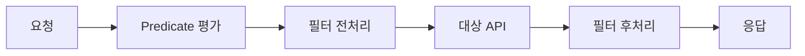

# 역할, 구성 요소와 함께 쓰는 의존성

Gateway는 요청을 어디로 보낼지 결정하고 앞뒤에 공통 처리를 붙이는 앱입니다.
업무 API를 모두 이곳에 구현하는 것과는 다릅니다.
라우팅, 인증과 헤더 처리처럼 진입점에 필요한 기능부터 선택합니다.

## Route, Predicate와 Filter

| 요소 | 역할 | 예시 |
|---|---|---|
| Route | 목적지와 조건, 필터를 묶습니다. | catalog 라우트 |
| Predicate | 이 요청이 대상인지 판단합니다. | Path와 Method |
| Filter | 전달 전후 처리를 수행합니다. | 경로 제거와 응답 헤더 |

이 흐름에서 JWT 검증이나 테넌트 정책을 직접 추가할 수 있습니다.
그러나 상대 서비스가 처리해야 할 세부 업무 권한까지 Gateway가 모두 소유해야 한다는 뜻은 아닙니다.

## 함께 쓰는 의존성

다음은 Gateway 4.3 계열 WebFlux 서버 기준의 선택지입니다.
Boot와 Cloud BOM 적용을 전제로 하며 전부 필수는 아닙니다.

| 의존성 | 사용하는 경우 |
|---|---|
| spring-cloud-starter-gateway-server-webflux | WebFlux Gateway 실행 |
| spring-cloud-starter-loadbalancer | lb URI로 인스턴스 선택 |
| spring-cloud-starter-netflix-eureka-client | Eureka 등록과 발견 |
| spring-cloud-starter-config | Config Server 설정 사용 |
| spring-cloud-starter-bus-amqp | RabbitMQ 기반 갱신 이벤트 |
| spring-cloud-starter-circuitbreaker-reactor-resilience4j | 리액티브 호출의 장애 제어 |
| spring-boot-starter-actuator | 상태, 지표와 관리 기능 |

보안과 Redis 기반 제한 기능이 필요하면 관련 의존성을 별도로 선택합니다.
Gateway Starter가 모든 인증과 RateLimiter 저장소까지 준비해 주는 것은 아닙니다.
과거의 `spring-cloud-starter-gateway` 이름과 새 Starter 이름은 적용 버전에서 확인합니다.

먼저 고정 URL의 API 하나로 전달한 뒤 발견, 인증과 동적 설정을 차례로 붙이면 문제를 좁히기 쉽습니다.
요청이 실패하면 매핑, 필터 거절과 대상 연결 실패를 구분해 기록합니다.

구성은 [공식 Starter 안내](https://docs.spring.io/spring-cloud-gateway/reference/4.3/spring-cloud-gateway-server-webflux/starter.html), 전체 기능은 [Gateway 레퍼런스](https://docs.spring.io/spring-cloud-gateway/reference/4.3/index.html)를 참고합니다.

## 직접 구현한 예제

**최근 구현 예제:** [boot-base](https://github.com/No1stone/boot-base)의 Gateway에서 Java 라우팅 구성과 사용자 정의 JWT 필터를 함께 사용하는 형태를 확인할 수 있습니다.
Config와 Bus AMQP, 관측 관련 의존성도 함께 구성하므로, 개별 기능을 하나의 실행 앱으로 조합하는 예제로 볼 수 있습니다.

이 글의 Gateway 4.3 계열 설명과 저장소에서 실제 사용하는 버전은 구분합니다.
예제를 적용할 때는 저장소의 Boot 버전, Cloud BOM과 Gateway Starter를 함께 확인합니다.

**과거 학습 예제:** [gateway](https://github.com/No1stone/gateway)는 이전에 Gateway를 학습하며 남긴 별도 저장소입니다.
최근 구현과 비교할 때는 당시의 의존성과 설정 방식이라는 전제로 읽습니다.

## 자주 묻는 질문

### Route, Predicate와 Filter에서 무엇을 확인하나요?

라우트 매칭과 필터 처리는 Gateway의 핵심입니다. YAML 설정과 Java 구성, 커스텀 필터를 구분합니다.

### 함께 쓰는 의존성에서 무엇을 확인하나요?

앱에 넣는 라이브러리와 별도 운영 자원을 구분합니다. Boot와 Cloud BOM 조합부터 맞춥니다.
