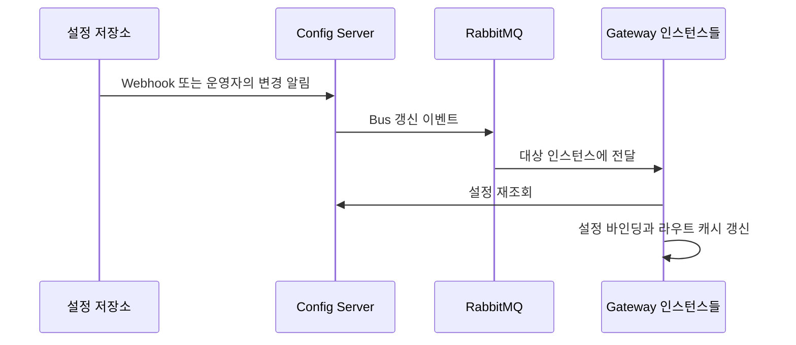

# Config, Bus와 RabbitMQ로 라우트 갱신

경로와 목적지 URI를 바꿀 때마다 Gateway를 재배포하지 않고 설정을 갱신하는 구성을 만들 수 있습니다.
Config는 설정을 제공하고, Bus는 변경을 알려 주며, Gateway는 라우트 정의와 실행 캐시를 갱신합니다.
각 단계가 연결돼 있어야 실제 요청의 목적지가 바뀝니다.

## 먼저 설정 라우트로 구성합니다

Gateway 4.3 WebFlux 앱에 Config Client와 AMQP Bus를 추가하는 예제입니다.
Gateway 기본 의존성과 호환되는 Cloud BOM은 이미 적용돼 있다고 가정합니다.

```groovy
implementation 'org.springframework.cloud:spring-cloud-starter-config'
implementation 'org.springframework.cloud:spring-cloud-starter-bus-amqp'
implementation 'org.springframework.boot:spring-boot-starter-actuator'
```

```yaml
spring:
  application:
    name: edge
  config:
    import: configserver:http://localhost:8888
  rabbitmq:
    host: localhost
    username: ${RABBIT_USERNAME}
    password: ${RABBIT_PASSWORD}
management:
  endpoints:
    web:
      exposure:
        include: health,busrefresh
```

접속 정보는 로컬 구조 예제입니다.
서버가 제공하는 edge용 설정에 라우트 정의를 두고 각 Gateway가 같은 변경 알림 경로를 사용하도록 합니다.
관리 엔드포인트는 별도 인증과 네트워크 제어가 전제입니다.



RabbitMQ로 YAML 전체를 밀어 넣는 흐름이 아니라, 설정을 다시 읽도록 이벤트를 전달하는 흐름입니다.
Config의 monitor를 통한 자동 알림에는 서버 측 monitor와 Bus 구성도 필요합니다.
학습 시에는 Gateway의 인증된 `POST /actuator/busrefresh`로 수동 갱신부터 확인할 수 있습니다.

## 라우트 반영까지 확인합니다

Gateway 4.3 WebFlux의 RouteRefreshListener는 RefreshScopeRefreshedEvent 등을 받아 RefreshRoutesEvent를 발행합니다.
해당 리스너와 설정 기반 RouteDefinition 경로를 사용하는지 확인합니다.
코드에 문자열을 고정한 RouteLocator가 동일하게 새 YAML로 교체된다고 가정하지 않습니다.

| 변경 | 가능한 범위 |
|---|---|
| 기존 경로와 URI | 설정 재로딩과 라우트 갱신으로 반영 가능 |
| 기존 필터 인수 | 필터가 지원하는 설정 범위에서 가능 |
| 새 필터 로직 | 코드 구현과 배포 필요 |

대상을 A에서 B로 바꾼 뒤 각 Gateway의 실제 요청 결과를 확인합니다.
이벤트 발행 성공이 모든 인스턴스의 동시 적용 완료를 뜻하지는 않습니다.
갱신 중 잘못된 정의, 누락된 필터와 복구할 이전 버전도 시험합니다.

이벤트는 [Config Push Notifications](https://docs.spring.io/spring-cloud-config/reference/server/push-notifications-and-bus.html), 갱신은 [Bus Endpoints](https://docs.spring.io/spring-cloud-bus/reference/spring-cloud-bus/bus-endpoints.html), 라우트 관측은 [Gateway Actuator](https://docs.spring.io/spring-cloud-gateway/reference/4.3/spring-cloud-gateway-server-webflux/actuator-api.html)를 참고합니다.

## 자주 묻는 질문

### 먼저 설정 라우트로 구성합니다에서 무엇을 확인하나요?

라우트 매칭과 필터 처리는 Gateway의 핵심입니다. YAML 설정과 Java 구성, 커스텀 필터를 구분합니다.

### 라우트 반영까지 확인합니다에서 무엇을 확인하나요?

라우트 매칭과 필터 처리는 Gateway의 핵심입니다. YAML 설정과 Java 구성, 커스텀 필터를 구분합니다.
