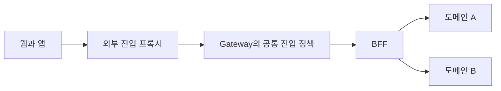

# Nginx, Ingress, Istio와 BFF의 역할 비교

Nginx, Ingress와 Gateway는 모두 요청을 전달할 수 있습니다.
BFF도 여러 API를 호출할 수 있어 겉으로 비슷해 보입니다.
하지만 경로 전달과 화면별 업무 조합은 다른 책임입니다.

| 구성 | 중심 책임 | 판단할 예 |
|---|---|---|
| Nginx 프록시 | 네트워크 진입과 전달 | TLS, 정적 파일과 upstream |
| Kubernetes Ingress | 외부 HTTP 라우팅 규칙 | 도메인과 경로를 Service에 연결 |
| Spring Cloud Gateway | 앱 수준 라우팅과 필터 | 토큰 확인, 정책 기반 목적지 선택 |
| BFF | 클라이언트 시나리오 조립 | 여러 도메인 응답을 화면에 맞게 구성 |
| Istio | 서비스 간 통신 제어 | mTLS와 트래픽 정책 |

Ingress는 리소스이고 Controller가 실제 트래픽 처리를 수행합니다.
특정 Controller 제품과 Kubernetes Ingress라는 규칙을 같은 수준의 이름으로 비교하지 않습니다.

모든 시스템이 위 계층을 다 가져야 하는 것은 아닙니다.
단순 서비스는 프록시에서 바로 업무 앱으로 보낼 수 있고, 같은 응답 계약이면 별도 BFF 없이 도메인 진입을 호출할 수 있습니다.
각 층을 추가한 이유가 중복되지 않게 설명합니다.

## 무엇을 어디에 둘까요

외부 토큰을 검증하고 허용된 테넌트 경로로 보내는 처리는 Gateway에서 구성할 수 있습니다.
반면 특정 사용자가 특정 데이터 행을 바꿀 수 있는지는 업무 정보가 있는 경계에서 판단해야 합니다.
화면 조립을 Gateway의 필터에 모두 넣으면 라우팅과 업무 변경의 배포 단위가 엉킬 수 있습니다.

통신 시간 제한과 재시도를 여러 층에서 적용한다면 전체 대기 시간을 계산합니다.
프록시가 한 번 재시도하고 BFF도 다시 호출하면 상대는 예상보다 많은 요청을 받을 수 있습니다.

검증은 경로별 진입 권한, 내부 호출의 신원 전달과 오류 응답을 따라갑니다.
Gateway를 통과했다는 이유만으로 모든 내부 API가 무조건 신뢰할 입력이 되는 것은 아닙니다.

기술 경계는 [Kubernetes Ingress](https://kubernetes.io/docs/concepts/services-networking/ingress/)와 [Gateway](https://docs.spring.io/spring-cloud-gateway/reference/)를 참고합니다.

## 자주 묻는 질문

### 무엇을 어디에 둘까요에서 무엇을 확인하나요?

최소 설정으로 동작을 확인한 뒤 확장합니다. 성공과 실패를 경로별로 기록합니다.

### Nginx, Ingress, Istio와 BFF의 역할 비교 적용 시 확인할 점에서 무엇을 확인하나요?

최소 설정으로 동작을 확인한 뒤 확장합니다. 성공과 실패를 경로별로 기록합니다.
