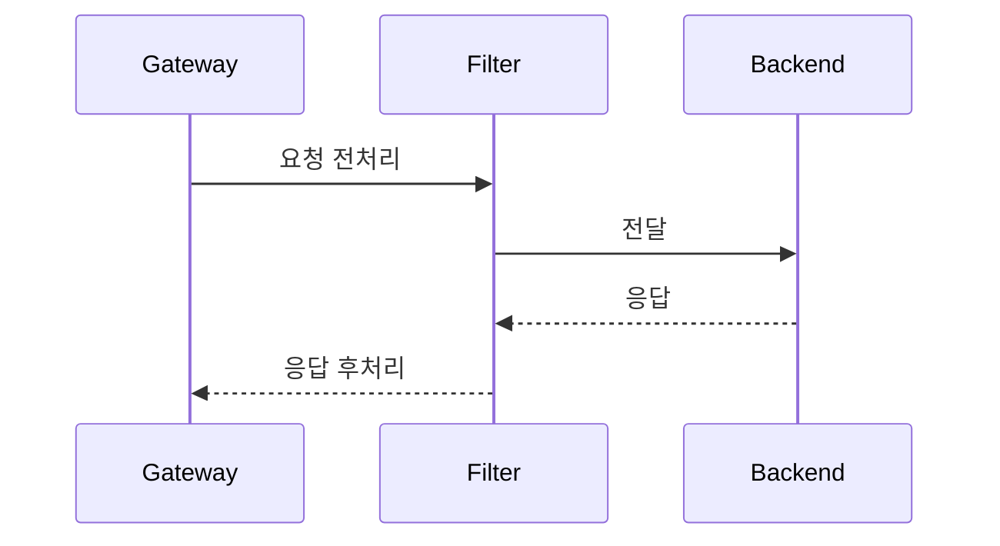

# 기본 Predicate와 Filter 사용

Predicate는 요청이 라우트에 맞는지 판단하고, Filter는 그 라우트로 처리할 때 요청과 응답을 변경합니다.
조건과 변경을 분리하면 어떤 요청이 왜 통과했는지 설명하기 쉽습니다.

```yaml
spring:
  cloud:
    gateway:
      server:
        webflux:
          routes:
            - id: catalog-read
              uri: http://localhost:8081
              predicates:
                - Path=/catalog/**
                - Method=GET
              filters:
                - StripPrefix=1
                - AddResponseHeader=X-Gateway, edge
```

Gateway 4.3 WebFlux의 예제입니다.
같은 라우트의 조건은 함께 만족해야 합니다.
이 구성은 POST를 백엔드가 거절하게 하는 것이 아니라 해당 GET 라우트에 매칭되지 않게 합니다.
다른 라우트가 POST를 받아 갈 수 있는지도 전체 정의에서 확인합니다.

| 기능 | 사용 예 | 주의점 |
|---|---|---|
| Path와 Host | 경로와 도메인 분기 | 중첩 경로와 라우트 순서 |
| Method | HTTP 메서드 제한 | 전체 접근 권한을 대신하지 않음 |
| StripPrefix | 앞 경로 제거 | 서비스 context path와 일치 여부 |
| RewritePath | 정규식 경로 변경 | 치환 변수와 YAML escaping |
| 헤더 필터 | 공통 값 추가 및 제거 | 위조 가능한 입력과 비밀값 |

## 필터의 앞과 뒤



순서가 있는 필터는 전처리와 후처리에서 관찰 순서가 달라질 수 있습니다.
응답이 이미 커밋된 뒤에는 헤더나 상태를 바꿀 수 없는 경우가 있습니다.
따라서 필터 이름 목록만이 아니라 실제 실행 위치를 확인합니다.

전역 필터와 라우트 필터를 섞으면 인증, 로깅과 오류 응답이 중복될 수 있습니다.
공통 적용이 필요한지 특정 라우트에만 필요한지 먼저 정합니다.

테스트에서는 매칭 성공뿐 아니라 다른 메서드, 경계 경로, trailing slash와 큰 헤더도 확인합니다.
본문을 읽는 필터는 스트림을 소비해 다음 처리기가 읽지 못하게 만들 수 있으므로 별도 예제로 검증합니다.

기본 종류는 [Predicate와 Filter 공식 안내](https://docs.spring.io/spring-cloud-gateway/reference/4.3/spring-cloud-gateway-server-webflux.html)를 참고합니다.

## 자주 묻는 질문

### 필터의 앞과 뒤에서 무엇을 확인하나요?

라우트 매칭과 필터 처리는 Gateway의 핵심입니다. YAML 설정과 Java 구성, 커스텀 필터를 구분합니다.

### 기본 Predicate와 Filter 사용 적용 시 확인할 점에서 무엇을 확인하나요?

라우트 매칭과 필터 처리는 Gateway의 핵심입니다. YAML 설정과 Java 구성, 커스텀 필터를 구분합니다.
