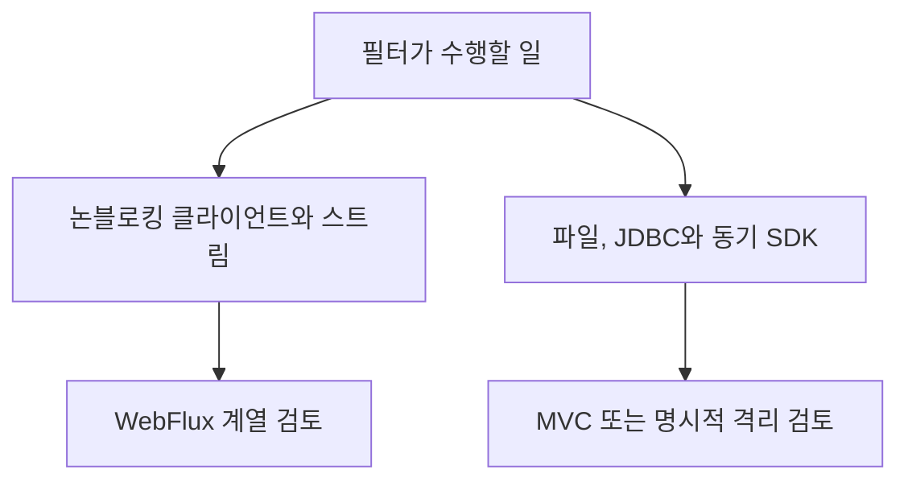

# Gateway WebFlux와 MVC

Spring Cloud Gateway에는 WebFlux와 Web MVC 계열이 있습니다.
오래된 글의 Netty 기반 설명을 모든 Gateway 구현에 적용하면 의존성과 필터 API가 맞지 않을 수 있습니다.
먼저 실행 모델을 선택하고 그 계열의 예제를 사용합니다.

| 기준 | Server WebFlux | Server Web MVC |
|---|---|---|
| 기반 | WebFlux와 Reactor Netty | Servlet과 MVC 함수형 라우팅 |
| 처리 표현 | Mono와 GatewayFilter | MVC용 라우터와 필터 |
| 대기 처리 | 이벤트 루프를 막지 않는 구성이 중요 | 동기 라이브러리와 연결하기 자연스러움 |
| 코드 재사용 | MVC 필터를 그대로 사용하지 않음 | WebFlux GatewayFilter를 그대로 사용하지 않음 |

```groovy
// 사용할 서버 계열에 맞춰 선택합니다.
implementation 'org.springframework.cloud:spring-cloud-starter-gateway-server-webflux'
// 또는 MVC 계열
implementation 'org.springframework.cloud:spring-cloud-starter-gateway-server-webmvc'
```

Gateway 4.3 공식 문서의 이름을 기준으로 한 부분 예제입니다.
새 프로젝트에서 두 서버 Starter를 모두 넣어 자동 선택을 기대하지 않습니다.

## 블로킹 작업이 필요한 필터

WebFlux 필터에서 파일이나 JDBC를 동기 호출하면 이벤트 루프가 대기할 수 있습니다.
`Mono`로 감쌌다는 이유만으로 I/O가 논블로킹이 되지는 않습니다.
별도 스케줄러로 옮기는 방법도 있지만 큐와 동시성 제한까지 관리해야 합니다.

반대로 MVC를 선택했다고 대량 연결을 다룰 수 없다는 뜻도 아닙니다.
가상 스레드와 연결 풀을 검토할 수 있지만 외부 자원의 용량은 별도 제한입니다.
실제 필터의 작업과 운영 지표를 기준으로 비교합니다.



이 그림은 선택 기준이지 성능 순위가 아닙니다.
정상 부하뿐 아니라 느린 상대, 연결 종료와 큰 응답을 포함해 측정합니다.
기존 필터와 운영 경험을 유지하는 비용도 고려합니다.

비교의 출발점은 [WebFlux Gateway](https://docs.spring.io/spring-cloud-gateway/reference/4.3/spring-cloud-gateway-server-webflux.html)와 [MVC Gateway](https://docs.spring.io/spring-cloud-gateway/reference/4.3/spring-cloud-gateway-server-webmvc.html)입니다.

## 자주 묻는 질문

### 블로킹 작업이 필요한 필터에서 무엇을 확인하나요?

라우트 매칭과 필터 처리는 Gateway의 핵심입니다. YAML 설정과 Java 구성, 커스텀 필터를 구분합니다.

### Gateway WebFlux와 MVC 적용 시 확인할 점에서 무엇을 확인하나요?

라우트 매칭과 필터 처리는 Gateway의 핵심입니다. YAML 설정과 Java 구성, 커스텀 필터를 구분합니다.
