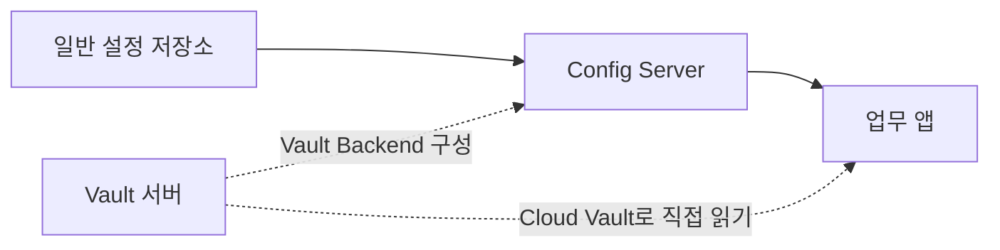
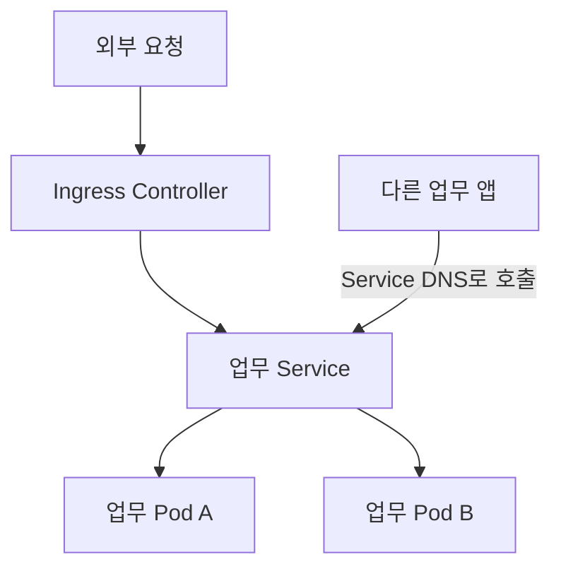

# Spring Cloud

Spring Cloud는 분산 환경에서 필요한 설정 관리, 서비스 발견, 라우팅과 메시징 기능을 Spring 애플리케이션에 연결하는 프로젝트 묶음입니다.
대체로 필요한 Starter와 라이브러리를 의존성으로 추가하고 설정해 사용합니다.
기능에 따라 Config Server나 Eureka Server 같은 별도 앱을 구성하거나 Vault, Kubernetes와 메시지 브로커 등 외부 시스템에 연결합니다.

**[Spring Cloud 공식 GitHub 저장소 목록](https://github.com/orgs/spring-cloud/repositories)**에서 각 프로젝트의 소스와 개발 현황을 볼 수 있습니다.
전체 구성과 공식 문서의 출발점은 [Spring Cloud 프로젝트 페이지](https://spring.io/projects/spring-cloud/)입니다.
이 페이지에서는 저장소 이름보다 대표 기능과 사용 상황을 먼저 보고, 비슷한 역할의 기술들이 어떻게 연결되는지 비교합니다.

## 필요한 기능에서 프로젝트를 찾습니다

| 필요한 기능 | 살펴볼 프로젝트 | 사용하는 상황 |
|---|---|---|
| API 진입 경로와 공통 필터 | Gateway | 여러 API로 요청을 나누고 인증과 공통 처리를 적용합니다. |
| 서비스 주소 등록과 발견 | Netflix Eureka, Consul, Zookeeper | 앱 인스턴스의 주소와 수가 달라지는 환경에서 호출 대상을 찾습니다. |
| 인스턴스 선택 | Commons의 LoadBalancer | 같은 서비스를 제공하는 주소 중 이번 요청의 대상을 고릅니다. |
| 환경별 설정 제공과 갱신 | Config, Bus | 설정 제공 경로를 모으고 여러 앱에 변경 이벤트를 전달합니다. |
| 비밀 설정 연동 | Cloud Vault | Vault의 비밀 값을 앱 설정에 연결합니다. |
| 실패가 반복되는 호출의 영향 제한 | Circuit Breaker | 장애 호출을 제한하고 앱에 맞는 실패 대응을 연결합니다. |
| 메시지 기반 데이터 처리 | Stream, Function | 수집, 가공과 저장 앱을 메시지로 연결합니다. |
| 단기 작업과 배치 운영 | Task, Spring Batch, SCDF | 작업 실행, 항목 처리와 배포 관리를 서로 다른 범위로 구성합니다. |
| Kubernetes 정보와 설정 활용 | Cloud Kubernetes | 서비스 발견, ConfigMap과 Secret을 앱의 기능에 연결합니다. |
| 서비스 간 계약 검증 | Contract | 생산자와 소비자의 요청 및 응답 기대를 테스트합니다. |

이 표는 함께 설치할 기본 세트가 아닙니다.
예를 들어 Kubernetes가 주소 발견을 제공하는 환경에서는 Eureka를 별도로 운영하지 않을 수 있습니다.
이미 인프라가 제공하는 기능과 앱에서 추가해야 할 기능을 나누어 선택합니다.

## 프로젝트별 대표 기능

프로젝트 이름을 누르면 해당 GitHub 저장소로 이동합니다.
하나의 저장소가 여러 모듈과 Starter를 포함할 수 있으므로 저장소와 배포 의존성을 일대일로 보지는 않습니다.
아래는 Spring Cloud의 기능을 이해하기 위한 주요 프로젝트이며, 빌드와 릴리스용 저장소까지 모두 나열한 목록은 아닙니다.

| 프로젝트 | 대표 기능 | 사용 형태와 알아둘 관계 |
|---|---|---|
| [Gateway](https://github.com/spring-cloud/spring-cloud-gateway) | 경로 조건, 요청 및 응답 필터, 라우팅 | 게이트웨이 앱으로 구성할 수 있습니다. WebFlux와 MVC 계열의 API를 구분합니다. |
| [Netflix, Eureka](https://github.com/spring-cloud/spring-cloud-netflix) | Eureka 서버 구성, 등록, heartbeat와 주소 조회 | 서버와 클라이언트 지원을 제공합니다. Zookeeper로 바뀐 프로젝트가 아닙니다. |
| [Commons](https://github.com/spring-cloud/spring-cloud-commons) | DiscoveryClient 등 공통 계약, LoadBalancer | 앱에 추가하는 기반 라이브러리입니다. 레지스트리와 인스턴스 선택의 책임을 나눕니다. |
| [Config](https://github.com/spring-cloud/spring-cloud-config) | 환경별 외부 설정 제공, Git 등 저장소 연동, 암호화 값 처리 | Config Server와 Client를 구성합니다. Vault를 설정 저장소로 사용할 수도 있습니다. |
| [Vault](https://github.com/spring-cloud/spring-cloud-vault) | Vault 인증, 비밀 설정 로딩과 지원되는 lease 관리 | Spring Vault 위에 설정 통합을 제공합니다. Vault 서버 자체는 별도입니다. |
| [Bus](https://github.com/spring-cloud/spring-cloud-bus) | 설정 변경 등 관리 이벤트의 인스턴스 간 전파 | Kafka 또는 AMQP 기반 전송을 사용합니다. Config와 함께 쓸 수 있지만 필수 조합은 아닙니다. |
| [Circuit Breaker](https://github.com/spring-cloud/spring-cloud-circuitbreaker) | 공통 API로 장애 제어 구현 연결, 호출 차단과 실패 대응 | Resilience4j 같은 구현을 앱에서 사용합니다. Istio와 제어 위치가 다릅니다. |
| [Stream](https://github.com/spring-cloud/spring-cloud-stream) | 메시지 입출력 바인딩, 소비자 그룹과 파티셔닝 설정 | Kafka와 RabbitMQ 등에 Binder로 연결합니다. 브로커의 고유 동작은 남습니다. |
| [Function](https://github.com/spring-cloud/spring-cloud-function) | 함수 등록, 조합과 실행 환경 연결 | 웹, 메시지 처리와 서버리스 등에 활용합니다. Stream의 함수 모델과도 연결됩니다. |
| [Task](https://github.com/spring-cloud/spring-cloud-task) | 종료되는 앱의 실행 생명주기와 이력 관리 | Spring Batch와 함께 사용할 수 있지만 Job과 Step 처리 자체를 대체하지 않습니다. |
| [Kubernetes](https://github.com/spring-cloud/spring-cloud-kubernetes) | 서비스 발견, ConfigMap과 Secret 연동, 설정 변경 감지 구성 | 이미 있는 Kubernetes를 앱에서 활용합니다. 클러스터를 설치하는 도구는 아닙니다. |
| [Consul](https://github.com/spring-cloud/spring-cloud-consul) | Consul 기반 등록과 발견, 설정 통합 | Consul 서버를 기반으로 사용합니다. Eureka와 비교할 발견 경로 중 하나입니다. |
| [Zookeeper](https://github.com/spring-cloud/spring-cloud-zookeeper) | Zookeeper 기반 등록과 발견, 설정 통합 | Zookeeper를 Spring Cloud 모델에 연결합니다. Eureka의 새 이름은 아닙니다. |
| [OpenFeign](https://github.com/spring-cloud/spring-cloud-openfeign) | 인터페이스 기반 HTTP 호출의 Spring 통합 | 공식적으로 feature-complete입니다. 신규 도입 시 HTTP Service Clients와 비교합니다. |
| [Contract](https://github.com/spring-cloud/spring-cloud-contract) | 서비스 계약 테스트, 테스트와 stub 생성 및 활용 | 실제 네트워크와 전체 업무 시나리오 검증은 별도로 둡니다. |
| [Open Service Broker](https://github.com/spring-cloud/spring-cloud-open-service-broker) | 서비스 카탈로그, 자원 준비, 앱 연결과 해제의 API 구현 지원 | 서비스 신청과 제공을 연결하는 서버를 만듭니다. 메시지 브로커와는 다른 역할입니다. |

Cloud 버전 조합을 관리하는 [spring-cloud-release](https://github.com/spring-cloud/spring-cloud-release)와 빌드를 지원하는 [spring-cloud-build](https://github.com/spring-cloud/spring-cloud-build)도 있습니다.
이들은 업무 앱처럼 실행할 서버가 아니라 여러 프로젝트를 개발하고 조합하는 기반입니다.
개별 모듈의 버전은 [Starter, BOM과 Release Train](./foundations/starters-and-release-train.md)에서 설명합니다.

## Spring Vault와 Spring Cloud Vault는 무엇이 다른가요

두 프로젝트는 Vault에 접근한다는 점에서 연결돼 있지만 사용 목적이 다릅니다.

| 구분 | Spring Vault | Spring Cloud Vault |
|---|---|---|
| 중심 기능 | Vault API를 사용하는 클라이언트 기반 | Vault 비밀을 Spring 외부 설정에 통합 |
| 대표 사용 | VaultTemplate으로 비밀 조회, 저장과 폐기 | DB 사용자와 비밀번호 등을 앱 설정에 연결 |
| 예시 요구 | 기능 실행 중 필요한 경로의 서명 키를 읽습니다. | 기동할 때 DataSource에 필요한 자격 증명을 받습니다. |
| 관계 | 기반 프로젝트입니다. | Spring Vault를 바탕으로 구성됩니다. |

Spring Vault는 [spring-projects/spring-vault](https://github.com/spring-projects/spring-vault)에 있습니다.
Spring Cloud 조직의 목록에 없다고 별개의 비밀 저장소 제품인 것은 아닙니다.
둘 다 실제 Vault 서버에 접근하는 Java 쪽 지원이며 서버 설치와 접근 정책을 대신하지는 않습니다.
세부 기능은 [Spring Vault](https://spring.io/projects/spring-vault/)와 [Cloud Vault](https://docs.spring.io/spring-cloud-vault/reference/)에서 확인합니다.

## Config도 암호화하는데 Vault는 왜 함께 쓰나요

Config의 중심은 앱별, 환경별 설정을 제공하는 것입니다.
Vault의 중심은 비밀에 대한 접근과 수명을 관리하는 것입니다.
두 기능은 일부 겹치며 반드시 둘 다 사용해야 하는 것은 아닙니다.

| 비교 | Spring Cloud Config | HashiCorp Vault |
|---|---|---|
| 주로 관리할 대상 | 환경별 앱 설정 | 비밀번호, 키와 인증서 등 비밀 |
| 보호와 제공 | 암호화된 값을 저장하고 설정 제공 시 복호화할 수 있습니다. | 인증된 주체의 정책에 따라 비밀 접근을 허용합니다. |
| 변경 관리 | 저장소와 설정 배포 및 갱신 경로를 구성합니다. | 선택한 엔진에 따라 자격 증명 발급, 갱신과 폐기를 구성합니다. |
| 주요 판단 | 어떤 앱에 어떤 설정을 제공할지 | 누가 어떤 비밀에 언제까지 접근할지 |

Config의 `{cipher}` 값은 기본적으로 클라이언트에 제공하기 전에 복호화됩니다.
Git에 평문을 남기지 않는 이점이 있지만, 복호화 키와 설정 제공 API의 접근 제어 및 전송 보호는 필요합니다.
[Config 암호화 공식 문서](https://docs.spring.io/spring-cloud-config/reference/server/encryption-and-decryption.html)가 이 동작을 설명합니다.

다음 두 구조 모두 가능합니다.
일반 설정과 비밀을 앱이 각각 읽을지, Config Server가 Vault를 저장소로 사용해 제공할지 선택하는 것입니다.

점선은 선택 가능한 연결이며 두 경로를 반드시 동시에 사용한다는 뜻은 아닙니다.
중계하는 주체가 늘면 인증, 권한과 비밀이 전달되는 범위도 함께 설계합니다.
Config의 Vault Backend는 [공식 연동 문서](https://docs.spring.io/spring-cloud-config/reference/server/environment-repository/vault-backend.html)를 참고합니다.

Bus는 설정 변경 이벤트를 여러 인스턴스에 전달하는 통로입니다.
저장소의 파일을 고쳤다는 사실만으로 모든 앱과 객체가 즉시 교체되는 것은 아닙니다.
갱신 이벤트를 발행하는 경로와 RefreshScope 및 설정 바인딩의 적용 범위를 확인해야 합니다.
DB 연결 풀처럼 별도 교체 정책이 필요한 자원도 있습니다.
[Bus Refresh 동작](https://docs.spring.io/spring-cloud-bus/reference/spring-cloud-bus/bus-endpoints.html)과 [Refresh Scope](https://docs.spring.io/spring-cloud-commons/reference/spring-cloud-commons/application-context-services.html)를 함께 읽습니다.

## Kubernetes를 쓰면 Eureka를 생략할 수 있나요

Kubernetes Service와 DNS가 앱의 주소 접근 요구를 충족한다면 Eureka를 별도로 두지 않을 수 있습니다.
이때 Eureka의 역할과 비교할 대상은 주로 Service와 DNS이며, Ingress만으로 대체했다고 설명하지 않습니다.

| 기능 | Spring 중심 구성 | Kubernetes에서의 대응 |
|---|---|---|
| 서비스 이름으로 주소 찾기 | Eureka와 DiscoveryClient | Service와 DNS, 필요하면 Kubernetes API 기반 발견 |
| 인스턴스에 트래픽 전달 | Cloud LoadBalancer 등 | Service의 전달 경로 또는 별도 구성 |
| 외부 HTTP의 도메인과 경로 분기 | Gateway나 프록시 | Ingress 규칙과 이를 처리하는 Controller |
| 앱 내부의 공통 정책 | Gateway 필터와 앱 정책 | 인프라 라우팅만으로 모두 대체되지는 않음 |

Ingress는 규칙을 선언하는 Kubernetes 리소스이고, Ingress Controller는 그 규칙을 실제 트래픽에 적용하는 구현입니다.
NGINX 기반 Controller도 구현 방식 중 하나이며, Kubernetes Ingress와 별개의 동일 수준 제품으로 비교하지 않습니다.
Gateway가 필요한 구성이라면 Ingress 뒤에 Gateway를 배치하고 업무 Service로 연결할 수도 있습니다.

Spring Cloud Kubernetes는 앱에서 Kubernetes의 서비스 발견과 설정을 활용하도록 돕습니다.
앱을 Pod로 실행하거나 Service DNS를 사용하는 데 반드시 필요한 라이브러리는 아닙니다.
공식 기준은 [Kubernetes Service](https://kubernetes.io/docs/concepts/services-networking/service/), [Ingress](https://kubernetes.io/docs/concepts/services-networking/ingress/)와 [Cloud Kubernetes](https://docs.spring.io/spring-cloud-kubernetes/reference/)에서 확인합니다.

## Istio가 있으면 Spring Circuit Breaker는 필요 없나요

일부 통신 제어 기능은 겹치지만 제어하는 위치와 판단에 사용하는 정보가 다릅니다.
Spring Cloud Circuit Breaker가 Istio로 이름을 바꾸거나 대체된 프로젝트는 아닙니다.

| 비교 | Spring Cloud Circuit Breaker와 구현 라이브러리 | Istio의 트래픽 제어 |
|---|---|---|
| 위치 | 앱 내부의 메서드와 외부 호출 경계 | 메시가 처리하는 프록시 통신 경로 |
| 판단 대상 | 반환 결과, 예외와 설정한 실패 기준 | 연결 및 요청 상태, 통신 오류와 인스턴스 상태 |
| 대표 대응 | 호출 제한, 앱에서 정한 fallback 연결 | 연결과 요청 한도, 장애 인스턴스의 일시 제외 |
| 업무 의미 | 특정 예외를 실패로 볼지 앱에서 정의 가능 | 앱 내부의 업무 판단을 자동으로 이해하지 않음 |

예를 들어 외부 추천 서비스가 실패했을 때 최근 저장한 추천을 돌려주는 판단은 앱에서 표현합니다.
반면 여러 서비스에 공통으로 통신 제한과 장애 인스턴스 제외를 적용하는 것은 메시에서 구성할 수 있습니다.
함께 쓴다면 재시도 횟수와 타임아웃이 중첩되지 않게 책임과 전체 대기 시간을 맞춥니다.

동작 범위는 [Spring Cloud Circuit Breaker](https://docs.spring.io/spring-cloud-circuitbreaker/reference/)와 [Istio Circuit Breaking](https://istio.io/latest/docs/tasks/traffic-management/circuit-breaking/)을 비교합니다.
Istio의 circuit breaking과 Resilience4j의 상태 전이 모델이 모든 세부 동작까지 같다는 의미는 아닙니다.

## SCDF는 Cloud Kubernetes와 함께 쓰는 플랫폼인가요

Spring Cloud Data Flow, SCDF는 스트리밍 앱과 단기 작업을 등록하고 배포, 실행 및 이력을 관리하는 플랫폼입니다.
Kubernetes를 실행 대상으로 사용할 수 있지만, 앱마다 Spring Cloud Kubernetes를 넣어야 한다는 뜻은 아닙니다.

| 프로젝트 또는 기반 | 담당하는 범위 |
|---|---|
| Stream과 Function | 데이터가 흐르는 앱의 메시지 처리와 함수 모델 |
| Task와 Spring Batch | 종료되는 작업의 생명주기와 배치 단계 및 복구 |
| SCDF | 앱과 파이프라인 등록, 배포 및 실행 관리 |
| Kubernetes | 배포된 컨테이너와 실행 자원 관리 |
| Cloud Kubernetes | 앱이 Kubernetes의 발견과 설정 기능을 활용하는 통합 |

예를 들어 수집 앱, 가공 앱과 저장 앱을 만들고 이를 등록해 배포하거나, 배치를 실행하고 이력을 확인하는 운영 구상을 SCDF와 연결해 볼 수 있습니다.
SCDF가 Kubernetes에 배포하는 기능과 앱이 ConfigMap을 읽는 Cloud Kubernetes 기능은 서로 다른 경계입니다.
구조는 [SCDF 아키텍처](https://dataflow.spring.io/docs/concepts/architecture/)에서 확인합니다.

**2026년 11월 19일 확인 기준, SCDF 공개 저장소는 spring-attic으로 이동한 아카이브 상태이며 Broadcom의 오픈소스 유지보수가 종료됐다고 안내합니다.**
기능과 구조를 학습하는 것과 현재 신규 운영 기반으로 도입하는 판단을 나눕니다.
지원 조건은 [현재 SCDF 저장소](https://github.com/spring-attic/spring-cloud-dataflow)의 공식 안내에서 확인합니다.

## Open Service Broker는 어떤 브로커인가요

Open Service Broker는 개발자가 DB 같은 서비스를 신청하면 준비하고 앱에 연결해 주는 API를 다룹니다.
RabbitMQ 같은 메시지 전달 브로커와는 다른 의미입니다.
Spring Cloud Open Service Broker는 이 표준에 맞는 서버를 구현하도록 지원합니다.

| 대표 기능 | 예시 |
|---|---|
| Catalog | 신청 가능한 개발용 DB와 서비스 플랜을 제공합니다. |
| Provision | DB 인스턴스 또는 기존 DB의 스키마 같은 자원을 준비합니다. |
| Bind | 앱이 사용할 접속 정보와 권한을 연결합니다. |
| Unbind | 앱과 서비스의 연결을 해제합니다. |
| Deprovision | 준비했던 자원을 정리합니다. |

내부 개발 포털에서 개발용 DB를 신청하고 접속 정보를 받는 흐름으로 이해할 수 있습니다.
실제 DB와 계정을 만드는 구현은 연결해야 하며 의존성 추가만으로 자원 제공이 완성되지는 않습니다.
API의 범위는 [Open Service Broker 공식 설명](https://www.openservicebrokerapi.org/)을 참고합니다.

## 상세 글과 기존 메모

| 묶음 | 이어서 확인할 내용 |
|---|---|
| [구성과 의존성](./foundations/index.md) | Framework, Boot, Cloud 관계와 Starter, BOM, 운영 서버 및 대표 조합 |
| [Spring Cloud Gateway](./gateway/index.md) | 라우트, 필터, Discovery와 Config 조합 |
| [서비스 발견과 Eureka](./discovery/index.md) | 등록, 발견, Eureka, Consul과 Kubernetes DNS |
| [Config, Vault와 설정 갱신](./configuration/index.md) | Config, Bus, RefreshScope와 Vault |
| [서비스 호출과 장애 제어](./clients-and-resilience/index.md) | OpenFeign, LoadBalancer와 Circuit Breaker |
| [Stream과 메시징](./messaging/index.md) | Stream Binder와 재처리 |
| [Spring Cloud Kubernetes](./kubernetes/index.md) | DiscoveryClient, ConfigMap과 Secret |
| [Function, Task와 Batch](./functions-and-tasks/index.md) | Function, Task와 Batch 조합 |
| [SCDF와 파이프라인 운영](./data-flow/index.md) | SCDF 목적, 지원 상태와 파이프라인 |
| [로그, 메트릭과 분산 추적](./observability/index.md) | 관측 연계 영역 |
| [서비스 계약 테스트](./contracts/index.md) | Spring Cloud Contract |
| [Open Service Broker](./service-broker/index.md) | 카탈로그와 자원 생명주기 |
| [Legacy](./legacy/index.md) | 기존 Gateway, Config Server와 Eureka 예제 |

이미 작성된 상세 글은 공개 URL을 유지합니다.
[앱 라이브러리와 별도 운영 서버](./foundations/runtime-components.md), [등록, 발견과 로드밸런싱](./discovery/discovery-and-balancing.md), [Starter, BOM과 Release Train](./foundations/starters-and-release-train.md)을 참고합니다.

각 프로젝트의 도입 여부는 기능 필요성, 운영 환경과 버전 지원을 함께 보고 결정합니다.
기존 메모의 구현을 최신 버전의 모든 동작으로 일반화하지 않습니다.

## 자주 묻는 질문

### Spring Cloud 묶음에서는 무엇을 다루나요?

Spring Cloud의 목적과 하위 글 범위를 연결합니다. 상세 구현은 각 하위 글을 봅니다.

### Spring Cloud부터 읽어야 하나요?

입구 글에서 하위 글의 역할만 확인한 뒤 필요한 주제로 들어가면 됩니다.
