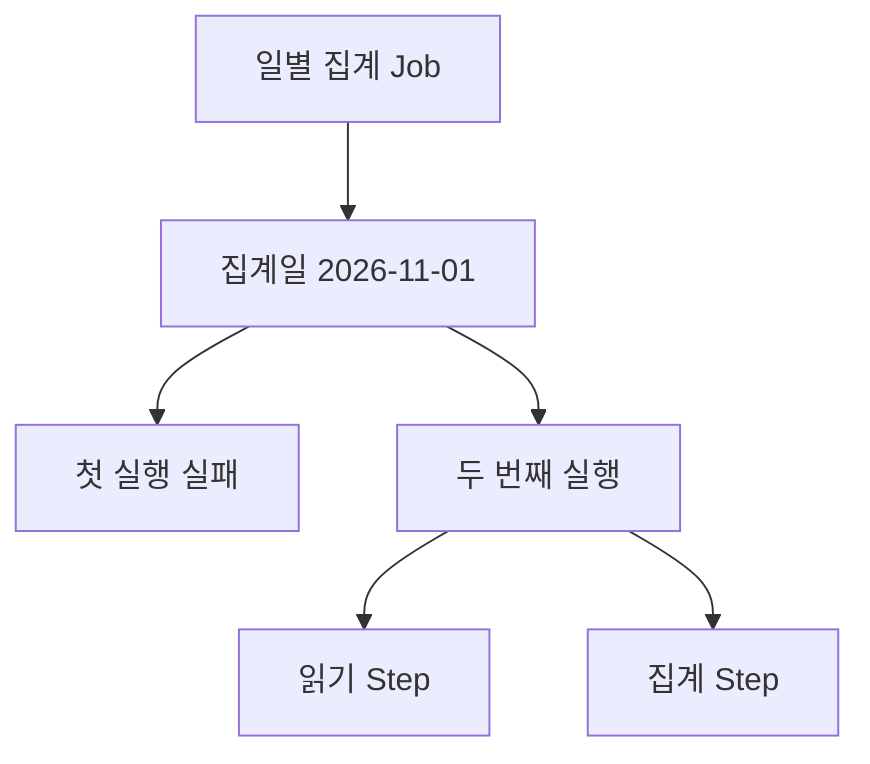

# Job과 Step

배치 프로그램에는 처리 코드 외에도 실행 이력, 실패 위치와 재시작 기준이 필요합니다.
Spring Batch는 이런 실행 구조를 Job과 Step, 저장된 실행 메타데이터로 표현합니다.
이 글의 코드는 Boot 3.5와 Spring Batch 5.2 기준이며 Batch 6 예제와 빌더 API를 섞지 않습니다.

## 작업 정의와 실행 이력은 다릅니다

| 개념 | 의미 |
|---|---|
| Job | 하나의 배치 작업 정의입니다. |
| Step | 작업 안의 실행 단계입니다. |
| JobInstance | Job 이름과 식별 파라미터로 구분하는 논리 실행 대상입니다. |
| JobExecution | 그 대상을 실행한 한 번의 시도입니다. |
| StepExecution | 각 단계의 실행 결과와 카운터입니다. |
| JobRepository | 실행 메타데이터를 저장하고 조회합니다. |

같은 집계일의 작업이 실패한 뒤 다시 실행되면 같은 JobInstance에 다른 JobExecution이 생길 수 있습니다.
매번 현재 시각을 식별 파라미터로 넣으면 실패 작업의 재시작이 아니라 새 작업이 될 수 있습니다.



## 작업과 단계를 연결합니다

```java
@Bean
Job dailyJob(JobRepository repository, Step aggregateStep) {
    return new JobBuilder("dailyJob", repository)
            .start(aggregateStep)
            .build();
}
```

```java
JobParameters parameters = new JobParametersBuilder()
        .addString("businessDate", "2026-11-01")
        .toJobParameters();
jobLauncher.run(dailyJob, parameters);
```

JobRepository와 Step, JobLauncher가 구성된 경우의 부분 예제입니다.
파라미터는 단순 실행 인수뿐 아니라 작업의 식별에도 관여합니다.
집계일의 시간대와 재실행 정책을 먼저 정의합니다.
같은 식별 파라미터로 이미 완료된 작업은 기본적으로 다시 실행할 수 없으므로 재집계는 별도 의도를 표현해야 합니다.

## Scheduler와 Batch를 구분합니다

Scheduler는 언제 실행할지, Batch는 실행을 어떤 단계와 복구 단위로 관리할지 다룹니다.
Scheduled가 JobLauncher를 호출할 수 있지만 여러 앱에서 같은 시각에 호출하는 문제는 별도입니다.
JobRepository의 제약과 중복 실행 예외를 무시하고 새 파라미터를 계속 만드는 방식은 피합니다.

JobRepository의 메타데이터 DB와 실제 업무 DB가 다르면 트랜잭션 연결도 확인합니다.
초기 스키마 자동 생성은 개발과 운영 정책을 나누고, 실행 이력 보관과 정리 기준을 둡니다.
Boot의 Job 자동 시작 여부도 명시해 웹 서버 기동 때 의도하지 않은 배치가 실행되지 않게 합니다.

검증에서는 같은 파라미터의 완료 후 실행, 실패 후 재시작과 다른 날짜 실행을 구분합니다.
상태만이 아니라 처리 건수와 실제 업무 데이터를 함께 확인합니다.

개념과 식별 기준은 [Spring Batch 5.2 도메인 설명](https://docs.spring.io/spring-batch/reference/5.2/domain.html)을 참고합니다.

## 자주 묻는 질문

### Chunk와 Tasklet은 언제 나누나요?

대량 읽기-처리-쓰기는 Chunk, 한 덩어리 작업은 Tasklet이 단순한 경우가 많습니다.

### 실패 후 재시작은 어디서 이어지나요?

실행 메타데이터와 커밋 구간을 보고 Step 진행 지점부터 이어갑니다.

