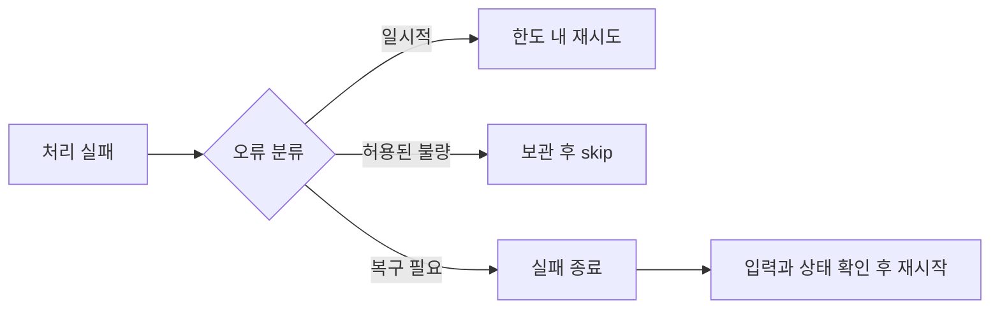

# 재시작과 실패 처리

배치의 실패 처리는 무조건 다시 실행하는 것으로 끝나지 않습니다.
일시적인 오류인지, 특정 입력이 잘못됐는지, 이미 처리한 결과가 남아 있는지에 따라 복구 단위를 정해야 합니다.
이 글은 Spring Batch 5.2의 Chunk 기반 작업을 기준으로 합니다.

## retry, skip과 restart

| 처리 | 대상 | 필요한 정책 |
|---|---|---|
| retry | 실행 중 일시적인 실패 | 재시도할 예외와 한도, 대기 |
| skip | 허용 가능한 불량 항목 | 건수 한도와 실패 내역 보관 |
| restart | 실패한 작업을 다시 실행 | 같은 실행 대상과 저장된 상태 |

읽을 수 없는 파일 형식은 같은 입력으로 재시도해도 계속 실패할 수 있습니다.
반면 잠금 경합은 새 시도에서 성공할 수 있습니다.
모든 Exception을 재시도 대상으로 잡으면 설정 오류와 프로그램 결함까지 반복하게 됩니다.

```java
return new StepBuilder("importStep", repository)
        .<SourceRow, ExportRow>chunk(100, manager)
        .reader(reader)
        .processor(processor)
        .writer(writer)
        .faultTolerant()
        .retryLimit(3)
        .retry(TransientDataAccessException.class)
        .skipLimit(10)
        .skip(FlatFileParseException.class)
        .build();
```

기존 구성 요소가 준비된 Step 메서드의 부분 예제입니다.
실제 예외 분류는 데이터와 저장소 특성에 맞게 좁힙니다.
한도와 대기 정책은 실제 재시도 횟수 및 부하를 테스트로 확인합니다.
skip이 발생했는데 Job 상태만 성공이라고 보고하면 불량 항목이 누락될 수 있습니다.

## 재시작은 새 파라미터 실행과 다릅니다

실패한 JobInstance를 이어가려면 같은 식별 파라미터와 저장된 ExecutionContext를 사용합니다.
완료된 Step은 기본적으로 다시 실행하지 않는 등 Step별 재시작 규칙도 적용됩니다.
코드나 입력 파일이 바뀐 상태에서 이전 위치만 복원하면 다른 결과를 만들 수 있으므로 입력 버전과 체크섬 등을 검토합니다.

## DB 커밋 밖의 결과를 봅니다

파일, 이메일과 외부 API는 Chunk 롤백만으로 되돌릴 수 없습니다.
장애 직전에 상대 시스템은 처리했는데 완료 기록이 남지 않았다면 재실행이 중복을 만들 수 있습니다.
멱등 키, 결과 재조회와 별도 발행 기록으로 복구 기준을 정합니다.



검증은 Writer 중간 예외, 커밋 직전 실패와 프로세스 재시작을 구분합니다.
일반 테스트 예외만으로 강제 종료 시의 상태까지 확인한 것으로 기록하지 않습니다.
운영자에게 실패 항목, 재실행 파라미터와 실제 처리 결과를 함께 제공하면 복구 판단이 쉬워집니다.

실행 중 복구는 [retry 설정](https://docs.spring.io/spring-batch/reference/5.2/step/chunk-oriented-processing/retry-logic.html), 단계 재실행은 [restart 설정](https://docs.spring.io/spring-batch/reference/5.2/step/chunk-oriented-processing/restart.html)을 참고합니다.

## 자주 묻는 질문

### Chunk와 Tasklet은 언제 나누나요?

대량 읽기-처리-쓰기는 Chunk, 한 덩어리 작업은 Tasklet이 단순한 경우가 많습니다.

### 실패 후 재시작은 어디서 이어지나요?

실행 메타데이터와 커밋 구간을 보고 Step 진행 지점부터 이어갑니다.

