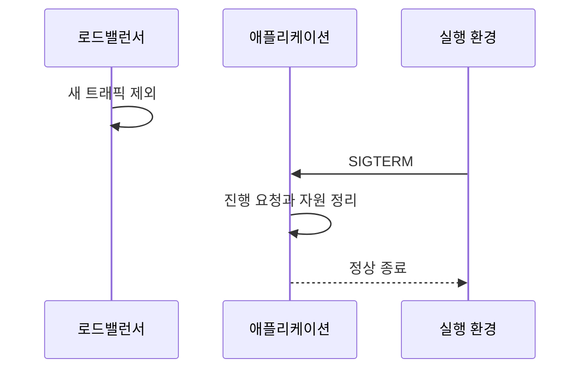

# 종료와 Graceful Shutdown

배포 중 서버를 종료할 때 진행 중 요청이 즉시 끊기면 재시도와 중복 실행이 생길 수 있습니다.
Graceful shutdown은 새 요청 유입을 제한하고 진행 중 처리를 마칠 시간을 주는 종료 절차입니다.
한 인스턴스의 정상 종료가 전체 서비스의 무중단 배포를 자동으로 보장하지는 않습니다.

## 종료에 시간 예산을 둡니다

Boot 3.5의 내장 웹 서버는 graceful shutdown이 기본으로 활성화됩니다.
의도를 드러내기 위해 설정을 명시할 수도 있습니다.

```yaml
server:
  shutdown: graceful
spring:
  lifecycle:
    timeout-per-shutdown-phase: 20s
```

이 값은 종료의 모든 단계를 합친 총 20초라는 뜻이 아니라 단계별 제한입니다.
외부 실행 환경이 그보다 먼저 프로세스를 강제 종료하면 정리할 시간이 없어집니다.
컨테이너의 종료 유예 시간과 로드밸런서의 요청 배출 시간을 함께 맞춥니다.

```yaml
services:
  app:
    image: example/catalog:1.0.0
    stop_grace_period: 45s
```

이미지 이름과 시간은 설정 구조를 보여 주는 예시입니다.
실제 값은 가장 긴 정상 요청, 작업 종료 시간과 배포 요구사항을 측정해 정합니다.



## 요청 종료와 백그라운드 작업은 다릅니다

웹 서버의 graceful shutdown은 HTTP 요청 처리를 중심으로 합니다.
별도로 만든 Executor, 메시지 소비자, 동적 스케줄과 외부 세션은 각자의 종료 정책이 필요합니다.
`@PreDestroy`에 정리를 넣어도 `SIGKILL`에서는 실행할 수 없습니다.

Dockerfile에서 Java를 셸의 자식으로 실행하면 신호가 기대대로 전달되지 않을 수 있습니다.
일반적으로 exec 형식의 `ENTRYPOINT ["java", "-jar", "/app/app.jar"]`를 사용하고 실제 PID와 신호 전달을 확인합니다.

| 증상 | 확인할 부분 |
|---|---|
| 종료 즉시 요청이 끊깁니다. | SIGTERM 전달과 외부 강제 종료 시간 |
| 배포 중 새 요청이 계속 들어옵니다. | readiness와 트래픽 제외 순서 |
| 프로세스가 오래 남습니다. | 실행기, 열린 자원과 종료 단계 로그 |
| 같은 요청이 두 번 처리됩니다. | 호출자 재시도와 멱등성 정책 |

## 확인 방법

응답을 잠시 지연하는 테스트 엔드포인트로 요청을 시작한 뒤 정상 종료 신호를 보냅니다.
진행 중 요청 완료, 새 요청 처리, 종료까지 걸린 시간을 각각 기록합니다.
그다음 제한 시간을 넘기는 요청도 시험해 강제 종료 시 결과를 확인합니다.
운영 업무 API에 임의로 대기 코드를 추가하지 않고 테스트 환경에서 수행합니다.

서버 종류별 새 요청 거절 방식은 다를 수 있습니다.
기본값과 제한 시간은 [Boot 3.5 graceful shutdown 공식 문서](https://docs.spring.io/spring-boot/3.5/reference/web/graceful-shutdown.html)를 참고합니다.

## 자주 묻는 질문

### 스타터만 넣으면 설정이 끝나나요?

스타터는 의존성과 자동 설정 후보를 가져옵니다. 조건과 오버라이드, 제외도 함께 확인합니다.

### Graceful shutdown은 언제 필요한가요?

진행 중 요청을 끊지 않고 종료하려면 종료 타임아웃과 커넥터 설정을 맞춥니다.

