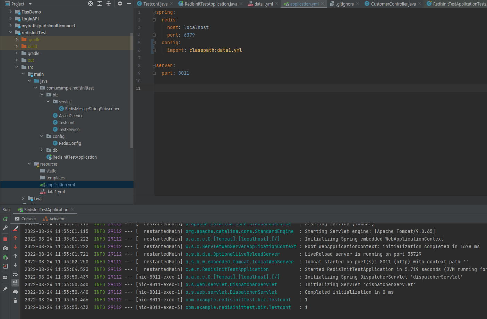

# application yml import

## 개요

한 파일에 서버 포트와 데이터소스·시크릿을 모두 두면 저장소 공개가 어렵습니다.
Boot 2.4+의 `spring.config.import`로 추가 YAML을 읽고, 민감 값은 별 파일·시크릿 저장소로 빼는 편이 안전합니다.



## 기본 사용

```yaml
spring:
  config:
    import: classpath:data1.yml

server:
  port: 8011
```

`optional:classpath:...`처럼 선택 import도 가능합니다.
여러 파일이면 쉼표로 나열하거나 import를 여러 줄로 둡니다.
프로필별 파일(`application-{profile}.yml`)과 함께 쓰면, 공통은 import하고 환경별만 프로필에 둡니다.

회사 저장소와 개인 공개 저장소를 나눌 때도 시크릿이 빠진 설정만 공개 대상에 올립니다.

<details>
<summary>참고 자료</summary>

- [Spring Boot Application Properties](https://docs.spring.io/spring-boot/docs/current/reference/html/application-properties.html) — `spring.config.import` 등 설정 키
</details>
