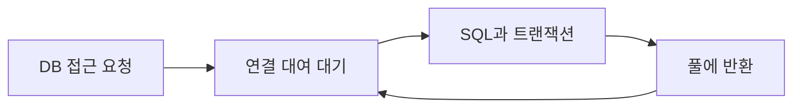

# DataSource와 커넥션 풀

DataSource는 애플리케이션이 DB 연결을 얻는 진입점입니다.
연결 풀은 이미 만든 연결을 재사용하고 동시에 빌려줄 개수를 제한합니다.
풀 크기를 키우면 대기가 줄 수도 있지만 DB의 처리 용량을 넘기면 오히려 지연이 커질 수 있습니다.

## 풀을 통과하는 요청



Boot 3.5의 일반적인 JDBC Starter 구성은 HikariCP를 사용합니다.
다른 풀을 명시하거나 여러 DataSource를 구성했다면 실제 빈 타입과 설정 접두사를 먼저 확인합니다.

```yaml
spring:
  datasource:
    url: ${DATABASE_URL}
    username: ${DATABASE_USERNAME}
    password: ${DATABASE_PASSWORD}
    hikari:
      maximum-pool-size: 10
      minimum-idle: 2
      connection-timeout: 2000
```

위 값은 동작 설명용이며 운영 권장값이 아닙니다.
여기서 connection-timeout은 풀에서 연결을 얻기 위한 대기 한도이며 SQL 실행 제한 시간이 아닙니다.
드라이버 연결 제한과 쿼리 시간 제한은 별도로 설정합니다.

| 관측 항목 | 의미 | 의심할 상황 |
|---|---|---|
| active | 빌려간 연결 | 긴 트랜잭션이나 반환 누락 |
| idle | 사용 가능한 연결 | 풀을 과도하게 잡았는지 확인 |
| pending | 대기 요청 | 처리량 초과 또는 점유 증가 |
| 획득 시간 | 대여까지 걸린 시간 | SQL 이전 병목 |
| 사용 시간 | 반환까지 걸린 시간 | 외부 호출이 트랜잭션에 포함됐는지 확인 |

## 인스턴스 수까지 계산합니다

서버 세 대가 각각 10개의 연결을 쓰면 애플리케이션만 최대 30개를 요구할 수 있습니다.
배치, 관리 접속과 다른 앱의 연결도 포함해야 합니다.
가상 스레드를 켠 뒤에도 이 제한은 그대로 남습니다.

트랜잭션 안에서 느린 외부 HTTP 호출을 기다리면 사용하지 않는 동안에도 연결이 점유될 수 있습니다.
단순히 풀을 늘리기 전에 트랜잭션 범위와 커넥션 대여 시점을 확인합니다.
유휴 연결의 수명은 DB나 네트워크의 연결 종료 정책보다 적절히 짧게 설정할지 검토합니다.

## 다중 DataSource

Legacy의 [설정 코드](/docs/knowledge/k-config)는 DataSource, SqlSessionFactory와 MapperScan을 이름으로 연결한 사례입니다.
두 DB를 사용하면 트랜잭션 매니저 선택도 명확해야 합니다.
두 DataSource가 있다는 이유로 단일 로컬 트랜잭션이 두 DB를 원자적으로 묶지는 않습니다.

검증에서는 작은 풀과 긴 요청으로 대기를 재현하고, 요청 종료 후 active가 정상 범위로 돌아오는지 확인합니다.
누수 감지 로그는 오래 빌린 연결의 단서이며 무조건 코드 누수를 확정하는 증거는 아닙니다.

기반 구성은 [Boot SQL 데이터 접근](https://docs.spring.io/spring-boot/3.5/reference/data/sql.html), 풀 속성은 [HikariCP 공식 설정](https://github.com/brettwooldridge/HikariCP#configuration-knobs-baby)을 참고합니다.

## 자주 묻는 질문

### JPA와 MyBatis 중 무엇을 고르나요?

도메인 중심 영속성과 연관 매핑이면 JPA, SQL 중심 제어면 MyBatis나 JDBC 계열이 맞는 경우가 많습니다.

### 커넥션 풀은 어디에 두나요?

DataSource 설정으로 풀을 두고, 타임아웃과 최대 연결 수를 트래픽에 맞게 맞춥니다.

