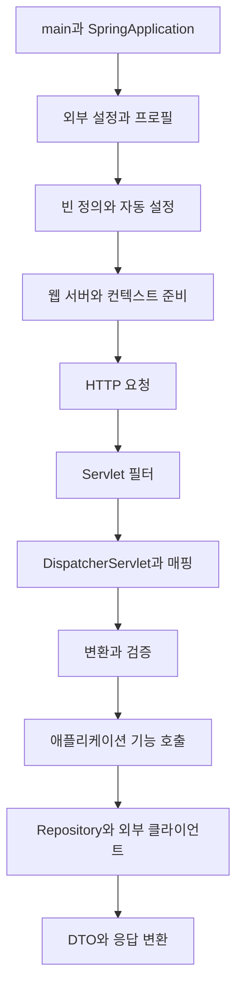

# Spring의 구성과 전체 동작 흐름

Spring을 공부할 때 애너테이션을 하나씩 외우면 각 기능은 보여도 전체 실행 흐름은 놓치기 쉽습니다.
먼저 기동할 때 만들어지는 구조와 요청마다 반복되는 흐름을 구분해 봅니다.
이 글의 기본 환경은 Spring Boot 3.5, Spring Framework 6.2의 Servlet 애플리케이션입니다.
WebFlux의 실행 모델은 별도 글에서 다룹니다.

## 시작할 때와 요청할 때 하는 일



실제 초기화에서는 후처리기, 이벤트, 라이프사이클 콜백 등이 추가됩니다.
위 그림은 설정이 언제 결정되고 요청 데이터가 어디를 통과하는지 찾기 위한 지도입니다.

## Starter는 구조를 연결하는 출발점입니다

Web Starter를 추가하면 웹 관련 의존성과 자동 설정 조건이 갖춰집니다.
그러나 URL과 업무 규칙이 자동으로 만들어지지는 않습니다.
Controller는 요청을 받고, 주입받은 기능을 호출하며, 결과를 HTTP 계약에 맞춰 반환합니다.

```java
@RestController
@RequestMapping("/clock")
class ClockController {
    private final Clock clock;

    ClockController(Clock clock) {
        this.clock = clock;
    }

    @GetMapping
    Map<String, String> now() {
        return Map.of("instant", clock.instant().toString());
    }
}
```

이 코드는 Clock 빈이 등록돼 있다고 가정한 요청 예제입니다.
DB나 인증 없이도 생성자 주입과 응답 직렬화 흐름을 확인할 수 있습니다.
시간을 고정한 빈으로 바꾸면 응답을 재현할 수 있습니다.

## Spring 기능과 프로젝트 설계를 구분합니다

| 구분 | Framework가 제공하는 기능 | 프로젝트가 정할 부분 |
|---|---|---|
| 객체 연결 | 빈과 DI | 포트, 어댑터와 유즈케이스의 경계 |
| HTTP | 매핑과 변환 | URI, 요청 DTO와 응답 계약 |
| 트랜잭션 | 시작, 참여와 롤백 | 어떤 업무를 하나로 묶을지 |
| 예외 | 예외 처리 확장 지점 | 업무 코드와 공개 오류 메시지 |
| 테스트 | 컨텍스트와 웹 테스트 지원 | 시나리오와 통과 기준 |

Facade나 BFF는 Spring이 강제하는 클래스 종류가 아닙니다.
한 도메인 기능을 호출할지, 여러 기능을 조합할지는 프로젝트 설계가 결정합니다.
기술 설명과 이 아카이브의 원셋 규칙을 같은 의미로 읽지 않습니다.

## 장애 위치를 따라가는 방법

기동이 안 되면 의존성, 설정 바인딩, 빈 생성 오류부터 살펴봅니다.
요청이 Controller에 도달하지 않으면 프록시 경로, 필터와 매핑을 확인합니다.
Controller에는 도달했는데 업무가 실패하면 입력 검증, 트랜잭션과 외부 호출을 따라갑니다.
성공 응답인데 저장 결과가 없으면 실제 커밋과 비동기 실행 경계를 확인합니다.

먼저 작은 `/clock` 요청을 실행한 뒤 필터, 유즈케이스, 저장소를 차례로 붙이면 어떤 단계가 추가됐는지 볼 수 있습니다.
모든 기능을 한 번에 넣은 기동 성공만으로 각 경계가 검증된 것으로 보지는 않습니다.

기반 기능은 [Framework 개요](https://docs.spring.io/spring-framework/reference/6.2/overview.html), Boot의 구성 방식은 [Boot 사용 안내](https://docs.spring.io/spring-boot/3.5/reference/using/index.html)를 참고합니다.

## 자주 묻는 질문

### Spring Framework와 Spring Boot는 어떻게 나누나요?

Framework는 IoC와 모듈 API의 기반이고, Boot는 자동 설정과 실행 도움으로 그 위에 올리는 선택입니다.

### 이 문서들의 Java 기준은 무엇인가요?

일반 예제는 Java 17 이상과 Boot 3 계열을 기준으로 두고, 가상 스레드 예제는 Java 21 이상을 전제로 합니다.

