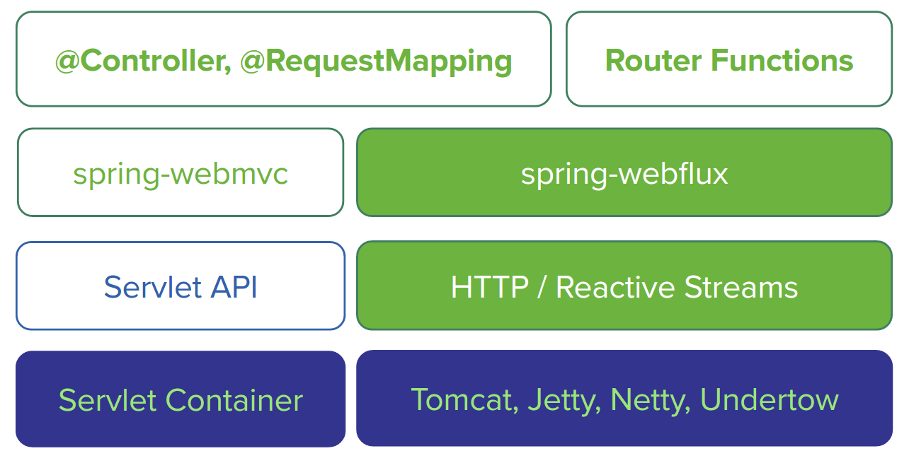

# Router Functions info

## 개요

Spring MVC 컨트롤러 매핑과 WebFlux Router Functions의 위치를 비교한 메모입니다.
Router Functions는 컨트롤러의 `@RequestMapping`에 해당하는 역할을 합니다.

## 비교

왼쪽은 MVC이고, 오른쪽은 WebFlux입니다.
Router Functions는 컨트롤러 RequestMapping에 해당합니다.
