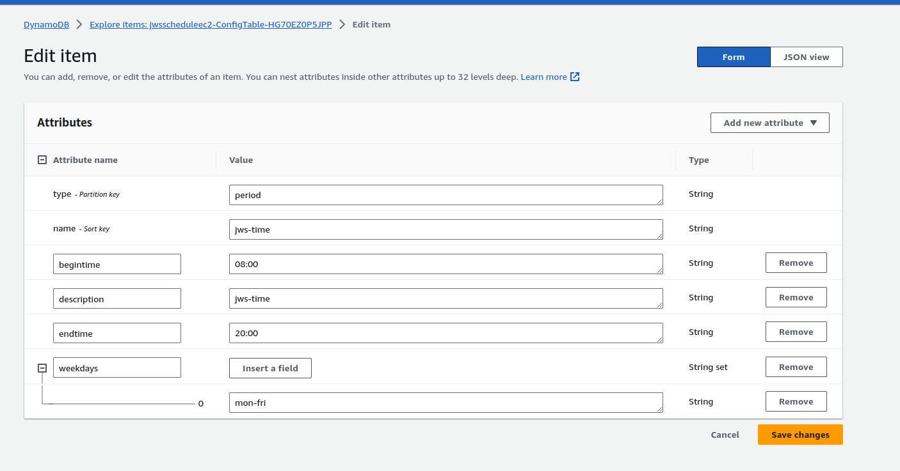

# instance-schedule

## 개요

AWS Instance Scheduler는 CloudFormation으로 올리는 솔루션으로, DynamoDB에 period·schedule를 두고 EC2(등)를 시간대에 맞춰 시작·중지합니다.
업무 시간만 켜 비용을 줄일 때 씁니다.
스택은 리전별 템플릿 또는 AWS Solutions의 최신 template URL로 생성합니다.



## period / schedule 예 (DynamoDB 항목)

`jwsscheduleec2`용으로 쓰던 값입니다.
period는 요일·시작·종료 시각이고, schedule는 period를 묶고 시간대·중지 정책을 정합니다.

```json
{
  "begintime": { "S": "08:00" },
  "description": { "S": "jws-time" },
  "endtime": { "S": "20:00" },
  "name": { "S": "jws-time" },
  "type": { "S": "period" },
  "weekdays": { "SS": ["mon-fri"] }
}
```

```json
{
  "description": { "S": "jws-schedule" },
  "enforced": { "S": "false" },
  "name": { "S": "jws-schedule" },
  "periods": { "SS": ["jws-time"] },
  "retain_running": { "S": "false" },
  "stop_new_instances": { "S": "true" },
  "timezone": { "S": "Asia/Seoul" },
  "type": { "S": "schedule" }
}
```

인스턴스에는 스케줄 이름에 맞는 태그(솔루션 문서의 태그 키)를 붙입니다.
`enforced`·`retain_running`·`stop_new_instances` 조합이 수동 기동과의 충돌을 정합니다.

<details>
<summary>참고 자료</summary>

- [EC2를 일정에 따라 중지·시작 (AWS re:Post)](https://repost.aws/ko/knowledge-center/stop-start-instance-scheduler)
- [Instance Scheduler CloudFormation 생성 (콘솔, latest template)](https://us-east-1.console.aws.amazon.com/cloudformation/home?region=us-east-1#/stacks/create?templateURL=https:%2F%2Fs3.amazonaws.com%2Fsolutions-reference%2Faws-instance-scheduler%2Flatest%2Finstance-scheduler.template)
- [과거 사용 템플릿 (ap-northeast-2 복사본)](https://s3.ap-northeast-2.amazonaws.com/cf-templates-axoaiydfdd54-ap-northeast-2/2023-05-12T065412.218Zb86-aws-instance-scheduler.template)
- [potato-yong 설정 메모](https://potato-yong.tistory.com/93)
- [wikidocs 일정 관리 메모](https://wikidocs.net/103092)
</details>
