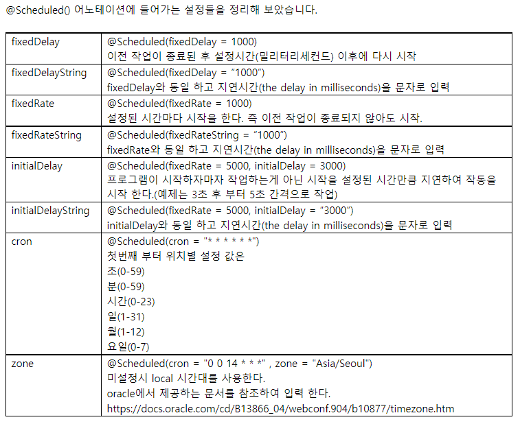

# @Scheduled

## 개요

`@EnableScheduling`을 켠 뒤 컴포넌트 메서드에 `@Scheduled`를 붙이면 주기 작업을 실행합니다.
간격 방식은 이전 실행이 끝난 뒤 쉬는 `fixedDelay`, 시작 시각 기준의 `fixedRate`, 달력 표현의 `cron`이 있습니다.
테스트 프로필에서는 스케줄러를 끄거나 mock으로 바꾸는 편이 안전합니다.



## 켜기

```java
@Configuration
@EnableScheduling
public class SchedulingConfig {
}
```

스케줄 메서드가 있는 클래스는 스프링 빈이어야 합니다(`@Component` 등).

## fixedDelay와 cron

웹훅을 주기적으로 넘기는 작업처럼, 이전 전달이 끝난 뒤에만 다시 돌리고 싶으면 `fixedDelay`가 맞습니다.
아래는 이전 실행이 끝난 뒤 3초 후에 다시 깨어나는 형태입니다.

```java
@Component
@Profile("!test")
public class WebhookCallbackScheduler {

    private final WebhookCallbackFacade webhookCallbackFacade;

    public WebhookCallbackScheduler(WebhookCallbackFacade webhookCallbackFacade) {
        this.webhookCallbackFacade = webhookCallbackFacade;
    }

    @Scheduled(fixedDelay = 3, timeUnit = TimeUnit.SECONDS)
    public void forward() {
        webhookCallbackFacade.forward();
    }
}
```

시각표가 필요하면 `cron`과 `zone`을 씁니다.
Spring의 cron은 `초 분 시 일 월 요일` 여섯 필드입니다(연도 필드는 선택).

```java
@Scheduled(cron = "0 0 0/2 * * *", zone = "Asia/Seoul")
public void cleanup() {
    staleKeyCleanupFacade.cleanup();
}
```

`0 0 0/2 * * *`는 서울 시각 기준 짝수 시 정각입니다.
미설정 시 zone은 서버 로컬 시간을 따릅니다.

## 속성 정리

| 속성 | 의미 |
|---|---|
| `fixedDelay` / `fixedDelayString` | 이전 실행 **종료 후** 대기(기본 밀리초, `timeUnit`으로 단위 변경 가능) |
| `fixedRate` / `fixedRateString` | 이전 실행 **시작** 기준 간격. 이전 작업이 길면 겹칠 수 있음 |
| `initialDelay` / `initialDelayString` | 앱 기동 후 첫 실행까지 지연 |
| `cron` | 달력 표현식 |
| `zone` | cron 해석 시간대 |

속성 값은 `${...}`로 설정에서 읽을 수 있습니다.

## cron 예

필드는 **초 분 시 일 월 주(년)** 순입니다.

| 표현식 | 의미 |
|---|---|
| `0 0 02 * * ?` | 매일 새벽 2시 |
| `0 0 12 * * ?` | 매일 12:00:00 |
| `0 15 10 ? * *` | 매일 10:15:00 |
| `0 15 10 * * ?` | 매일 10:15:00 (`?`와 `*` 위치만 다름) |
| `0 * 14 * * ?` | 매일 14시 매분 0초 |
| `0 0/5 14 * * ?` | 매일 14시 매 5분 |
| `0 0/5 14,18 * * ?` | 매일 14시·18시 매 5분 |
| `0 0-5 14 * * ?` | 매일 14:00~14:05 매분 |
| `0 10,44 14 ? 3 WED` | 3월 수요일 14:10, 14:44 |
| `0 15 10 ? * MON-FRI` | 평일 10:15 |
| `0 15 10 15 * ?` | 매월 15일 10:15 |
| `0 15 10 L * ?` | 매월 마지막 날 10:15 |
| `0 15 10 ? * 6L` | 매월 마지막 금요일 10:15 |
| `0 15 10 ? * 6#3` | 매월 세 번째 금요일 10:15 |

`fixedRate`는 이전 작업이 끝나지 않아도 다음 실행을 걸 수 있어, 외부 I/O가 긴 작업에는 `fixedDelay`나 분산 락을 검토합니다.

<details>
<summary>참고 자료</summary>

- [Spring Boot Scheduler @Scheduled 이용한 Batch 작업](https://copycoding.tistory.com/305) — `@EnableScheduling`, `fixedDelay` / `fixedRate` / `cron` 속성
- [토마의 개발노트 — cron 표현식](https://toma0912.tistory.com/17) — cron 필드와 예제 표현식
- [Oracle time zone 목록](https://docs.oracle.com/cd/B13866_04/webconf.904/b10877/timezone.htm) — `zone`에 쓸 수 있는 시간대 식별자
</details>
