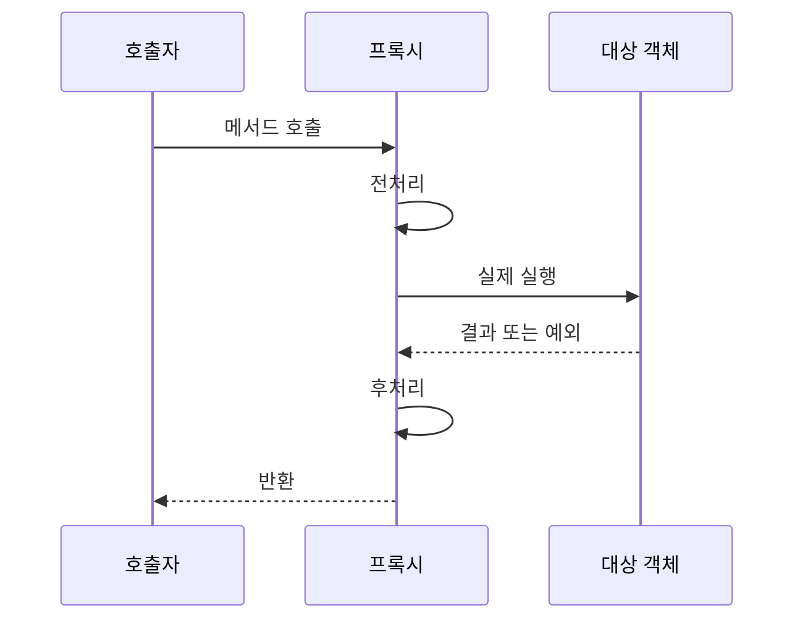

# AOP와 프록시

AOP는 여러 기능에 반복되는 처리를 호출 경계에 적용하는 방법입니다.
대표적으로 트랜잭션, 실행 시간 측정, 접근 제어가 있습니다.
Spring AOP의 기본 모델은 프록시를 거쳐 대상 객체를 호출하는 방식입니다.

## 호출이 지나가는 위치가 중요합니다



Advice는 언제 실행할지, Pointcut은 어떤 호출에 적용할지, Aspect는 그 규칙을 묶은 것입니다.
애너테이션이 붙은 모든 코드 위치에서 자동으로 끼어드는 방식이라고 이해하면 자기 호출에서 혼란이 생깁니다.

## 실행 시간 측정 예제

아래 예제는 `spring-boot-starter-aop`가 있는 Boot 3.5 환경을 가정합니다.
비밀 데이터와 요청 본문을 로그에 기록하지 않고 메서드와 소요 시간만 측정합니다.

```java
@Aspect
@Component
class TimingAspect {
    private static final Logger log = LoggerFactory.getLogger(TimingAspect.class);

    @Around("execution(public * example.catalog.application..*(..))")
    Object measure(ProceedingJoinPoint point) throws Throwable {
        long start = System.nanoTime();
        try {
            return point.proceed();
        } finally {
            log.debug("method={} elapsedNs={}",
                    point.getSignature().toShortString(),
                    System.nanoTime() - start);
        }
    }
}
```

`finally`를 사용해 예외가 발생해도 측정합니다.
예외를 삼키거나 새 결과를 반환하면 대상 메서드의 계약이 달라지므로 관측 코드의 책임을 넘어갑니다.

## 프록시 종류와 제한

| 방식 | 기반 | 주의점 |
|---|---|---|
| JDK 동적 프록시 | 인터페이스 | 구체 클래스 타입 주입을 기대하면 문제가 생길 수 있습니다. |
| 클래스 프록시 | 대상 클래스의 하위 타입 | final 클래스와 final 메서드는 확장 기반 적용이 제한됩니다. |

Spring Framework의 선택 원리와 Boot의 기본 프록시 설정은 구분합니다.
Boot 3.5의 AOP 자동 설정에서는 클래스 프록시가 기본이며 설정으로 변경할 수 있습니다.
인터페이스가 있다는 사실만으로 실행 중 프록시 종류를 단정하지 않습니다.

`this.inner()`는 대상 객체 안의 직접 호출이므로 기본 프록시 경계를 다시 통과하지 않습니다.
`inner()`에 `@Transactional`이나 `@Async`가 있어도 기대한 새 경계가 생기지 않을 수 있습니다.
별도 빈으로 책임을 분리해 외부 호출로 만들거나, 명시적 API를 사용하는 방식을 검토합니다.

확인은 실제 컨텍스트에서 외부 호출과 자기 호출을 비교합니다.
직접 `new`로 만든 객체를 테스트해서 Advice가 실행되지 않는 것은 정상입니다.
여러 Aspect의 순서가 의미를 가지면 `@Order`와 트랜잭션 Advice의 위치도 함께 검증합니다.

프록시 제한은 [공식 프록시 설명](https://docs.spring.io/spring-framework/reference/6.2/core/aop/proxying.html), Boot 기본값은 [AOP 자동 설정](https://docs.spring.io/spring-boot/3.5/reference/features/aop.html)을 참고합니다.

## 자주 묻는 질문

### 생성자 주입을 기본으로 두는 이유는 무엇인가요?

필수 의존성이 생성 시점에 드러나고, 테스트에서 동일 생성자로 객체를 만들기 쉽기 때문입니다.

### 같은 타입 빈이 여러 개면 어떻게 고르나요?

@Primary, @Qualifier, 이름, 컬렉션 주입으로 선택 범위를 좁힙니다.

