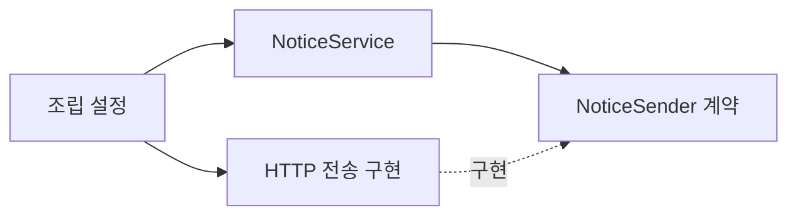

# IoC와 DI

객체가 협력 객체를 직접 생성하면 실행 방법까지 함께 결정하게 됩니다.
외부 API를 사용하는 객체 안에서 HTTP 클라이언트를 만들면, 테스트에서도 그 생성 경로와 설정을 따라가야 합니다.
IoC와 DI는 이 결정을 객체 밖으로 옮기는 방법을 설명합니다.

## IoC는 제어의 위치, DI는 의존성을 전달하는 방법입니다

IoC(Inversion of Control)는 생성, 연결, 호출 시점 같은 제어를 외부에 맡기는 개념입니다.
DI(Dependency Injection)는 필요한 객체를 생성자나 설정 메서드 등으로 전달하는 방식입니다.
DI를 적용하는 데 Spring이 반드시 필요한 것은 아닙니다.
Spring은 객체를 연결하는 작업을 컨테이너가 수행하도록 지원합니다.

| 구분 | 객체가 하는 일 | 외부에서 하는 일 |
|---|---|---|
| 직접 생성 | 구현체를 선택하고 생성합니다. | 생성 과정에 개입하기 어렵습니다. |
| 생성자 DI | 전달받은 기능을 사용합니다. | 구현체를 만들고 전달합니다. |
| Spring DI | 전달받은 빈을 사용합니다. | 컨테이너가 빈 정의에 따라 연결합니다. |

## 생성자 하나로 바뀌는 테스트 경계

다음 예제는 외부 알림을 보내는 최소 구조입니다.
업무 코드가 전송 방법을 결정하지 않도록 인터페이스를 둡니다.

```java
interface NoticeSender {
    void send(String message);
}

class NoticeService {
    private final NoticeSender sender;

    NoticeService(NoticeSender sender) {
        this.sender = sender;
    }

    void announce(String message) {
        if (message == null || message.isBlank()) {
            throw new IllegalArgumentException("message is required");
        }
        sender.send(message);
    }
}
```

테스트에서는 `new NoticeService(messages::add)`처럼 기록용 구현을 전달할 수 있습니다.
실제 서버에서는 HTTP 구현이나 메시지 브로커 구현을 전달합니다.
입력 검증 코드를 확인하는 데 네트워크를 띄울 필요가 없어집니다.

```java
@Configuration(proxyBeanMethods = false)
class NoticeConfig {
    @Bean
    NoticeService noticeService(NoticeSender sender) {
        return new NoticeService(sender);
    }
}
```

`NoticeSender` 구현체도 별도 빈으로 등록돼 있어야 합니다.
구현이 하나도 없으면 컨텍스트 초기화가 실패하고, 선택 기준 없이 여러 개가 있으면 주입 대상을 결정하지 못합니다.

## 의존성이 줄어드는 것과 숨겨지는 것은 다릅니다

DI를 사용해도 업무 코드가 외부 전송 기능에 의존한다는 사실은 남습니다.
달라지는 것은 구현체를 선택하는 위치입니다.
모든 객체를 인터페이스로 만들거나 빈으로 등록해야 한다는 규칙도 아닙니다.
값 객체와 DTO는 보통 필요할 때 생성하며, 교체 지점이나 외부 자원 경계에 추상화를 둡니다.



컨테이너를 직접 조회하는 `ApplicationContext.getBean()`을 업무 코드 곳곳에 두면 의존성이 생성자에서 사라집니다.
구현이 적어 보이더라도 어떤 기능이 필요한지 찾기 어려워질 수 있습니다.
먼저 [생성자 주입과 선택 기준](./dependency-injection.md)으로 의존성을 드러내고, 동적 조회가 필요한 지점만 별도로 설명하는 편이 좋습니다.

## 확인해 볼 것

컨텍스트 없이 기록용 구현으로 서비스를 생성해 봅니다.
그다음 Spring 설정에서 구현체를 제거했을 때 기동이 실패하는지 확인합니다.
앞의 검증은 업무 동작, 뒤의 검증은 객체 연결을 확인합니다.
둘을 분리하면 DI가 어떤 문제를 해결했는지 분명해집니다.

DI의 생성자와 설정 메서드 처리 방식은 [Spring Framework 6.2 공식 문서](https://docs.spring.io/spring-framework/reference/6.2/core/beans/dependencies/factory-collaborators.html)에서 확인할 수 있습니다.

## 자주 묻는 질문

### 생성자 주입을 기본으로 두는 이유는 무엇인가요?

필수 의존성이 생성 시점에 드러나고, 테스트에서 동일 생성자로 객체를 만들기 쉽기 때문입니다.

### 같은 타입 빈이 여러 개면 어떻게 고르나요?

@Primary, @Qualifier, 이름, 컬렉션 주입으로 선택 범위를 좁힙니다.

