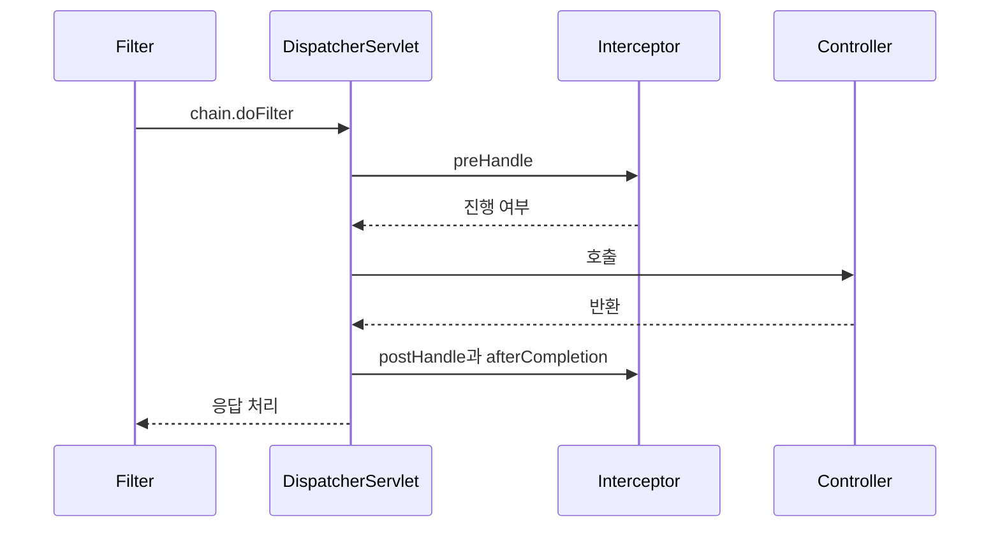

# Filter와 Interceptor

필터와 인터셉터는 모두 요청 앞뒤에서 실행되지만 적용 위치가 다릅니다.
로그, 인증과 권한 처리를 어디에 둘지 결정하려면 Controller보다 앞이라는 공통점보다 어느 요청을 볼 수 있는지 먼저 확인합니다.

## 적용 범위 비교

| 구분 | Servlet Filter | MVC HandlerInterceptor |
|---|---|---|
| 실행 위치 | DispatcherServlet 바깥 | MVC 처리기 실행 전후 |
| 입력 | Servlet 요청과 응답 | 요청과 응답, 선택된 handler |
| 예시 | 보안 체인, 요청 ID | 처리기 메타데이터 기반 공통 처리 |
| 예외 경계 | MVC 밖 실패가 생길 수 있음 | MVC 예외 처리와 연결됨 |



위 그림은 일반적인 동기 성공 흐름입니다.
예외와 비동기 요청에서는 호출 시점이 달라질 수 있습니다.
`postHandle`은 JSON 본문을 자유롭게 바꾸는 범용 응답 후처리 지점도 아닙니다.

## 요청 ID를 스레드에 남길 때

```java
@Component
class RequestIdFilter extends OncePerRequestFilter {
    @Override
    protected void doFilterInternal(HttpServletRequest request,
            HttpServletResponse response, FilterChain chain)
            throws ServletException, IOException {
        String id = UUID.randomUUID().toString();
        MDC.put("requestId", id);
        response.setHeader("X-Request-Id", id);
        try {
            chain.doFilter(request, response);
        } finally {
            MDC.remove("requestId");
        }
    }
}
```

기본 동기 요청의 최소 예제입니다.
MDC를 정리하지 않으면 재사용된 스레드의 다음 요청 로그에 이전 값이 남을 수 있습니다.
외부에서 받은 요청 ID를 신뢰할 경우 길이와 문자 검증도 필요합니다.

## 인증은 전용 보안 경계에서 처리합니다

Interceptor는 경로 매칭 차이 때문에 포괄적인 보안 계층으로 권장되지 않습니다.
Spring Security의 필터 체인과 인증 실패 처리기를 사용하고, 업무별 권한은 필요한 유즈케이스 경계에서도 확인합니다.
외부가 보낸 사용자 ID 헤더를 필터에서 읽는다는 사실만으로 신원이 검증되지는 않습니다.

Servlet 비동기 재디스패치에서는 같은 논리 요청이 다른 스레드를 사용할 수 있습니다.
OncePerRequestFilter의 async 및 error dispatch 정책과 MDC 전파를 별도로 확인합니다.
이 예제의 MDC가 모든 비동기 작업에 자동 전달된다고 가정하지 않습니다.

Legacy의 [인터셉터 메모](/docs/knowledge/k-handlerintercepter)는 이전 요청 흐름 기록으로 연결합니다.
현재 글은 해당 흐름을 새 다이어그램으로 정리했으며, 기존 그림의 모든 동작을 최신 보안 설계로 해석하지 않습니다.

필터의 순서, 정상 응답, 예외 응답, 비동기 요청과 요청 뒤 MDC 제거를 각각 시험합니다.
공식 기준은 [MVC Interception](https://docs.spring.io/spring-framework/reference/6.2/web/webmvc/mvc-config/interceptors.html)과 [OncePerRequestFilter API](https://docs.spring.io/spring-framework/docs/6.2.x/javadoc-api/org/springframework/web/filter/OncePerRequestFilter.html)를 참고합니다.

## 자주 묻는 질문

### MVC와 WebFlux는 같이 쓰나요?

보통 한 애플리케이션의 주 스택을 정합니다. 블로킹 JDBC와 WebFlux를 섞을 때는 스레드 모델을 따로 설계합니다.

### Interceptor와 Filter 차이는 무엇인가요?

Filter는 서블릿 단, Interceptor는 Spring MVC 핸들러 단에서 동작합니다.

