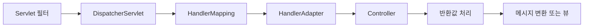

# Spring MVC

Spring MVC는 Servlet 기반 웹 프레임워크입니다.
중앙 진입점인 DispatcherServlet이 요청을 알맞은 처리기로 보내고 결과와 예외를 응답으로 바꿉니다.
Controller가 HTTP 처리의 전부를 직접 수행하는 구조는 아닙니다.

## 요청 한 건이 통과하는 경로



HandlerMapping은 어떤 처리기를 호출할지 찾고, HandlerAdapter는 그 처리기를 실제로 호출하는 방법을 제공합니다.
이 사이에서 매개변수 해석, 바인딩과 검증이 수행됩니다.
반환값도 문자열, ResponseEntity, DTO 등 타입에 따라 처리됩니다.

## JSON API와 화면 렌더링

```java
@RestController
@RequestMapping("/api/catalogs")
class CatalogController {
    @GetMapping("/{id}")
    ResponseEntity<Map<String, Object>> find(@PathVariable("id") Long id) {
        return ResponseEntity.ok(Map.of("id", id, "name", "sample"));
    }
}
```

`@RestController`의 반환 객체는 응답 본문 변환 대상입니다.
반면 일반 `@Controller`에서 String을 반환하면 뷰 이름으로 처리되는 경우가 일반적입니다.
같은 문자열 반환 코드라도 선언과 반환값 처리 경로를 함께 읽어야 합니다.
실제 업무 예제에서는 Map 대신 명시적인 응답 DTO를 두는 편이 계약을 설명하기 쉽습니다.

| 경계 | 주로 처리하는 내용 |
|---|---|
| 필터 | Servlet 요청 전체와 보안 필터 체인 |
| MVC | 매핑, 인수 변환, 검증과 응답 직렬화 |
| 유즈케이스 | 업무 순서와 정책 |
| 저장소 및 클라이언트 | DB와 외부 시스템 접근 |

## MVC가 모든 요청을 한 스레드로만 처리할까요

일반적인 동기 Controller는 요청 스레드에서 결과를 기다립니다.
그러나 MVC에도 Callable, DeferredResult, SseEmitter 등 Servlet 비동기 지원이 있습니다.
이를 사용한다고 JDBC나 파일 읽기가 논블로킹 API가 되는 것은 아닙니다.
대기를 어느 스레드가 담당하는지와 I/O API의 실행 모델을 나눠 봅니다.

예외 처리도 MVC에 도달한 예외와 필터에서 발생한 예외를 구분합니다.
`@RestControllerAdvice`만 등록했다고 보안 필터의 모든 실패 응답이 같은 경로로 처리되는 것은 아닙니다.

## 요청 계약을 확인합니다

MockMvc로 URI, HTTP 메서드, Content-Type과 응답 JSON을 검증할 수 있습니다.
그 검증은 실제 TCP 연결과 프록시, TLS까지 포함하지 않습니다.
실제 포트 테스트와 외부 환경 연동은 별도 경계로 남깁니다.
응답이 404라면 매핑 전에 경로가 바뀌었는지, 400이라면 바인딩과 검증이 실패했는지부터 살펴봅니다.

위임 구조는 [DispatcherServlet 공식 문서](https://docs.spring.io/spring-framework/reference/6.2/web/webmvc/mvc-servlet.html), 비동기는 [MVC 비동기 요청](https://docs.spring.io/spring-framework/reference/6.2/web/webmvc/mvc-ann-async.html)을 참고합니다.

## 자주 묻는 질문

### MVC와 WebFlux는 같이 쓰나요?

보통 한 애플리케이션의 주 스택을 정합니다. 블로킹 JDBC와 WebFlux를 섞을 때는 스레드 모델을 따로 설계합니다.

### Interceptor와 Filter 차이는 무엇인가요?

Filter는 서블릿 단, Interceptor는 Spring MVC 핸들러 단에서 동작합니다.

