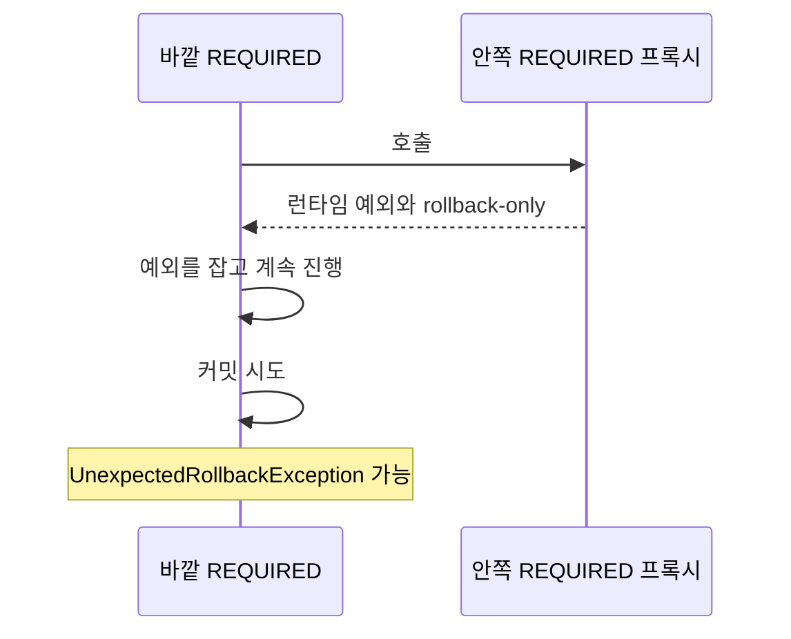

# 롤백과 예외 처리

예외가 발생했다고 모든 트랜잭션이 같은 방식으로 롤백되지는 않습니다.
예외 타입, 설정된 롤백 규칙과 예외가 프록시 밖으로 전달됐는지에 따라 결과가 달라집니다.
이 글은 Framework 6.2의 기본 선언적 트랜잭션 동작을 기준으로 설명합니다.

## 기본값과 명시적인 규칙

| 상황 | 기본적인 결과 |
|---|---|
| RuntimeException과 Error가 밖으로 전파 | 롤백 대상입니다. |
| checked 예외가 밖으로 전파 | 기본적으로 커밋 대상일 수 있습니다. |
| 예외를 내부에서 잡고 정상 반환 | 프록시는 정상 반환으로 볼 수 있습니다. |
| 내부 참여 트랜잭션이 rollback-only로 표시 | 바깥 커밋이 실패할 수 있습니다. |

```java
@Transactional(rollbackFor = IOException.class)
public void importFile() throws IOException {
    repository.insertStart();
    parser.read();
}
```

IOException까지 롤백하도록 명시한 부분 예제입니다.
모든 checked 예외를 같은 정책으로 처리할지는 프로젝트에서 정합니다.
Framework 6.2의 전역 기본 롤백 정책 변경 기능을 사용했다면 위 기본표와 달라질 수 있으므로 적용 설정을 확인합니다.

## catch가 롤백을 취소하지는 않습니다



같은 물리 트랜잭션에 참여한 안쪽 경계가 롤백을 요구하면, 바깥에서 예외를 잡더라도 커밋 가능한 상태로 돌아가지 않을 수 있습니다.
반대로 단순 일반 메서드에서 발생한 예외를 잡은 경우와도 구분해야 합니다.
어떤 프록시와 DB 작업이 rollback-only를 만들었는지 추적합니다.

## 실패 응답과 저장 결과를 함께 봅니다

업무 실패를 모두 정상 반환 DTO로 표현하면 트랜잭션 프록시는 실패를 인식하지 못할 수 있습니다.
실패 시 변경을 되돌려야 한다면 예외 계약이나 명시적 rollbackOnly 처리가 필요합니다.
이미 커밋한 뒤 HTTP 직렬화가 실패한 경우에는 500 응답이어도 저장은 완료됐을 수 있습니다.
호출자의 재시도에는 멱등성 정책이 필요합니다.

예외 변환 시 원인 예외를 유지하면 운영에서 제약 위반과 외부 실패를 찾기 쉽습니다.
내부 SQL과 스택을 API 본문에 그대로 공개하는 것과는 구분합니다.

## 검증할 실패 경로

런타임 예외, checked 예외, 명시적 rollbackFor와 내부 catch를 각각 시험합니다.
자동 롤백 테스트 안에서 변경이 보였는지만 확인하지 않고, 실제 경계 종료 뒤 독립 조회로 결과를 확인합니다.
DB 제약 실패는 flush나 commit에서 늦게 발생할 수 있으므로 메서드 본문만 검사해서는 부족합니다.

기본 규칙은 [롤백 공식 문서](https://docs.spring.io/spring-framework/reference/6.2/data-access/transaction/declarative/rolling-back.html)를 참고합니다.

## 자주 묻는 질문

### self-invocation에서 트랜잭션이 안 먹는 이유는?

같은 객체 내부 호출은 프록시를 우회할 수 있습니다. 별도 빈 호출이나 관점 재배치가 필요합니다.

### checked 예외는 기본 롤백되나요?

기본적으로 RuntimeException과 Error만 롤백합니다. checked는 rollbackFor로 지정합니다.

