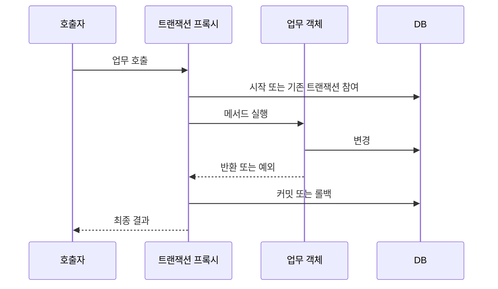

# Transactional과 적용 경계

트랜잭션은 어떤 변경을 함께 성공하거나 되돌릴지 정하는 경계입니다.
`@Transactional`을 많이 붙이는 것보다 실제 호출이 어느 프록시를 통과하고 어떤 자원을 묶는지 아는 것이 중요합니다.
이 글은 PlatformTransactionManager를 사용하는 동기 호출을 기준으로 합니다.

## 메서드 앞뒤에서 처리합니다



메서드 본문이 끝나도 커밋 중 제약 위반이 발생하면 호출자는 실패를 받을 수 있습니다.
본문 안의 마지막 로그가 성공이라는 이유로 커밋 완료까지 확정하지 않습니다.

```java
@Service
class CatalogFacade {
    private final CatalogRepository catalogs;
    private final ChangeRepository changes;

    CatalogFacade(CatalogRepository catalogs, ChangeRepository changes) {
        this.catalogs = catalogs;
        this.changes = changes;
    }

    @Transactional
    public void register(Catalog catalog, Change change) {
        catalogs.save(catalog);
        changes.save(change);
    }
}
```

두 Repository가 같은 트랜잭션 매니저의 자원에 참여한다고 가정한 부분 예제입니다.
Facade에 경계를 두는 것은 한 가지 설계 선택이며 Spring이 클래스 이름을 강제하지는 않습니다.
상위 기능에서 여러 저장 작업을 하나로 묶을 수 있다는 점이 핵심입니다.

## 자동으로 묶이지 않는 것

| 작업 | 로컬 DB 트랜잭션의 범위 |
|---|---|
| 같은 관리 연결의 SQL | 함께 커밋 또는 롤백할 수 있습니다. |
| 외부 HTTP 호출 | 상대 시스템 변경을 되돌리지 못합니다. |
| 파일 쓰기 | DB 롤백만으로 파일이 삭제되지 않습니다. |
| 새 스레드 작업 | 호출자의 스레드 바인딩 상태가 자동 전달되지 않습니다. |

외부 통신을 긴 트랜잭션에 포함하면 연결과 잠금을 오래 보유할 수 있습니다.
순서상 필요한 검증과 원자적으로 저장할 변경을 구분합니다.
메시지 발행의 신뢰성이 필요하면 Outbox와 재처리를 별도로 검토합니다.

## 적용되지 않는 호출을 찾습니다

기본 프록시 모드에서 같은 객체의 자기 호출은 새 프록시 경계를 통과하지 않습니다.
직접 `new`로 만든 객체도 컨테이너의 트랜잭션 프록시가 아닙니다.
public 메서드로 경계를 명확히 하고 별도 빈을 호출하는 구조로 확인하면 버전과 프록시 종류 차이를 줄일 수 있습니다.

`readOnly=true`는 읽기 전용이라는 의도를 전달하고 최적화에 사용될 수 있습니다.
모든 DB와 드라이버에서 쓰기를 절대 금지하는 보안 장치로 보지는 않습니다.
실제 차단이 필요하면 DB 권한과 읽기 자원 정책도 사용합니다.

검증은 두 번째 저장을 실패시켜 첫 번째 변경도 롤백되는지, 별도 트랜잭션에서 조회해 확인합니다.
테스트 자체의 자동 롤백이 업무 경계 누락을 가리지 않도록 주의합니다.

적용 범위는 [Transactional 공식 설명](https://docs.spring.io/spring-framework/reference/6.2/data-access/transaction/declarative/annotations.html)을 참고합니다.

## 자주 묻는 질문

### self-invocation에서 트랜잭션이 안 먹는 이유는?

같은 객체 내부 호출은 프록시를 우회할 수 있습니다. 별도 빈 호출이나 관점 재배치가 필요합니다.

### checked 예외는 기본 롤백되나요?

기본적으로 RuntimeException과 Error만 롤백합니다. checked는 rollbackFor로 지정합니다.

