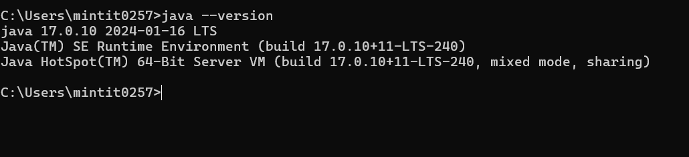
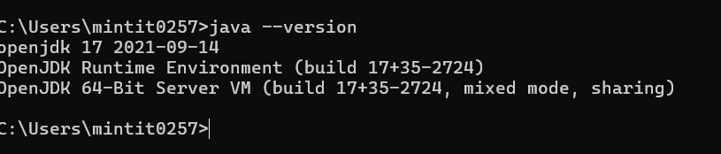

# tree meth type is null

## 개요

OpenJDK [JDK-8262095](https://bugs.openjdk.org/browse/JDK-8262095)는 컴파일/트리 API 경로에서 `tree.meth.type`이 null이 되는 이슈입니다.
JDK 17 환경에서 확인했고, 이후 JDK 빌드(메모 기준 21.10.05 이후 계열)에 패치가 들어갔습니다.

같은 증상이면 사용 중인 JDK vendor·빌드 번호를 티켓의 fix version과 대조합니다.
우회가 필요하면 티켓 댓글의 패치 버전으로 올리거나, 해당 API를 건드리는 도구(어노테이션 프로세서 등) 버전을 맞춥니다.

참고 자료

- [JDK-8262095](https://bugs.openjdk.org/browse/JDK-8262095) — `tree.meth.type` is null

