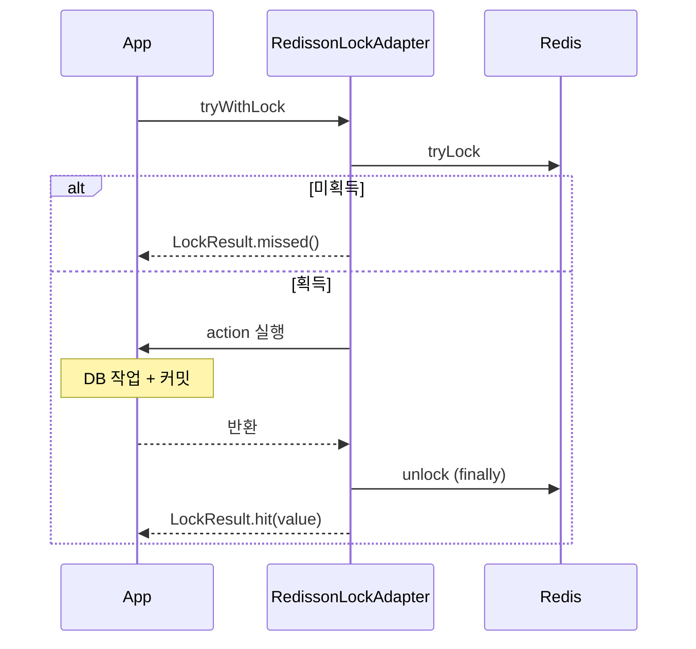

# lib-distributed-lock — LockPort, LockResult, Redisson 구현

> **개요:** 캐시(`lib-cache`)와 분리된 분산 락 스택입니다.
> Ref: [boot-base](https://github.com/No1stone/boot-base) (`lib-distributed-lock/`)

## LockPort / LockResult

```java
<T> LockResult<T> tryWithLock(String key, Duration wait, Supplier<T> action); // watchdog
<T> LockResult<T> tryWithLock(String key, Duration wait, Duration lease, Supplier<T> action);

public record LockResult<T>(boolean acquired, T value) {
    static <T> LockResult<T> missed();
    static <T> LockResult<T> hit(T value);
}
```

| 결과 | 의미 |
|---|---|
| `acquired == false` | 대기 시간 안에 못 잡음. 콜백 미실행 (`missed`) |
| `acquired == true` | 콜백 실행. `value`는 null일 수 있음 (Void 작업) |

## RedissonLockAdapter

```text
1. tryLock(wait) 또는 tryLock(wait, lease)
2. 실패 → missed()
3. 성공 → action.get() → hit(value)
4. finally → 현재 스레드 소유일 때만 unlock
```



작업 중 예외가 나도 finally에서 unlock을 시도합니다.<br />
콜백 예외는 호출부로 전파됩니다.

## watchdog과 고정 lease

| 오버로드 | 보유 | 언제 |
|---|---|---|
| wait만 | watchdog이 작업 중 연장 | 작업 길이가 들쭉날쭉할 때 |
| wait + lease | 고정 만료 | 최대 보유 시간을 하드 캡으로 둘 때 |

lease보다 작업이 길면 다른 워커가 같은 락을 잡을 수 있습니다.

## 커밋과 락 해제 순서

DB 트랜잭션은 라이브러리 밖입니다.<br />
콜백 안에서 **커밋까지 끝낸 뒤** 반환하면 finally unlock이 이어집니다.<br />
커밋 전에 unlock하면 다른 워커가 미커밋 구간을 볼 수 있습니다.

## 테스트가 보여 주는 것

`RedissonLockAdapterTest`는 획득 성공, 미획득, 인터럽트 등을 검증합니다.<br />
로컬에서 테스트를 돌리거나 GitHub의 테스트 코드를 Ref로 확인합니다.<br />

패턴 개념: [분산 락](/docs/knowledge/data/redis/patterns/distributed-lock)
