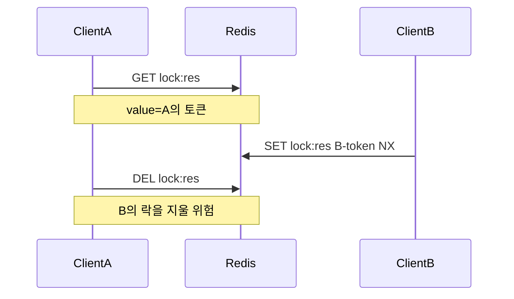

# Lua 스크립트와 여러 명령의 원자적 실행

> **개요:** 여러 Redis 명령을 끊김 없이 실행해야 할 때 Lua 스크립트를 씁니다.
> 락 소유권 확인 후 삭제 예를 중심으로 봅니다.

## 상황: 락 해제 경쟁

토큰 값으로 소유권을 둔 뒤, `GET`으로 확인한 다음 `DEL`하면 그 사이에 다른 클라이언트가 키를 가져갈 수 있습니다.



## Lua로 원자적 삭제

```lua
-- KEYS[1]=lock key, ARGV[1]=owner token
if redis.call('GET', KEYS[1]) == ARGV[1] then
  return redis.call('DEL', KEYS[1])
else
  return 0
end
```

서버에서 스크립트가 끝날 때까지 다른 명령이 끼어들지 않습니다.<br />
요청 제한, 카운터도 비슷한 패턴으로 `INCR`과 TTL을 한 스크립트에 넣을 수 있습니다.

## Redisson과의 구분

설명용 Lua는 “왜 원자성이 필요한지”를 보여 줍니다.<br />
boot-base 분산 락은 **Redisson `RLock`** 이 unlock, watchdog을 담당합니다.<br />
직접 Lua를 복사해 운영 락으로 쓰지 말고, [분산 락 패턴](/docs/knowledge/data/redis/patterns/distributed-lock)과 [lib-distributed-lock](/docs/knowledge/data/redis/boot-base/lib-distributed-lock)을 봅니다.<br />

Ref: [boot-base](https://github.com/No1stone/boot-base), [EVAL](https://redis.io/docs/latest/commands/eval/)
