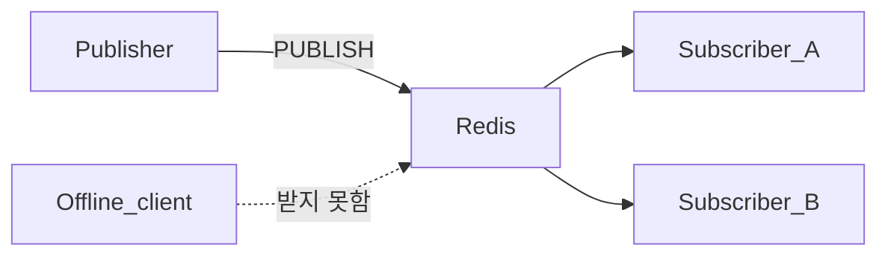

# Pub/Sub — 실시간 알림과 캐시 무효화 신호

> **개요:** 지금 연결되어 구독 중인 클라이언트에게만 메시지를 팬아웃합니다.
> 재생, 미수신 보장은 없습니다. 작업 큐와는 다른 글입니다.

## 상황

캐시를 지웠다는 신호, 채팅, 알림처럼 “지금 온라인인 구독자”에게만 빠르게 알리면 됩니다.<br />
오프라인 구독자가 나중에 받을 필요는 없습니다.

## 예제

```bash
# 구독자
SUBSCRIBE cache:invalidate

# 발행자
PUBLISH cache:invalidate 'product:42'
```



## 결과

- 구독 중인 연결만 메시지를 받습니다.
- Redis 재시작, 구독 전 발행분은 다시 받을 수 없습니다.
- Pub/Sub 메시지는 RDB/AOF에 안 남습니다.

## 작업 큐와 구분

| | Pub/Sub | 작업 큐 (List/Streams) |
|---|---|---|
| 목적 | 실시간 알림, 신호 | 할 일을 가져가 처리 |
| 미수신 | 유실 | 대기열에 남기거나 재처리 설계 |
| 예 | 캐시 무효화 브로드캐스트 | 이메일 발송 잡 |

큐, Consumer Group은 [Redis 작업 큐](/docs/knowledge/data/redis/patterns/work-queue)를 봅니다.<br />
랭킹 변경 알림에 Pub/Sub을 곁들이는 예는 [실시간 랭킹](/docs/knowledge/data/redis/patterns/ranking)을 봅니다.

## 참고

- [Pub/Sub use case](https://redis.io/docs/latest/develop/use-cases/pub-sub/)
