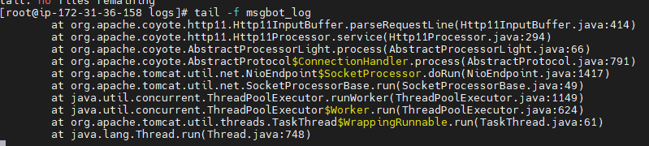
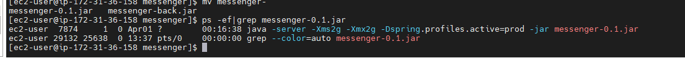
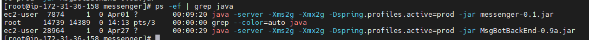

# AWS OperationSever

> **개요:** 운영 서버(opeserver)에서는 Docker를 쓰지 않고 JAR를 올려 바로 실행하는 메모입니다.
> 원 제목 철자(OperationSever)는 그대로 둡니다.

## 실행

파일을 올린 뒤 실행합니다.

```bash
java -jar chatbot.jar &
```

백그라운드, 프로덕션 프로필 예입니다.

```bash
nohup java -server -Xms2g -Xmx2g -Dspring.profiles.active=prod -jar chatbot.jar &
```



## 프로세스 확인

같은 경로에서 프로세스를 봅니다.

```bash
ps -ef | grep chatbot
```

## 종료

```bash
kill -9 pid
```

`pid`는 `ps`로 확인한 프로세스 ID로 바꿉니다.

## 로그

```bash
tail -f msgbot_log
```




