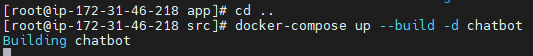
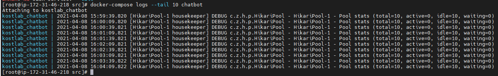
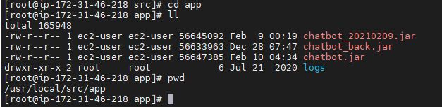

# docker 배포 로그

> **개요:** `docker-compose.yml`이 있는 디렉터리에서 서비스를 올리고 로그를 보는 메모입니다.



docker-compose 파일이 있는 곳에서 실행해야 합니다.

## 배포



```bash
docker-compose up --build -d chatbot
```

## 로그 확인



```bash
docker-compose logs --tail 10 chatbot
docker-compose logs --tail=100 -f chatbot
```

`-f`는 로그를 따라가며 봅니다.
서비스 이름 `chatbot`은 compose의 서비스명에 맞게 바꿉니다.
