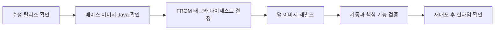

# Docker 이미지 버전 관리: 메이저 태그부터 다이제스트 고정까지

Dockerfile에 `FROM amazoncorretto:25`를 사용하고 있다면 Java 보안 업데이트가 나왔을 때 무엇을 바꿔야 할까요?
메이저 버전은 그대로여도 같은 태그가 가리키는 이미지가 갱신될 수 있습니다.
반대로 Dockerfile을 수정하지 않고 재배포만 하면 기존 앱 이미지 속 Java가 계속 실행될 수 있습니다.

이 글에서는 실제 패치가 들어간 베이스 이미지를 확인하고, 그 이미지를 사용해 앱을 다시 빌드한 뒤 배포하는 흐름을 살펴봅니다.
예제는 Corretto 25를 사용하지만 Java 17에서도 같은 확인 과정을 적용할 수 있습니다.

## 메이저 업그레이드와 보안 패치 선택

Java 17에서 25로 올리면 언어와 런타임의 메이저 업그레이드입니다.
보안 공지가 나왔다면 먼저 현재 사용하는 Java 계열과 배포판에서 해당 취약점을 수정한 릴리스를 확인합니다.
Corretto, Oracle JDK, Temurin은 배포 일정과 빌드 번호가 다를 수 있습니다.

아래는 Java 11, 17, 21, 25 계열별로 확인한 Corretto 보안 업데이트입니다.

| Java 계열 | 2026년 11월 18일 확인한 Corretto 정식 릴리스 | 공식 릴리스 |
|---|---|---|
| 11 | `11.0.33.1.1` | [Corretto 11](https://github.com/corretto/corretto-11/releases/tag/11.0.33.1.1) |
| 17 | `17.0.21.1.2` | [Corretto 17](https://github.com/corretto/corretto-17/releases/tag/17.0.21.1.2) |
| 21 | `21.0.13.1.2` | [Corretto 21](https://github.com/corretto/corretto-21/releases/tag/21.0.13.1.2) |
| 25 | `25.0.5.1.2` | [Corretto 25](https://github.com/corretto/corretto-25/releases/tag/25.0.5.1.2) |

Corretto 11은 AWS의 `CVE-2026-114938` 공지에서 영향 없음으로 분류됩니다.
11의 버전은 같은 시기의 다른 취약점 수정을 포함한 정식 보안 업데이트로 함께 기록했습니다.
17, 21, 25의 위 릴리스는 변경 내역에 해당 CVE 수정을 명시합니다.
이 표는 확인 날짜가 있는 배포판별 기록이며 이후 패치에서는 최신 공지를 다시 확인합니다. [AWS CVE 공지](https://explore.alas.aws.amazon.com/CVE-2026-114938.html)

예를 들어 Java 17을 유지하면서 수정된 Corretto 17을 적용할 수 있습니다.
Java 25로의 업그레이드는 프레임워크와 라이브러리 호환성, 성능과 운영 검증을 포함한 별도의 선택입니다.
해당 취약점의 수정 상태는 [AWS 공식 보안 공지](https://explore.alas.aws.amazon.com/CVE-2026-114938.html)에서 확인합니다.

## 태그와 실제 런타임 버전은 다를 수 있습니다

| 이미지 표기 | 선택하는 대상 | 바뀔 수 있는 부분 |
|---|---|---|
| `amazoncorretto:25` | Java 25 계열의 이미지 태그입니다. | 태그가 가리키는 이미지가 갱신될 수 있습니다. |
| `amazoncorretto:25.0.5-al2023` | 세부 버전 이름과 Amazon Linux 2023 기반 이미지를 선택합니다. | 같은 태그가 OS 패치나 런타임 패치로 재발행될 수 있습니다. |
| `amazoncorretto@sha256:…` | 특정 이미지의 내용을 식별합니다. | 새로운 이미지를 쓰려면 다이제스트를 교체합니다. |

Corretto의 패키지 릴리스가 `25.0.5.1.2`여도 Docker 태그에 전체 번호가 그대로 제공된다고 가정하지 않습니다.
실제로 위 확인 시점의 `25`와 `25.0.5-al2023` 이미지는 같은 인덱스를 가리켰고, amd64와 arm64 빌드 메타데이터에는 `25.0.5.1.2` 패키지를 설치하는 정보가 있었습니다.
다운로드 페이지에 새 JDK가 공개된 것과 각 컨테이너 변형의 배포 완료 여부는 따로 확인합니다.

태그의 목록은 [Docker 공식 이미지 정의](https://github.com/docker-library/official-images/blob/master/library/amazoncorretto)를 참고하고, 최종 판단은 실행할 플랫폼의 이미지로 확인합니다.

## 현재 사용하는 메이저 계열의 이미지를 선택합니다

| 앱의 Java 계열 | 확인할 메이저 이미지 | 세부 버전을 확인할 위치 |
|---|---|---|
| 11 | `amazoncorretto:11` | 컨테이너의 `java -version` 출력을 Corretto 11 릴리스와 대조합니다. |
| 17 | `amazoncorretto:17` | 컨테이너의 `java -version` 출력을 Corretto 17 릴리스와 대조합니다. |
| 21 | `amazoncorretto:21` | 컨테이너의 `java -version` 출력을 Corretto 21 릴리스와 대조합니다. |
| 25 | `amazoncorretto:25` | 컨테이너의 `java -version` 출력을 Corretto 25 릴리스와 대조합니다. |

각 계열의 JDK 릴리스와 Docker 이미지 게시 시점은 따로 확인합니다.
다음 예제에서 java_major를 현재 앱의 11, 17, 21, 25 중 하나로 지정합니다.

```bash
java_major=21
docker pull "amazoncorretto:$java_major"
docker run --rm "amazoncorretto:$java_major" java -version
docker buildx imagetools inspect "amazoncorretto:$java_major"
```

내부 버전을 확인한 이미지의 다이제스트를 FROM에 지정하는 과정은 네 계열에 동일하게 적용합니다.

## 새 이미지를 받고 Java를 확인합니다

```bash
docker pull amazoncorretto:25
docker run --rm amazoncorretto:25 java -version
```

`pull`로 현재 레지스트리 이미지를 가져오고, 짧게 실행해 실제 Java 버전을 출력합니다.
메이저 태그를 처음 쓸 때뿐 아니라 보안 패치 적용 때도 같은 과정을 거칩니다.
출력의 Corretto 빌드 번호와 공식 수정 릴리스를 대조합니다.

Mac이 arm64이고 배포 서버가 amd64라면 두 플랫폼을 구분합니다.
로컬에서 확인한 arm64 결과만으로 amd64 런타임의 검증을 대신하지 않도록, 대상 플랫폼의 빌드와 실행 환경에서 확인합니다.
지원 플랫폼과 인덱스는 다음 명령으로 볼 수 있습니다.

```bash
docker buildx imagetools inspect amazoncorretto:25
```

출력에는 최상위 Digest와 플랫폼별 manifest가 표시됩니다.
멀티 아키텍처 인덱스의 다이제스트는 여러 플랫폼의 이미지 묶음을, 하위 manifest의 다이제스트는 특정 플랫폼의 이미지를 식별합니다.
원하는 고정 범위와 배포 플랫폼을 함께 기록합니다. [Docker imagetools inspect](https://docs.docker.com/reference/cli/docker/buildx/imagetools/inspect/)

## 검증한 이미지의 다이제스트로 고정합니다

다음 값은 2026년 11월 18일 레지스트리에서 확인한 Corretto 25 멀티 아키텍처 인덱스의 예입니다.
배포할 때는 사용할 이미지의 현재 값과 포함된 Java 버전을 직접 확인합니다.

```dockerfile
FROM amazoncorretto:25.0.5-al2023@sha256:8b82be5adeabd374f5438e90635a120868e07ea8e85be6b691eb1c994d53f1e2

WORKDIR /app
COPY app.jar /app/app.jar
ENTRYPOINT ["java", "-jar", "/app/app.jar"]
```

이 예제는 빌드 컨텍스트에 실행 가능한 `app.jar`가 준비돼 있다고 가정합니다.
태그는 사람이 선택한 계열을 읽기 쉽게 남기고, 다이제스트는 실제로 사용할 이미지를 고정합니다.
새 보안 패치가 나오면 새 다이제스트를 검토해 갱신하고 다시 테스트합니다.
고정한 이미지의 패치가 자동 반영되지 않으므로 버전 확인과 갱신 작업을 운영에 포함합니다. [Docker 베이스 이미지 고정](https://docs.docker.com/build/building/best-practices/#pin-base-image-versions)

## pull과 no-cache는 적용 대상이 다릅니다

베이스 이미지를 갱신한 뒤 앱 이미지를 새 태그로 빌드합니다.
다음 명령은 프로젝트 Dockerfile과 빌드 산출물이 준비된 상태를 가정합니다.

```bash
docker build --pull -t my-app:2026-11-18-java-patch .
```

`--pull`은 베이스 이미지의 레지스트리 상태를 확인합니다.
다이제스트를 고정했다면 해당 이미지를 가져오며, 다른 새 패치 이미지로 바꾸려면 FROM의 다이제스트도 갱신해야 합니다.
`--no-cache`는 Dockerfile 빌드 단계의 캐시 사용을 끄는 옵션입니다.
설치 단계까지 다시 실행해 검증해야 할 때 함께 사용할 수 있습니다.

```bash
docker build --pull --no-cache -t my-app:2026-11-18-java-patch .
```

매번 모든 단계를 다시 수행할 필요가 있는지 보고 선택합니다.
또한 FROM 뒤에서 패키지를 추가 설치하거나 외부 파일을 다운로드하면 베이스 다이제스트만으로 앱 이미지 전체의 재현성이 결정되지는 않습니다.
그 단계의 의존성과 다운로드 버전도 관리합니다. [Docker 빌드 옵션](https://docs.docker.com/reference/cli/docker/buildx/build/)

## 재배포 후 실행 중인 런타임을 확인합니다

베이스 이미지는 앱 이미지를 만들 때 사용됩니다.
이미 만들어 둔 앱 이미지에는 당시 베이스의 파일이 포함돼 있으므로, 새 베이스를 받아도 현재 실행 중인 앱은 새로 빌드하고 교체해야 합니다.



빌드한 이미지의 Java는 다음과 같이 확인합니다.
앱 이미지에 ENTRYPOINT가 있으므로 Java 실행 파일을 직접 지정합니다.

```bash
docker run --rm --entrypoint java my-app:2026-11-18-java-patch -version
```

Compose로 운영 중이라면 서비스의 image를 새 앱 이미지 태그로 바꾸고 컨테이너를 교체합니다.
다음 명령은 `app` 서비스가 레지스트리에서 이미지를 받는 구성의 예입니다.

```bash
docker compose pull app
docker compose up -d --no-deps app
docker compose exec app java -version
```

Compose에서 로컬 build를 사용하는 구성이라면 새로 빌드한 결과로 재생성하는 흐름에 맞춥니다.
멀티 스테이지 Dockerfile은 Gradle 빌드 단계의 JDK와 최종 실행 단계의 JDK를 각각 확인합니다.
특히 실제 서비스가 사용하는 최종 단계의 런타임이 수정 버전인지 확인합니다.

## 다음 패치를 위한 기록

| 기록 | 다음 업데이트에 사용하는 이유 |
|---|---|
| 배포판과 전체 Java 빌드 번호 | 보안 공지의 수정 버전과 대조합니다. |
| 베이스 이미지와 인덱스 또는 플랫폼 다이제스트 | 어떤 파일을 바탕으로 빌드했는지 확인합니다. |
| 앱 이미지 태그와 다이제스트 | 검증한 산출물과 배포 대상을 연결합니다. |
| 대상 플랫폼과 검증 결과 | 개발 Mac과 실제 서버의 차이를 확인합니다. |

메이저 태그를 유지하는 방식에서도 패치 적용은 가능합니다.
고정된 산출물을 관리하려면 검증한 다이제스트를 기록하고, 새 패치가 나올 때 갱신하는 절차를 정하면 됩니다.

컨테이너 없이 JAR를 실행하는 서버는 [JAR 배포의 Java 버전 고정과 사용자 경로 JDK 교체](../../tooling/ci/jar-deployment-with-user-jdk.md)를 참고합니다.

## 자주 묻는 질문

### `amazoncorretto:25`만 쓰면 보안 패치가 자동으로 반영되나요?

태그가 가리키는 이미지가 갱신될 수는 있지만, 이미 빌드해 둔 앱 이미지와 실행 중인 컨테이너는 자동으로 바뀌지 않습니다.
새 베이스를 확인한 뒤 앱 이미지를 다시 빌드하고 교체해야 합니다.

### 태그와 다이제스트를 함께 쓰는 이유는 무엇인가요?

태그는 계열을 읽기 쉽게 남기고, 다이제스트는 실제로 빌드에 쓸 이미지 내용을 고정합니다.
새 패치가 나오면 다이제스트를 다시 확인하고 갱신합니다.

### `--pull`과 `--no-cache`는 언제 같이 쓰나요?

`--pull`은 베이스 이미지의 레지스트리 상태를 확인하고, `--no-cache`는 Dockerfile 단계 캐시를 끕니다.
설치 단계까지 다시 검증할 때만 `--no-cache`를 함께 선택하면 됩니다.
