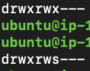

# 소유권 수정

소유권 주기

```bash
sudo chown -R app1-user:app1-group /home/app1-user
sudo chown -R app2-user:app2-group /home/app2-user
sudo chown -R db-user:db-group /home/db-user

```

```bash
ls -ld /home/app1-user
ls -ld /home/app2-user
ls -ld /home/db-user
```

권한변경

```bash
sudo chmod 770 /home/app1-user
sudo chmod 770 /home/app2-user
sudo chmod 770 /home/db-user

```

앞으로 생성될 파일도 그룹소속

```bash
sudo chmod g+s /home/app1-user
sudo chmod g+s /home/app2-user
sudo chmod g+s /home/db-user

```



---

drwxrws--- ←-로 변경되야함

적용 그냥 재부팅하면됨

```bash
newgrp app1-group

```
