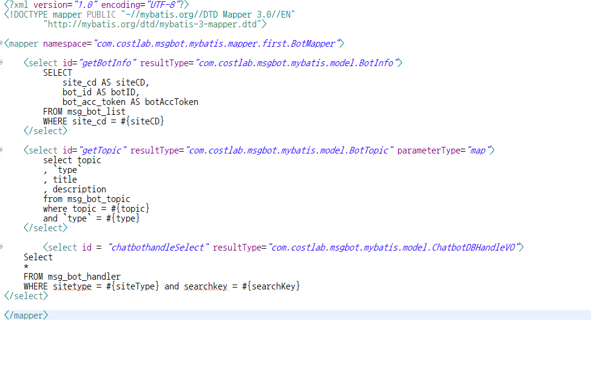
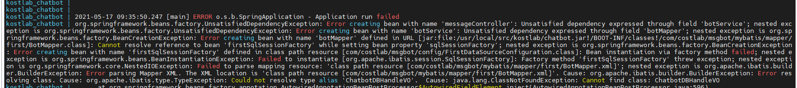

# TypeException

## 개요

로컬에서는 되던 MyBatis 조회가 실행 환경에서 TypeException으로 실패한 기록입니다.
원인은 VO 경로 설정이었고, 배포에서는 `resultType`에 풀 패키지 경로를 써야 했습니다.

## 증상



로컬에서는 테스트가 되었는데, 실행 환경에서는 되지 않았습니다.

## 원인

스프링 VO 경로 설정 문제였습니다.
배포 버전에서는 풀 경로로 작성해야 합니다.

```xml
resultType="풀경로"
```



## 메모

Mybatis 파라미터 타입은 나중에 더 파볼 예정입니다.
