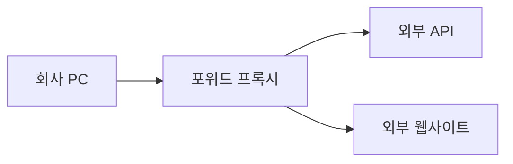
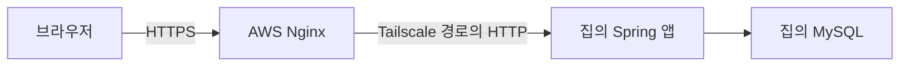

# 프록시란? 포워드 프록시와 리버스 프록시

브라우저에서 서비스에 접속할 때 요청이 곧바로 앱 서버에 도착한다고 생각하기 쉽습니다.
실제 구성에서는 회사의 외부 접속 프록시, AWS의 Nginx, 내부 API Gateway처럼 여러 중간 서버를 거칠 수 있습니다.
각 프록시가 누구의 요청을 대신 보내는지 알면 접근 정책과 장애 지점을 구분하기 쉬워집니다.

## 클라이언트의 외부 접속을 모으는 포워드 프록시

회사 PC가 외부 사이트에 접속할 때 지정한 프록시를 거치도록 설정할 수 있습니다.
프록시는 요청 목적지에 접근할 수 있는지 판단하고 외부 서버에 연결합니다.
이 구조에서 정책의 중심은 조직의 클라이언트와 외부 목적지입니다.
HTTPS는 CONNECT 터널을 사용하기도 하며, 본문을 해석하는 TLS 검사에는 별도의 인증서 신뢰 구성이 필요합니다.

## 서비스의 진입점이 되는 리버스 프록시

사용자가 `app.example.com`에 접속하면 Nginx가 요청을 받고 내부 앱으로 전달할 수 있습니다.
이때 운영자는 공개 도메인과 내부 서버의 연결 관계를 정합니다.
앱을 다른 노트북으로 옮겨도 공개 주소는 유지하고 프록시 목적지만 바꿀 수 있습니다.

| 구분 | 포워드 프록시 | 리버스 프록시 |
|---|---|---|
| 설정하는 연결 | 클라이언트의 외부 접속 경로입니다. | 서비스의 공개 진입 경로입니다. |
| 목적지 선택 | 클라이언트가 지정한 외부 목적지에 연결합니다. | 운영자가 정한 업스트림으로 전달합니다. |
| 예시 정책 | 외부 도메인 접근을 허용하거나 거절합니다. | 도메인과 경로별로 앱을 선택합니다. |

## AWS와 집 서버를 연결하는 예

이 예시에서는 인증서를 AWS Nginx에서 관리하고, 앱의 공개 HTTP 진입점도 Nginx에 모읍니다.
Nginx와 집 앱 사이의 연결은 Tailscale 주소로 지정합니다.
Tailscale의 네트워크 접근 정책, 앱의 인증, DB 계정 권한은 각각 자신이 담당하는 구간에 적용합니다.
앱의 JDBC 호출은 앱에서 DB로 나가는 연결입니다.
이 호출의 경로와 권한도 함께 그려두면 HTTP 오류와 DB 연결 오류를 구분할 수 있습니다.

## 요청은 구간마다 관찰합니다

브라우저에서 보이는 오류가 앱까지 전달됐는지 먼저 확인합니다.
Nginx access log에는 요청이 남았는데 앱 로그가 없다면 업스트림 연결과 경로를 확인합니다.
앱 로그까지 있다면 앱이 반환한 상태와 Nginx가 사용자에게 보낸 상태를 대조합니다.
이 확인을 위해 요청 ID와 업스트림 주소를 함께 남기는 방법은 로그 묶음에서 다룹니다.

프록시의 분류와 원래 요청 정보를 전달하는 헤더는 [MDN 프록시 문서](https://developer.mozilla.org/en-US/docs/Web/HTTP/Guides/Proxy_servers_and_tunneling)를 참고합니다.
