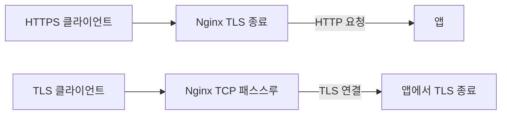

# L4와 L7 프록시의 차이

프록시 설정을 볼 때 `http`와 `stream`이 등장합니다.
두 설정은 요청을 해석하는 단위가 다릅니다.
HTTP 경로에 따라 분기할 것인지, TCP 연결 자체를 중계할 것인지 먼저 정하면 사용할 모듈을 고르기 쉽습니다.

| 관점 | L4 전달 | L7 HTTP 전달 |
|---|---|---|
| 주로 보는 단위 | TCP 연결이나 UDP 데이터그램 흐름입니다. | HTTP 메서드, 호스트, 경로와 헤더입니다. |
| Nginx 설정 문맥 | `stream`에 구성합니다. | `http`에 구성합니다. |
| 목적지 분기 예 | 접속 포트별로 서비스에 연결합니다. | `/api/`와 `/images/`를 다른 대상으로 보냅니다. |
| 로그 예 | 연결 시간과 송수신 바이트를 남깁니다. | URI, HTTP 상태와 응답 시간을 남깁니다. |

## TLS 종료 위치가 해석 범위를 바꿉니다

HTTPS 연결을 TCP 그대로 앱에 전달하면 앱이 인증서를 제공하고 TLS를 종료합니다.
이 상태에서 중간 프록시는 암호화된 HTTP 경로를 읽을 수 없습니다.
Nginx에서 TLS를 종료하면 복호화된 HTTP 요청을 기준으로 경로를 선택하고 헤더를 전달할 수 있습니다.

TLS 패스스루에서 ClientHello의 SNI를 읽어 목적지를 고르는 구성도 있습니다.
이를 적용하면 도메인에 따른 TCP 목적지 선택은 가능하지만, HTTP의 `/api/` 경로를 기준으로 선택하려면 HTTP를 해석할 수 있는 지점이 필요합니다.
SNI 공개 여부와 지원 모듈도 확인합니다.

## 홈랩에서 고르는 기준

웹과 REST API를 공개할 때는 `http`의 server와 location부터 시작합니다.
장비의 TCP 프로토콜이나 DB 연결을 중계할 때는 `stream`에서 프로토콜 요구를 따로 확인합니다.
Kafka처럼 접속 이후 브로커 주소를 추가로 안내하는 프로토콜은 bootstrap 연결 중계만으로 모든 연결이 해결되는지도 검증해야 합니다.

각 문맥에서 사용할 수 있는 설정은 [HTTP core](https://nginx.org/en/docs/http/ngx_http_core_module.html)와 [Stream core](https://nginx.org/en/docs/stream/ngx_stream_core_module.html)에 구분되어 있습니다.
