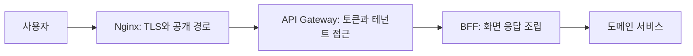

# 프록시, 로드밸런서, API Gateway의 역할

Nginx와 Spring Cloud Gateway를 함께 배치하면 둘 다 요청을 전달합니다.
역할을 설계할 때는 각 계층에서 판단하는 정책을 적어두면 됩니다.
외부 연결의 처리와 서비스 접근 정책이 어디에 있는지 명확하면 설정 변경 범위도 좁아집니다.

## 한 요청이 지나가는 역할

Nginx에서는 TLS 종료와 정적 파일, 업스트림 전달을 담당할 수 있습니다.
API Gateway에서는 검증한 토큰과 요청 경로를 사용해 접근 가능한 테넌트를 판단합니다.
BFF는 화면에 필요한 여러 API 결과를 조합하고, 도메인 서비스는 업무 규칙을 처리합니다.
이 배치는 예시이며 서비스가 작으면 필요한 계층부터 구성합니다.

| 용어 | 하는 일 | 한 제품에서 함께 수행할 수 있는가 |
|---|---|---|
| 프록시 | 요청을 받아 다른 서버에 전달합니다. | Nginx에서 프록시와 부하 분산을 함께 설정할 수 있습니다. |
| 로드밸런서 | 여러 대상 중 요청이나 연결을 받을 대상을 고릅니다. | AWS ALB나 Nginx upstream으로 구성할 수 있습니다. |
| API Gateway | API 진입점에서 인증, 경로, 사용량 등의 정책을 적용합니다. | 서비스 요구에 따라 프록시 기능과 함께 운영합니다. |

## 중복 정책을 줄이는 방법

예를 들어 Nginx에서 `/api/`를 제거하고 Gateway에서도 같은 접두사를 제거하면 앱이 예상한 경로와 달라집니다.
각 계층에 입력 경로와 출력 경로를 한 줄씩 기록해 실제 요청과 비교합니다.
JWT 검증과 사용자별 권한을 여러 곳에 적용한다면 각 검증이 어떤 신뢰 경계를 지키는지도 적습니다.
토큰이 검증됐다는 사실만으로 요청 본문의 다른 사용자 ID를 신뢰할 수 있는 것은 아니므로, 도메인의 대상 접근 조건도 정합니다.

## 구성을 선택할 때 확인할 질문

서비스 진입점에서 TLS만 종료하면 되는지, 목적지가 여러 개인지, 테넌트별 접근 검증이 필요한지 살펴봅니다.
별도의 계층을 추가하면 연결 수와 타임아웃, 로그의 관찰 지점도 늘어납니다.
문제가 생겼을 때 어느 계층에서 요청을 거절했는지 알 수 있도록 각 계층의 책임과 요청 ID 전달을 함께 정합니다.

Nginx에서 업스트림 그룹으로 요청을 분산하는 기본 동작은 [공식 부하 분산 가이드](https://nginx.org/en/docs/http/load_balancing.html)를 참고합니다.
