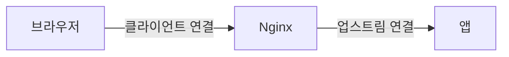

# keepalive와 연결 재사용

프록시에서는 클라이언트와 Nginx의 연결, Nginx와 앱의 연결이 각각 존재합니다.
브라우저 쪽 연결을 유지해도 업스트림 연결이 매번 새로 생성되는 구성이 가능합니다.
반복 요청의 연결 비용을 보려면 두 구간을 나눠 관찰합니다.



## 업스트림의 유휴 연결을 재사용합니다

```nginx
# http 문맥
upstream app_pool {
    server backend:8080;
    server backend2:8080;
    keepalive 16;
}

server {
    listen 80;
    location /api/ {
        proxy_pass http://app_pool;
        proxy_http_version 1.1;
        proxy_set_header Connection "";
    }
}
```

keepalive 값은 worker별로 보관할 유휴 업스트림 연결 수를 정합니다.
동시에 열릴 수 있는 전체 연결의 최대값과는 구분합니다.
백엔드도 HTTP 연결 유지에 대응해야 하므로 테스트 서버와 실제 Spring 서버의 동작을 각각 확인합니다.

## 늘리기 전에 확인할 것

| 관찰 | 의미 |
|---|---|
| 업스트림 연결 시간이 반복해서 큼 | TCP나 TLS 연결 생성 비용을 조사합니다. |
| 유휴 소켓 수가 많음 | worker 수와 인스턴스 수를 포함해 실제 연결 예산을 봅니다. |
| 간헐적인 reset 또는 502 | 업스트림의 유휴 연결 종료와 재사용 시점을 조사합니다. |

앞단과 앱의 keepalive 타임아웃이 다르면 종료 직전 연결을 재사용하는 경합이 발생할 수 있습니다.
실패한 요청을 재시도할 수 있는지도 메서드와 업무 멱등성에 따라 판단합니다.
쓰기 요청에 대한 자동 재시도는 중복 반영까지 함께 다룹니다.

이 설정을 적용한 뒤 반복 요청에서 연결 시간과 upstream 응답 시간을 비교합니다.
연결 캐시의 범위는 [upstream keepalive](https://nginx.org/en/docs/http/ngx_http_upstream_module.html#keepalive)를 참고합니다.
