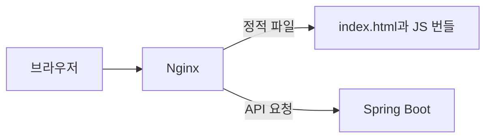

# Nginx란? 웹 서버와 리버스 프록시

Nginx는 파일을 HTTP로 제공하고, 앱 서버로 요청을 전달하고, 여러 업스트림으로 부하를 나누는 용도로 사용합니다.
한 서비스에서도 React 빌드 파일은 Nginx가 직접 읽고, `/api/`는 Spring Boot에 전달하도록 설정할 수 있습니다.
이 구성을 이해하면 요청이 파일 조회로 끝나는지 앱 호출로 이어지는지 구분할 수 있습니다.

## 정적 파일과 앱 요청의 처리 경로



다음은 구성의 모양을 보여 주는 부분 설정입니다.
`server`는 `http` 문맥 안에 놓고, `root` 경로에는 실제 빌드 파일을 준비합니다.

```nginx
server {
    listen 80;
    server_name app.example.com;
    root /srv/web;

    location /api/ {
        proxy_pass http://backend:8080;
    }

    location / {
        try_files $uri $uri/ /index.html;
    }
}
```

`/api/devices`는 backend로 전달하고, `/assets/app.js`는 디스크에서 찾습니다.
SPA의 화면 경로는 실제 파일이 없을 때 `index.html`을 반환해 브라우저 라우터가 처리하게 할 수 있습니다.
누락된 JS 파일까지 HTML로 반환하면 브라우저 오류가 생길 수 있으므로 정적 자산 경로의 정책도 별도로 정합니다.

## 연결을 받을 수 있는 주소인지 확인합니다

Nginx와 앱이 같은 호스트에 있어도 컨테이너가 다르면 `127.0.0.1`의 대상이 달라집니다.
Compose 기본 네트워크에서는 서비스 이름으로 앱에 접근합니다.
앱이 집의 다른 노트북에 있으면 Nginx에서 접근 가능한 LAN이나 Tailscale 주소를 지정합니다.

| 앱 위치 | 예제 업스트림 |
|---|---|
| 같은 Compose 네트워크 | `http://backend:8080` |
| Nginx와 같은 호스트 네트워크 | `http://127.0.0.1:8080` |
| 다른 노트북 | 해당 노트북의 내부 주소와 앱 포트 |

## 처음 확인할 결과

앱 요청이 도착하는지 확인한 뒤 정적 파일과 TLS 설정을 더합니다.
처음부터 여러 rewrite와 캐시를 함께 켜면 어떤 설정이 응답을 바꿨는지 찾기 어려워집니다.
실습에서는 응답에 경로를 돌려주는 작은 백엔드를 사용해 각 변경이 전달 경로에 주는 영향을 확인합니다.

기본 설정의 흐름은 [Nginx 시작 가이드](https://nginx.org/en/docs/beginners_guide.html)에 정리되어 있습니다.
