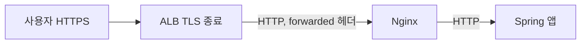

# ALB 뒤의 Nginx와 다중 프록시

ALB가 HTTPS를 받고 Nginx에 HTTP로 전달하면 Nginx는 자신의 구간을 HTTP로 관찰합니다.
이 값을 그대로 앱에 전달하면 앱이 원래 요청도 HTTP였다고 판단해 리다이렉트나 쿠키 설정이 어긋날 수 있습니다.
각 계층이 어떤 요청 정보를 추가하는지 기록해 둡니다.



## 신뢰하는 프록시 범위를 지정합니다

다음은 ALB만 접근할 수 있는 Nginx 구간을 가정한 부분 설정입니다.
예시 CIDR은 실제 ALB 서브넷과 접근 정책에 맞춰 제한합니다.
보안 그룹에서도 Nginx에 접근 가능한 출발지를 제한합니다.

```nginx
# http 문맥
set_real_ip_from 10.0.1.0/24;
set_real_ip_from 10.0.2.0/24;
real_ip_header X-Forwarded-For;
real_ip_recursive on;

map $http_x_forwarded_proto $original_proto {
    default $scheme;
    http    http;
    https   https;
}

server {
    listen 80;
    location /api/ {
        proxy_pass http://backend:8080;
        proxy_set_header Host $host;
        proxy_set_header X-Forwarded-For $remote_addr;
        proxy_set_header X-Forwarded-Proto $original_proto;
    }
}
```

이 예제는 해석한 사용자 주소를 앱에 단일 값으로 전달하는 정책입니다.
전체 프록시 체인을 보존하려면 접근 로그와 앱의 신뢰 해석 규칙까지 맞춰 별도로 설계합니다.
Nginx를 외부에서 직접 접근할 수 있게 열어두면 사용자가 앞단 프록시 헤더를 흉내 낼 수 있으므로 접근 경계를 먼저 확인합니다.

## 실습에서 재현할 증상

| 증상 | 확인 |
|---|---|
| HTTPS 리다이렉트가 반복됨 | TLS 종료 위치와 앱에 전달한 원래 프로토콜을 확인합니다. |
| 사용자 IP가 항상 ALB 주소 | realip 신뢰 범위와 헤더를 확인합니다. |
| 헬스체크만 실패 | 헬스체크의 Host와 경로가 들어갈 server를 확인합니다. |

실제 외부 요청과 내부 헬스체크를 각각 보내 앱의 주소와 프로토콜 인식을 비교합니다.
ALB의 헤더 처리 모드는 [AWS 공식 문서](https://docs.aws.amazon.com/elasticloadbalancing/latest/application/x-forwarded-headers.html), Nginx 주소 해석은 [realip 모듈](https://nginx.org/en/docs/http/ngx_http_realip_module.html)을 참고합니다.
