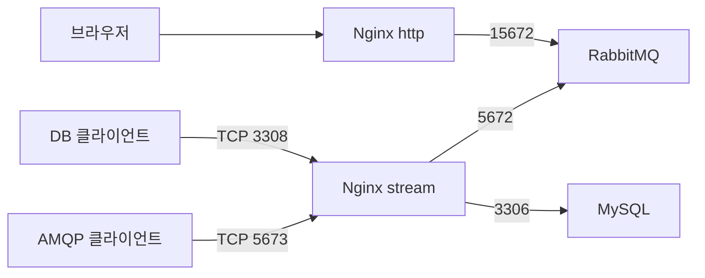

# Stream 모듈과 HTTP 프록시의 차이

브라우저의 RabbitMQ 관리 콘솔과 앱의 AMQP 연결은 같은 서버를 사용해도 전달 방식이 다릅니다.
관리 콘솔은 HTTP 요청으로 열고, AMQP와 MySQL 연결은 각 프로토콜의 TCP 세션을 맺습니다.
Nginx에서는 이런 연결을 stream 문맥에서 중계할 수 있습니다.

## 직접 구성한 infra-dev의 사례

개인 인프라 실습에서는 공개 프록시 인스턴스와 리소스 인스턴스를 분리했습니다.
리소스 서버의 MySQL, Redis, RabbitMQ AMQP 연결은 stream으로, RabbitMQ 관리 콘솔과 관측 도구의 웹 화면은 http로 전달했습니다.
접속 경로와 실제 리소스 Compose는 [infra-dev 저장소](https://github.com/No1stone/infra-dev#resource-server-endpoint), [리소스 서버 Compose](https://github.com/No1stone/infra-dev/blob/main/docker/resource/docker-compose.yml)에 기록되어 있습니다.

| 연결 | Nginx 문맥 | 프록시에서 읽는 정보 |
|---|---|---|
| RabbitMQ 관리 콘솔 | http | HTTP 경로와 헤더를 읽습니다. |
| RabbitMQ AMQP 클라이언트 | stream | TCP 연결을 업스트림으로 전달합니다. |
| MySQL 클라이언트 | stream | DB 프로토콜이 오가는 TCP 연결을 전달합니다. |
| 로그 수집용 UDP | stream | 데이터그램과 응답 흐름을 중계합니다. |

이 글의 stream은 Nginx의 전송 계층 프록시 기능을 뜻합니다.
RabbitMQ Streams, Kafka Streams처럼 메시지 저장이나 처리를 가리키는 기능은 각 제품에서 별도로 제공합니다.

## HTTP 경로로 DB를 분기할 수 있는가

MySQL 클라이언트는 `/mysql/`이라는 HTTP 경로를 보내지 않습니다.
보통 서비스별 접속 포트를 나누고, 프록시가 그 포트를 내부 서비스에 연결하도록 구성합니다.
TLS 연결에서 SNI를 이용하는 방식은 클라이언트가 보내는 핸드셰이크와 실제 지원 범위를 확인해야 합니다.

stream 중계 자체는 프로토콜 인증이나 암호화를 추가하지 않습니다.
실습의 평문 연결을 외부에 공개할 때는 접근 가능한 네트워크, TLS와 서비스 계정 정책을 별도로 정합니다.
전체 설정의 문맥은 [Stream core 문서](https://nginx.org/en/docs/stream/ngx_stream_core_module.html)를 참고합니다.
