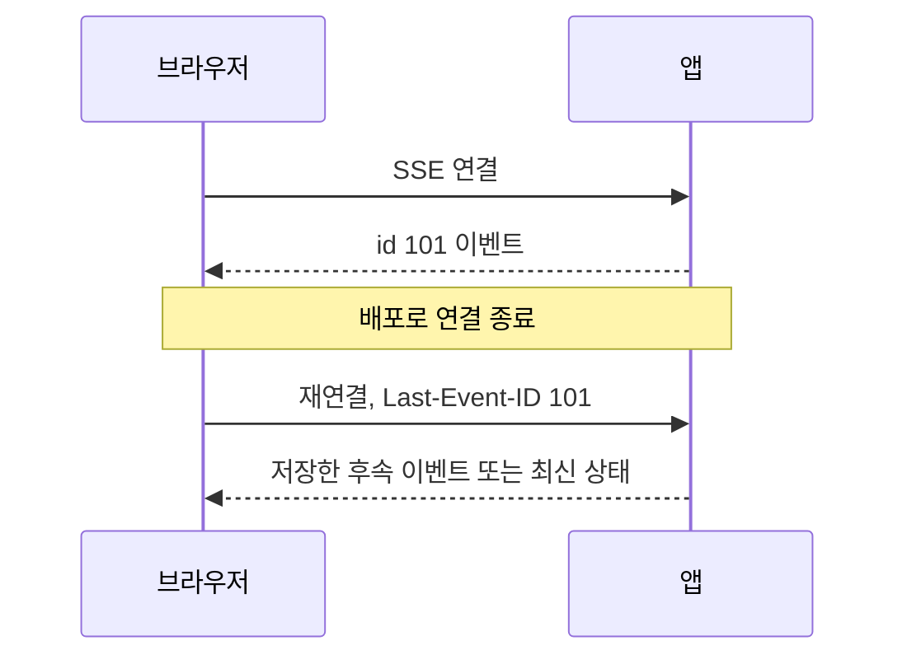

# SSE 연결 유지, 하트비트와 재연결

SSE 연결은 배포와 네트워크 변화로 끊길 수 있습니다.
화면의 알림 건수를 유지하려면 연결 재시작과 데이터 복구를 각각 다룹니다.
재연결 뒤 최신 미확인 건수를 다시 조회하는 방식은 누락된 모든 UI 이벤트를 재현하는 것보다 단순한 경우가 많습니다.

## 하트비트로 유휴 연결을 유지합니다

SSE의 주석 행을 주기적으로 보내 연결에 데이터가 흐르게 할 수 있습니다.
다음은 앱이 내보내는 하트비트의 모양입니다.

```text
: heartbeat

```

프록시의 응답 읽기 타임아웃과 앞단 로드밸런서의 유휴 제한보다 짧은 간격을 선택합니다.
앱 타이머가 지연될 여유도 두고 확인합니다.
Nginx가 응답을 모아두면 하트비트도 늦어질 수 있으므로 버퍼링 설정을 함께 봅니다.

## 연결 복구와 이벤트 복구



브라우저 EventSource는 연결이 끊기면 재연결을 시도합니다.
이벤트에 id를 부여하면 재연결 요청에서 Last-Event-ID를 받을 수 있지만, 실제 복원은 서버가 저장 이력과 처리 방법을 갖춰야 합니다.
인증 만료나 접근 거절은 정상적인 네트워크 재연결과 구분해 처리합니다.

| 알림 성격 | 재연결 시 처리 예 |
|---|---|
| 빨간 배지의 미확인 건수 | 현재 상태 API를 다시 호출합니다. |
| 확인해야 할 업무 알림 목록 | 저장된 알림을 커서나 ID로 조회합니다. |
| 실시간 화면 갱신 신호 | 최신 데이터를 재조회해 화면을 맞춥니다. |

## 앱 두 대와 롤링 배포

재연결은 이전과 다른 인스턴스로 갈 수 있습니다.
알림을 특정 인스턴스의 메모리에만 남기면 다른 인스턴스에서 이력을 복원하기 어렵습니다.
전달 신호의 분배와 알림 원본 저장, 사용자별 읽음 상태를 나누어 설계합니다.
실습에서는 알림을 보낸 뒤 연결된 앱을 종료하고, 재연결과 건수 재조회를 확인합니다.

EventSource의 id와 재시도 동작은 [MDN SSE 문서](https://developer.mozilla.org/en-US/docs/Web/API/Server-sent_events/Using_server-sent_events)를 참고합니다.
