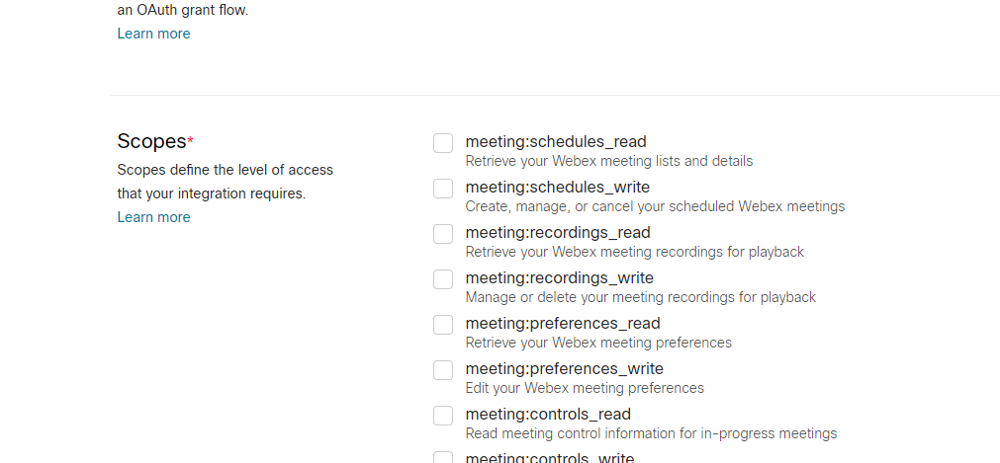
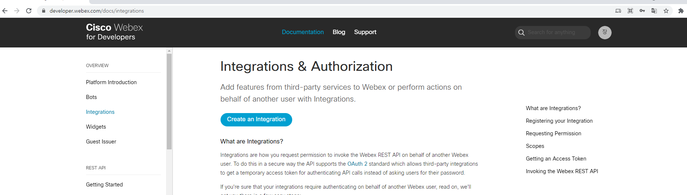

# Token

## 개요

Webex Integration은 사용자 대신 API를 호출할 때 쓰는 OAuth 2.0 클라이언트입니다.
등록 시 필요한 **scope(범위)** 만 고르고, 같은 범위를 인가 요청에도 넣습니다.
범위를 나중에 추가·변경하면 기존 토큰으로는 새 권한이 적용되지 않으므로 토큰을 다시 발급합니다.

범위는 그 토큰으로 호출할 수 있는 API·리소스를 나타냅니다.

## 등록 시 확인할 것

1. My Webex Apps에서 Integration을 만듭니다.
2. Redirect URI를 콜백 URL과 일치시킵니다.
3. 필요한 scope만 선택합니다.
4. client id / secret을 안전한 저장소에 둡니다. secret은 생성 직후에만 보입니다.

무인·조직 단위 자동화가 목적이면 Integration 대신 Service App을 검토합니다.
개인 탐색용 Personal Access Token과 Integration 토큰의 수명·권한이 다릅니다.

참고 자료

- [Webex Integrations](https://developer.webex.com/docs/integrations) — Integration 생성, scope, OAuth 인가 흐름

