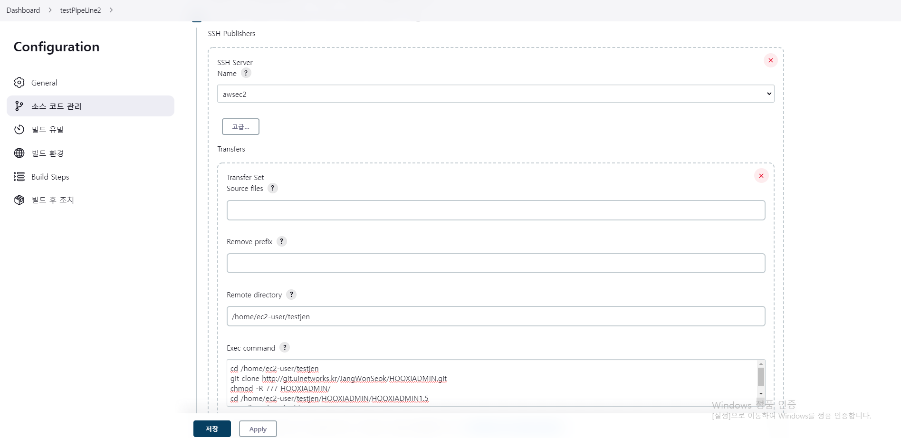

# jenkins setting

> **개요:** Jenkins 잡에서 SSH와 Gradle을 설정하고, exec로 Git 내려받기부터 클린 빌드까지 확인한 뒤 docker-compose로 CI/CD를 이어 가려 한 메모입니다.

## 설정 화면

## 확인한 내용

- SSH는 별도 설정이 필요합니다.
- Gradle global setting이 필요합니다.
- exec command로 Git을 받은 뒤 클린 빌드까지 확인했습니다.

해당 커맨드를 docker-compose 형태로 바꿔 쓰면 CI/CD 흐름을 마무리할 수 있다는 메모입니다.
