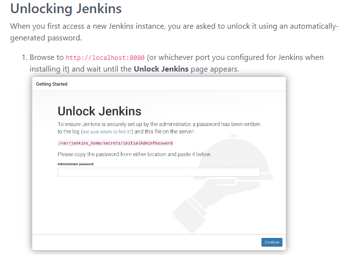
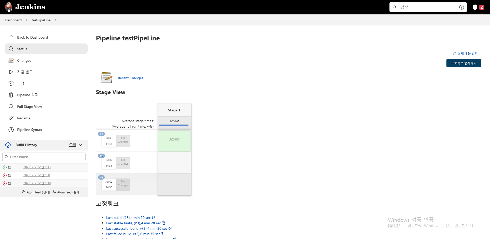
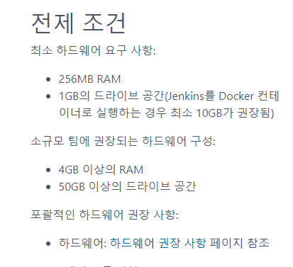

# 젠킨스

## 개요

젠킨스입니다.

젠킨스 최소스펙
파이프라인 (일반사용) 구성을 들어가면 스크립트를 작성 할 수 있다.
stage. step. 에 linux에서 실행될 명령어를 입력한다.
젠킨스 이클립스 에디터
jenkins setting





## 예제·코드

```bash
sudo yum upgrade
sudo yum update

sudo yum install java-11-amazon-corretto.x86_64
java -version

sudo wget -O /etc/yum.repos.d/jenkins.repo \ https://pkg.jenkins.io/redhat-stable/jenkins.repo
sudo rpm --import https://pkg.jenkins.io/redhat-stable/jenkins.io.key

sudo yum install jenkins
sudo systemctl daemon-reload
sudo systemctl enable jenkins
sudo systemctl start jenkins
sudo systemctl status jenkins
```

```bash
sudo cat /var/lib/jenkins/secrets/initialAdminPassword

```

```bash
pipeline {
    agent any
    stages {
        stage('Stage 1'){
            steps{
                echo 'hello World!!'
            }
        }
    }
}
```

<details>
<summary>참고 자료</summary>

- [Linux](https://www.jenkins.io/doc/book/installing/linux/) — Jenkins – an open source automation server which enables developers around the world to reliably build, test, and deploy their software
- [https://pkg.jenkins.io/redhat-stable/jenkins.repo](https://pkg.jenkins.io/redhat-stable/jenkins.repo)
- [https://pkg.jenkins.io/redhat-stable/jenkins.io.key](https://pkg.jenkins.io/redhat-stable/jenkins.io.key)
</details>
