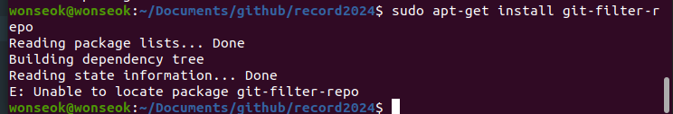
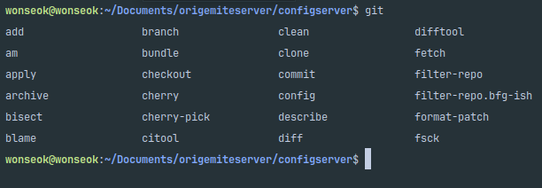
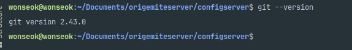

# GIT FilterRepo

## 개요

Ubuntu에서 git-filter-repo를 snap으로 설치한 과정과 GitHub 문서 링크입니다.

하위 폴더를 새 저장소로 분리할 때 쓰는 `git-filter-repo` 설치 메모입니다.
Ubuntu 기본 apt 패키지에는 없었고, snap으로 설치했습니다.
필터리포 사용법:
Git 버전 2.22.0 이상이 필요합니다.
Ubuntu 기준으로 기본 패키지에 포함되어 있지 않았습니다.
`apt-get`으로는 사용할 수 없다고 나왔습니다.





## 예제·코드

```bash
sudo apt update
sudo apt install snapd
sudo snap install git-filter-repo
```

<details>
<summary>참고 자료</summary>

- [하위 폴더를 새 리포지토리로 분할 - GitHub 문서](https://docs.github.com/ko/get-started/using-git/splitting-a-subfolder-out-into-a-new-repository?platform=linux) — Git 리포지토리 내의 폴더를 새 리포지토리로 전환할 수 있습니다.
</details>
