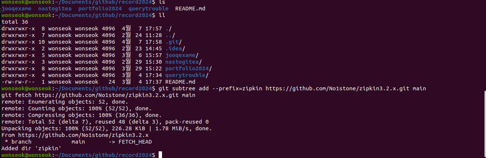

# subtree

## 개요

`git subtree`는 다른 원격 저장소를 현재 저장소의 하위 폴더로 붙이거나, 그 폴더의 변경을 다시 원격으로 보냅니다.
서브모듈과 달리 히스토리가 메인 저장소에 포함되는 편이라, 단순 포함·갱신에 쓰기 쉽습니다.
일상 푸시는 메인 원격에 하고, 서브트리 쪽은 필요할 때 pull/push를 분리하는 편이 덜 꼬입니다.



## 명령 예

```bash
# 추가
git subtree add --prefix=zipkin https://github.com/No1stone/zipkin3.2.x.git main

# 갱신 (폴더 / 원격 / 브랜치)
git subtree pull --prefix=<folder> <remote> <branch>

# 하위 폴더 변경을 원격으로
git subtree push --prefix=<folder> <remote> <branch>
```

<details>
<summary>참고 자료</summary>

- [No1stone/zipkin3.2.x](https://github.com/No1stone/zipkin3.2.x.git)
- [No1stone/boot-vault](https://github.com/No1stone/boot-vault.git)
</details>
