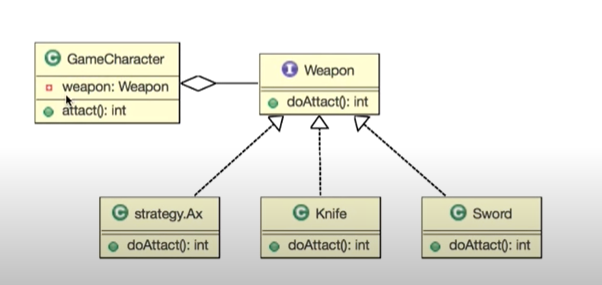

# 스트래티지 패턴(Strategy Pattern)

> **개요:** 인터페이스를 통해 원하는 구현(전략)에 접근하는 패턴입니다.
> MyBatis 매퍼 인터페이스를 떠올리면 이해하기 쉽다는 메모입니다.

## 개념

인터페이스를 두고, 실행 시점에 구현체를 바꿔 가며 같은 방식으로 기능을 호출합니다.

원 노트 비유: 게임 캐릭터가 Weapon을 구현(implements)하고, 인터페이스 하위에 정의된 기능을 실행합니다.
무기(전략)만 바꿔도 캐릭터 쪽 호출 코드는 같게 유지할 수 있습니다.
