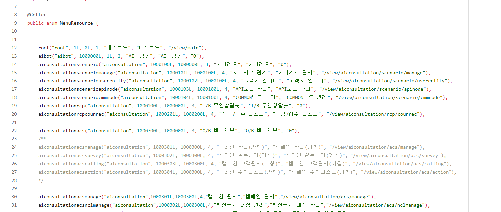
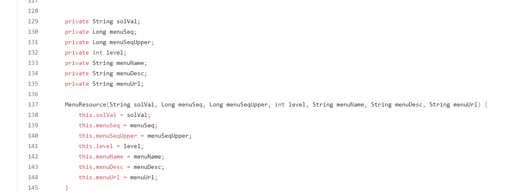
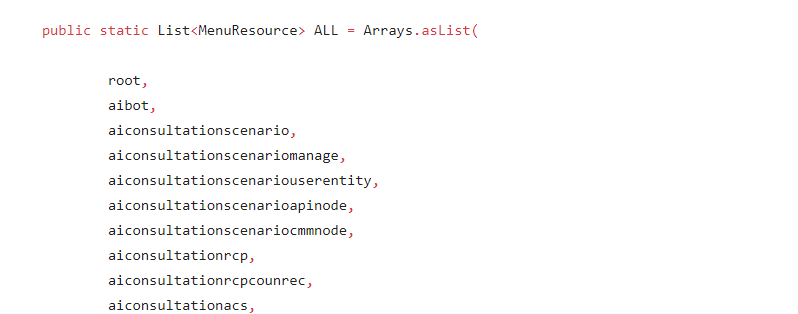
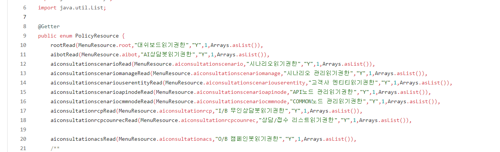
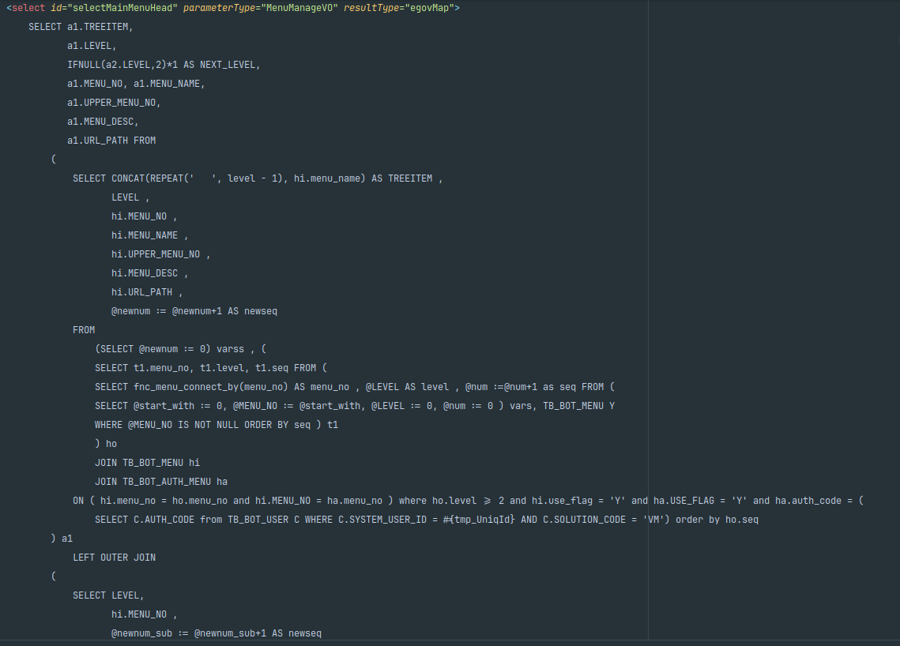
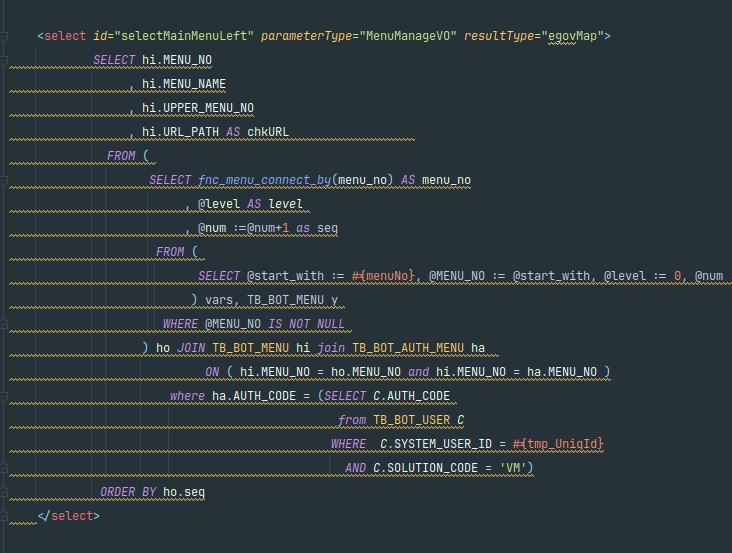
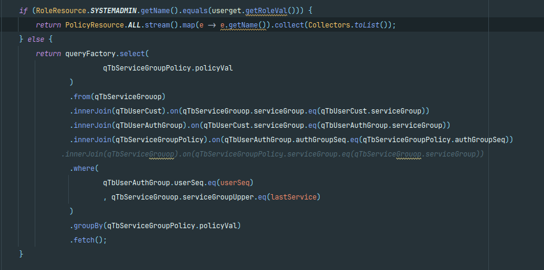
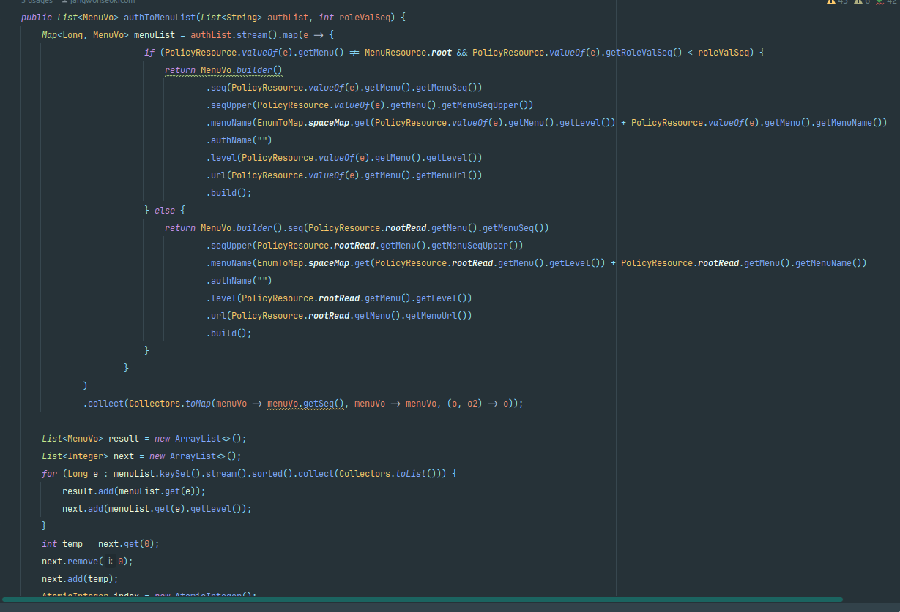
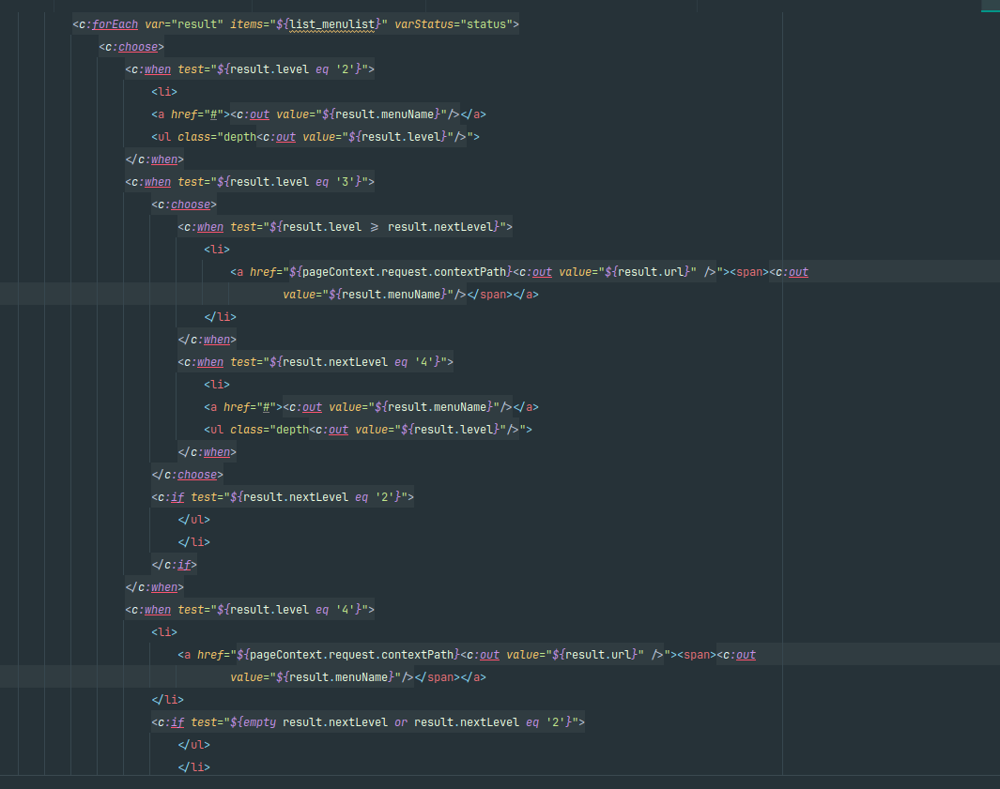
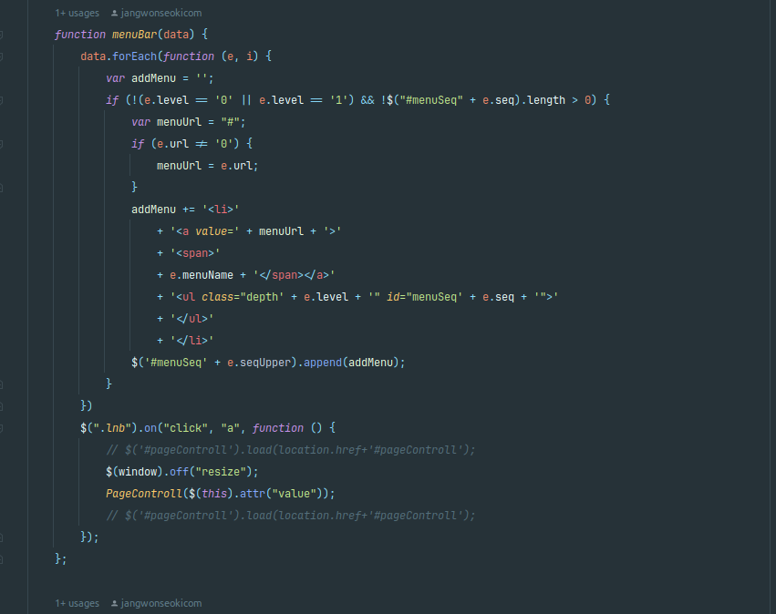

# 권한·메뉴 개선

> **개요:** 서비스 개요 아래에서 이어지는 권한·메뉴 개선 서술입니다.

## IAM 구조를 표현한 이유

전자정부 프레임워크 메뉴 권한 구조를

IAM 구조로 마이그레이션한 경험을 바탕으로 간소화 한 내용입니다.

링크

[https://www.egovframe.go.kr/wiki/doku.php?id=egovframework:bopr:가이드:관리자메뉴:권한관리](https://www.egovframe.go.kr/wiki/doku.php?id=egovframework:bopr:%EA%B0%80%EC%9D%B4%EB%93%9C:%EA%B4%80%EB%A6%AC%EC%9E%90%EB%A9%94%EB%89%B4:%EA%B6%8C%ED%95%9C%EA%B4%80%EB%A6%AC)

전자정부의 프레임워크의 권한구조는 메뉴 권한 URL등을

Database에 저장해서 사용하는 구조였습니다.

모든 데이터를 DB에서 관리하기때문에 

개발자마다 프로젝트 세팅할때부터 JSP의 URL과 메뉴 롤등의 정보를

쿼리로 관리해야하는 불편함이 있었습니다.

Enum으로 변경하여 개발한 경험을 풀어보려합니다.

## Enum으로 변환

캡쳐가 잘안보일수도 있으시겠지만…

전자정부에서의 Role을 Enum으로 사용하여 관리하였습니다.

(회사프로젝트라 모든내용을 공개못드리는점 양해부탁드립니다.)

해당롤이 메뉴의 레벨, 뎁스, 메뉴명을 가지며

동적으로 메뉴생성하는 데이터였습니다.

메뉴롤을 가지고있는 정책을 별도로 다른 Enum을통해서

구조화하여 enum으로 분리하였습니다.

## Query의 코드화1

데이터베이스 설계는 해당 포트폴리오의 ERD와 비슷하지만

메뉴에 관한 연관관계가 더있었습니다.

(회사프로젝트라 모든내용을 공개못드리는점 양해부탁드립니다.)

전자정부 프레임워크의 메뉴 쿼리입니다.

이때 테스트했을때 최소 1초이상걸리는 쿼리였습니다. 

(오래된기억이라 생각이 잘 나지 않습니다만 1초보단.. 오래걸렸습니다.)

이때 사용된쿼리의 Function에는 같은 mysql임에도 버전 x.0.1차이로

윈도우 함수가 변경되어 같은 디비임에도 로그인이 되지 않는 상황이 빈번하게 발생하고 있었습니다.

해당부분을 단순 코드로 변경하게 되었습니다.

## Query의 코드화2

변경된 메뉴 및 권한처리는

유저가 로그인을 하면 그룹권한에 해당하는 정책만 조회하게 변경하였습니다.

단순히 조인이 3번 들어가지만

전자정부를 사용하는 쿼리보다 훨씬 단순하며 쿼리속도도

100ms 이하로 나올정도로 개선되었습니다.

이제 이 데이터로 메뉴를 그리는 작업이 남게 되었습니다.

유저가 해당 api에 권한이 있는지 확인하기 훨씬 편리한 구조가 되었습니다.

조회된 데이터를 List로 넘기면 메뉴vo로 변경하게 하였습니다.

(지금와서보니 함수형으로 분리할 수 있는 코드인거같습니다..)

## Query의 코드화3

전자정부 menu와 코드로 변경한 menu데이터가 같아서

아래 jsp 코드로도 동작할수있지만 리펙토링 하였습니다.

(jsp에서 thymeleaf 변환작업할때 하였습니다)

변경 전

변경 후

## 문제점

메뉴 랜더링을 간소화하고 database에 의존하지 않게 성능도개선했다고

나름 생각하지만.. 아직 문제점이 남아있습니다.

오래전에 만든 프로젝트여서

기존 API 들이 GET, POST 2종류로만 이루어져있고

대부분의 조회 또한 POST로 개발되어있었습니다.

다 Enum으로 코드화 하면 관리할수 있겠지만.

restfulAPI 규칙에 맞게 개발되었다고하면.

Get권한인 Read(1)권한과

나머지를 Modify(2)로 
특별한기능들은  (3번등) 별도로 관리하면 

적은 데이터로 관리 할 수 있다 생각합니다.

이포트폴리오는

읽기권한이 1인것과,

읽기 및 수정권한을 2번으로 판단하여

게이트웨이에서 URL을 라우팅합니다.

## 관련 글

- [묶음 개요](./overview.md)
- [애플리케이션 서비스](./application-services.md)
