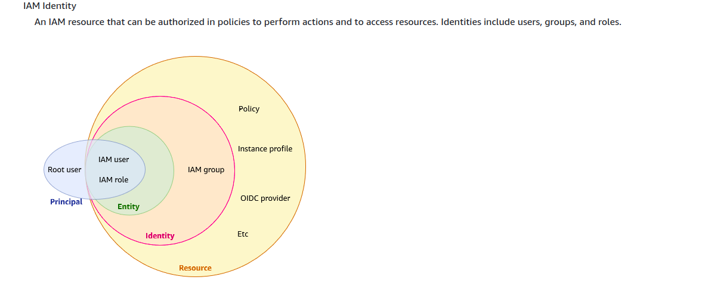

# 아이컴시스 MSA·IAM 포트폴리오

> **개요:** 회사에서 API 권한 관리와 AWS 관리를 맡아 온 경험을 바탕으로, Spring Cloud API Gateway와 MSA 기초, IAM 제어를 구현한 포트폴리오입니다.
> 세부 설명, 코드, 이미지는 하위 문서에 있습니다.

## 하위 문서

- [권한·메뉴 개선](./iam-and-menu-improvement.md)
- [설계 개요와 비용](./design-and-runtime.md)
- [AWS 설정](./aws-setting.md)
- [애플리케이션 서비스](./application-services.md)
- [서버 설정과 데이터 경로](./runtime-data-path.md)
- [개발 환경](./development-environment.md)

## Over view

AWS 및 Java Spring backend 개발자의 포트폴리오를 작성하기

회사에서 Api권한관리와 AWS 관리를 맡아왔기 때문에

Spring cloud 로 API GateWay를 구현하며 MSA기본과 IAM을 제어하는

개발하는 포트폴리오 입니다.

도메인과 AWS 인프라를 이용해

운영시간은 mon-fri 09:00 ~ 18:00까지 

운영되는 서버를 포트폴리오로 사용합니다.

## 서비스 개요

MSA 기초 서비스로 권한그룹(IAM) 을 유저와 고객사라는 개념으로

구현하는 프로젝트 입니다.

[https://docs.aws.amazon.com/IAM/latest/UserGuide/intro-structure.html](https://docs.aws.amazon.com/IAM/latest/UserGuide/intro-structure.html)

## 관련 패턴

개념·예제는 Patterns에 두고, 이 묶음에는 당시 문제·구현·판단·결과를 남깁니다.

- [Gateway 권한 라우팅](../../patterns/architecture-patterns/gateway-authorization-routing.md)
- [CDC](../../patterns/architecture-patterns/cdc.md) — Source 연결·Sink 이슈는 [데이터 경로](./runtime-data-path.md)에 그대로 둡니다

## 참고

- [AWS IAM Identity and access management](https://docs.aws.amazon.com/IAM/latest/UserGuide/intro-structure.html)
- [전자정부 권한관리 가이드](https://www.egovframe.go.kr/wiki/doku.php?id=egovframework:bopr:가이드:관리자메뉴:권한관리)
