# 서버 설정과 데이터 경로

> **개요:** 「Server Setting」 하위 페이지입니다.

## Server Setting

NATInstance 는 Amazon Linux1 Centos6 

[https://docs.aws.amazon.com/ko_kr/AWSEC2/latest/UserGuide/set-time.html](https://docs.aws.amazon.com/ko_kr/AWSEC2/latest/UserGuide/set-time.html)

cyctemctl → service

## Nginx

nginx 설치후

버전별로 pid가 다른걸 몰랐어서

에러로 조금 헤맸습니다.

재설치하느라 설치과정부터 캡쳐를 뜨지못했습니다.

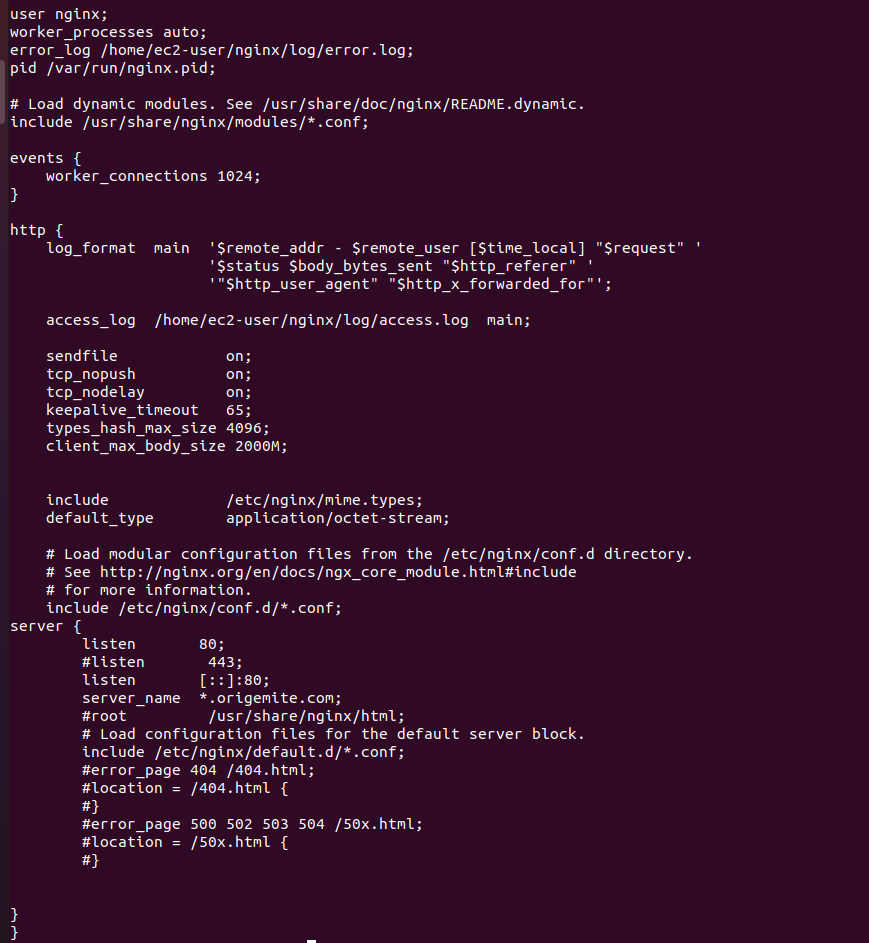

깃을위해 맥스 바디사이즈 2기가로 수정.

에러로그와 접속로그 경로를 수정했습니다.

## Mysql

mysql 과 깃은 도커로 올렸습니다.

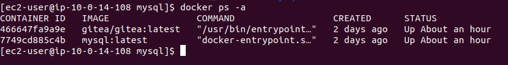

## Gitea

깃티

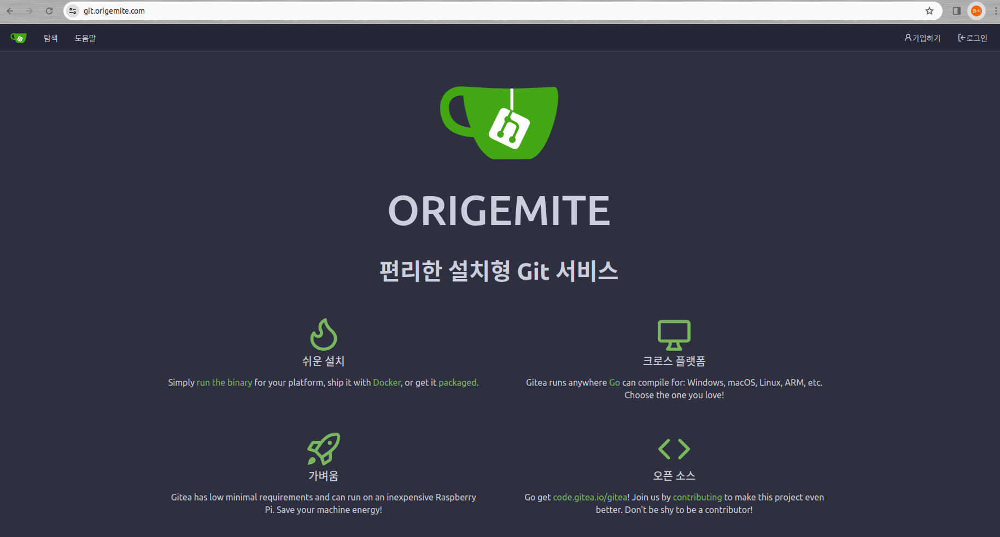

기타설정후

git.origemite.com

접속확인

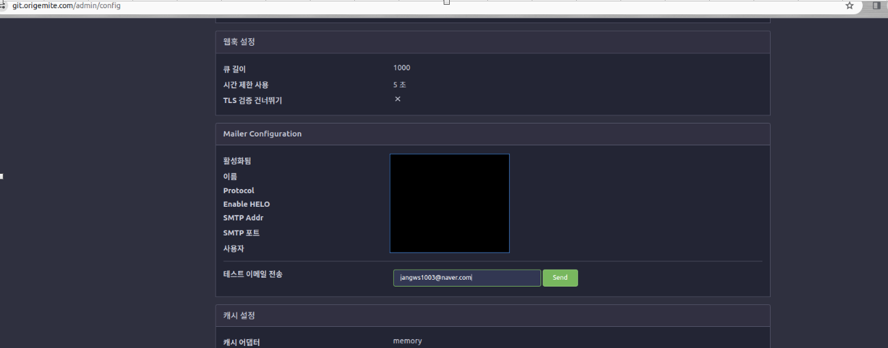

HTTPS 까지 잘 적용되어있습니다.

S3정적호스팅과 로드밸런싱 두개다 acm이 적용이 잘된거같습니다.


메일테스트

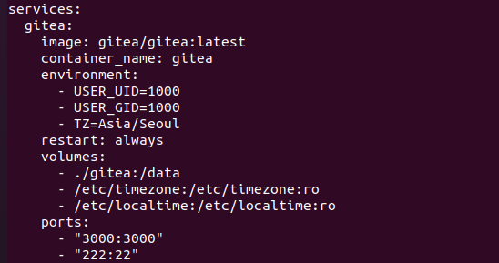

## kafka

[https://kafka.apache.org/documentation/](https://kafka.apache.org/documentation/)

싱글브로커 도커컴포즈

```bash
version: '3.7'
services:
  zookeeper:
    image: wurstmeister/zookeeper
    networks:
      kafka-network:
        ipv4_address: 172.61.0.2
    ports:
      - "2181:2181"

  kafka:
    image: wurstmeister/kafka
    ports:
      - "9092:9092"
    environment:
      KAFKA_ADVERTISED_HOST_NAME: 172.61.0.3
      KAFKA_CREATE_TOPICS: "test:1:1"
      KAFKA_ZOOKEEPER_CONNECT: zookeeper:2181
    volumes:
      - /var/run/docker.sock:/var/run/docker.sock
    depends_on:
      - zookeeper
    networks:
      kafka-network:
        ipv4_address: 172.61.0.3

networks:
  kafka-network:
    driver: bridge
    ipam:
      config:
        - subnet: 172.61.0.0/16
```

**KAFKA_CREATE_TOPICS: "test:1:1"**

test 토픽의 이름

첫 번째 **`1`**은 토픽의 파티션 수

두 번째 **`1`**은 토픽의 복제 인수

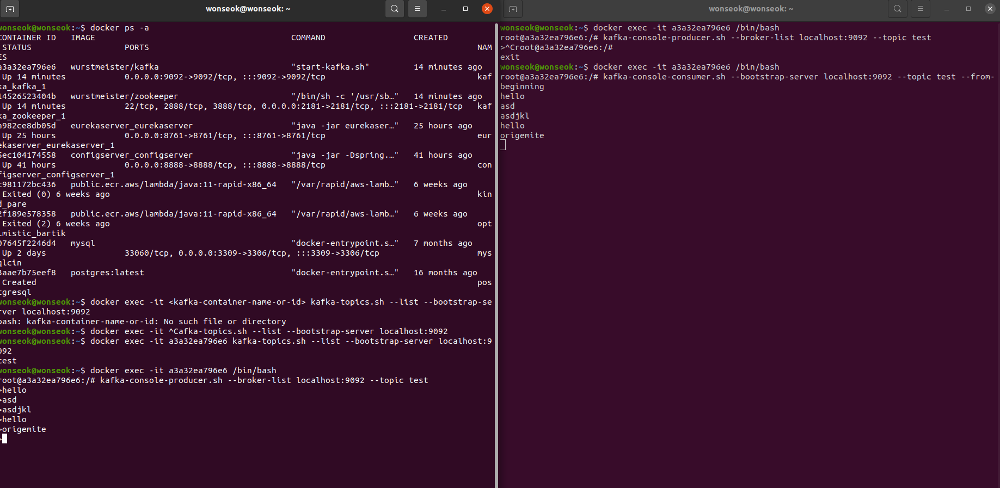

브로커 테스트

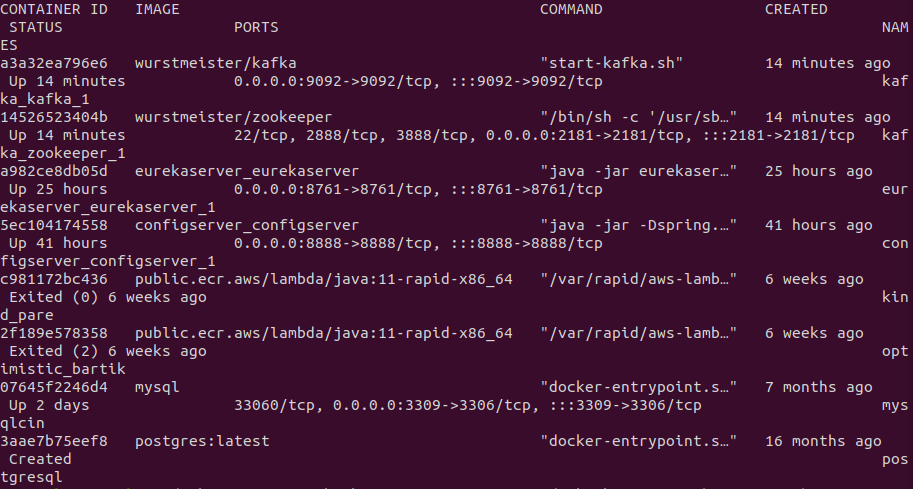

토픽리스트확인

```bash
docker exec -it kafka kafka-topics.sh --list --bootstrap-server localhost:9092
```

프로듀서 

```bash
kafka-console-producer.sh --broker-list localhost:9092 --topic <topic-name>
```

```bash
kafka-console-producer --broker-list localhost:9092 --topic origemite
```

컨슈머

```bash
kafka-console-consumer.sh --bootstrap-server localhost:9092 --topic <topic-name> --from-beginning
```

```bash
docker exec -it kafka /bin/bash
kafka-console-consumer --bootstrap-server localhost:9092 --topic resume --from-beginning
```

토픽생성

```bash
kafka-topics.sh --create --bootstrap-server <서버주소>:<포트> --replication-factor <복제인자수> --partitions <파티션수> --topic <토픽명>
```

```bash
kafka-topics --create --bootstrap-server localhost:9092 --replication-factor 1 --partitions 1 --topic origemitedb
```

토픽목록

```bash
kafka-topics.sh --list --bootstrap-server <서버주소>:<포트>
```

```bash

docker exec -it kafka /bin/bash
kafka-topics --list --bootstrap-server localhost:9092
```

토픽삭제

```bash
kafka-topics.sh --delete --bootstrap-server <서버주소>:<포트> --topic <토픽명>
```

```bash
kafka-topics --delete --bootstrap-server localhost:9092 --topic origemitedb
```

메세지생산

```bash
kafka-console-producer.sh --broker-list <서버주소>:<포트> --topic <토픽명>
```

메세지 소비

```bash
kafka-console-consumer.sh --bootstrap-server <서버주소>:<포트> --topic <토픽명> --from-beginning
```

## Confluentinc Connect Sink

[https://github.com/confluentinc/demo-scene/blob/master/kafka-to-database/docker-compose.yml](https://github.com/confluentinc/demo-scene/blob/master/kafka-to-database/docker-compose.yml)

[https://docs.confluent.io/platform/current/installation/configuration/connect/sink-connect-configs.html](https://docs.confluent.io/platform/current/installation/configuration/connect/sink-connect-configs.html)

[https://docs.confluent.io/kafka-connectors/jdbc/current/sink-connector/sink_config_options.html](https://docs.confluent.io/kafka-connectors/jdbc/current/sink-connector/sink_config_options.html)

[https://docs.confluent.io/kafka-connectors/jms-source/current/source_connector_config.html](https://docs.confluent.io/kafka-connectors/jms-source/current/source_connector_config.html)[https://docs.confluent.io/kafka-connectors/debezium-mysql-source/current/overview.html](https://docs.confluent.io/kafka-connectors/debezium-mysql-source/current/overview.html)

```bash
version: '3'

services:
  zookeeper:
    image: confluentinc/cp-zookeeper:latest
    environment:
      ZOOKEEPER_CLIENT_PORT: 2181
    networks:
      origemite_network:
        ipv4_address: 172.140.0.2
  kafka:
    image: confluentinc/cp-kafka:latest
    depends_on:
      - zookeeper
    environment:
#      KAFKA_ZOOKEEPER_CONNECT: zookeeper:2181
      KAFKA_ZOOKEEPER_CONNECT: 172.140.0.2:2181
      KAFKA_ADVERTISED_LISTENERS: PLAINTEXT://kafka:9092
      KAFKA_OFFSETS_TOPIC_REPLICATION_FACTOR: 1
    networks:
      origemite_network:
        ipv4_address: 172.140.0.3
  connect:
    image: confluentinc/cp-kafka-connect:latest
    depends_on:
      - kafka
      - zookeeper
    environment:
#      CONNECT_BOOTSTRAP_SERVERS: kafka:9092
      CONNECT_BOOTSTRAP_SERVERS: 172.140.0.3:9092
      CONNECT_REST_ADVERTISED_HOST_NAME: connect
      CONNECT_REST_PORT: 8083
      CONNECT_GROUP_ID: kafka-connect-group
      CONNECT_CONFIG_STORAGE_TOPIC: kafka-connect-config
      CONNECT_OFFSET_STORAGE_TOPIC: kafka-connect-offsets
      CONNECT_STATUS_STORAGE_TOPIC: kafka-connect-status
      CONNECT_KEY_CONVERTER: org.apache.kafka.connect.json.JsonConverter
      CONNECT_VALUE_CONVERTER: org.apache.kafka.connect.json.JsonConverter
      CONNECT_KEY_CONVERTER_SCHEMAS_ENABLE: "false"
      CONNECT_VALUE_CONVERTER_SCHEMAS_ENABLE: "false"
      CONNECT_CONFIG_STORAGE_REPLICATION_FACTOR: 1
      CONNECT_OFFSET_STORAGE_REPLICATION_FACTOR: 1
      CONNECT_STATUS_STORAGE_REPLICATION_FACTOR: 1
      CONNECT_PLUGIN_PATH: "/usr/share/java,/usr/share/confluent-hub-components"
    ports:
      - "8083:8083"
    command:
      - bash
      - -c
      - |
        echo "Installing connectors..."
        confluent-hub install --no-prompt confluentinc/kafka-connect-jdbc:latest
        echo "Starting Kafka Connect..."
        /etc/confluent/docker/run & 
        sleep infinity
    networks:
      origemite_network:
        ipv4_address: 172.140.0.4
  mysql-master:
    image: mysql:5.7
    restart: always
    environment:
      MYSQL_ROOT_PASSWORD: ${MYSQL_ROOT_PASSWORD}
      MYSQL_DATABASE: ${MYSQL_DATABASE}
      MYSQL_USER: ${MYSQL_USER}
      MYSQL_PASSWORD: ${MYSQL_PASSWORD}
      TZ: Asia/Seoul
    env_file: .env
    command: --server-id=1 --log-bin=mysql-bin --binlog-format=ROW --sql-mode="STRICT_TRANS_TABLES,NO_ZERO_IN_DATE,NO_ZERO_DATE,ERROR_FOR_DIVISION_BY_ZERO,NO_ENGINE_SUBSTITUTION"
    ports:
      - "3310:3306"
    volumes:
      - ./mysql-master/data:/var/lib/mysql
      - ./mysql-master/data:/etc/mysql/conf.d
    networks:
      origemite_network:
        ipv4_address: 172.140.0.5
  mysql-slave:
    image: mysql:5.7
    restart: always
    environment:
      MYSQL_ROOT_PASSWORD: ${MYSQL_ROOT_PASSWORD}
      MYSQL_DATABASE: ${MYSQL_DATABASE}
      MYSQL_USER: ${MYSQL_USER}
      MYSQL_PASSWORD: ${MYSQL_PASSWORD}
      TZ: Asia/Seoul
    env_file: .env
    command: --server-id=2 --sql-mode="STRICT_TRANS_TABLES,NO_ZERO_IN_DATE,NO_ZERO_DATE,ERROR_FOR_DIVISION_BY_ZERO,NO_ENGINE_SUBSTITUTION"
    depends_on:
      - mysql-master
    ports:
      - "3311:3306"
    volumes:
      - ./mysql-slave/data:/var/lib/mysql
      - ./mysql-slave/data:/etc/mysql/conf.d
    networks:
      origemite_network:
        ipv4_address: 172.140.0.6

networks:
  origemite_network:
    driver: bridge
    ipam:
      config:
        - subnet: 172.140.0.0/16
```

[https://github.com/confluentinc/demo-scene/blob/master/kafka-to-database/docker-compose.yml](https://github.com/confluentinc/demo-scene/blob/master/kafka-to-database/docker-compose.yml)

컨플루언트 도커를 사용할 경우 

/home/appuser 으로 시작함

```bash
cd /bin
pwd
ls

```

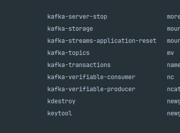

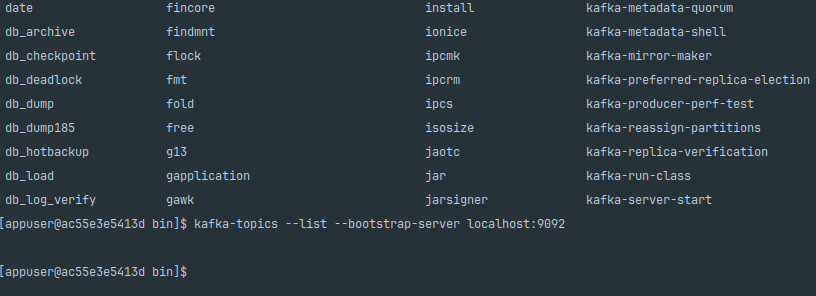

.sh 가 빠져있습니다.

```bash
kafka-topics --list --bootstrap-server localhost:9092
```

sh 빼고 실행

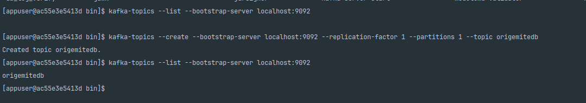

```bash
kafka-topics --create --bootstrap-server localhost:9092 --replication-factor 1 --partitions 1 --topic origemitedb
```

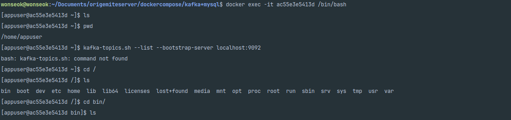

```bash
curl -i -X POST -H "Content-Type:application/json" http://localhost:8083/connectors/ -d '{
  "name": "mysql-sink",
  "config": {
    "connector.class": "io.confluent.connect.jdbc.JdbcSinkConnector",
    "tasks.max": "1",
    "topics": "origemitedb",
    "connection.url": "jdbc:mysql://mysql-master:3310/origemite?useSSL=false&allowPublicKeyRetrieval=true",
    "connection.user": "root",
    "connection.password": "",
    "auto.create": "false",
    "insert.mode": "insert",
    "key.converter": "org.apache.kafka.connect.storage.StringConverter",
    "value.converter": "org.apache.kafka.connect.json.JsonConverter",
    "value.converter.schemas.enable": "false",
    "pk.mode": "record_key",
    "pk.fields": "USR_ID"
  }
}'
```

```bash
curl -i -X POST -H "Content-Type:application/json" http://localhost:8083/connectors/ -d '{
  "name": "mysql-sink",
  "config": {
    "connector.class": "io.confluent.connect.jdbc.JdbcSinkConnector",
    "tasks.max": "1",
    "topics": "origemitedb",
    "connection.url": "jdbc:mysql://172.140.0.5:3306/origemite?useSSL=false&allowPublicKeyRetrieval=true",
    "connection.user": "root",
    "connection.password": "",
    "auto.create": "false",
    "insert.mode": "insert",
    "key.converter": "org.apache.kafka.connect.storage.StringConverter",
    "value.converter": "org.apache.kafka.connect.json.JsonConverter",
    "value.converter.schemas.enable": "true",
    "table.whitelist":"TB_USER",
    "database.connectionTimeZone": "Asia/Seoul",
    "pk.mode": "record_key",
    "pk.fields": "USR_ID"
  }
}'
```

컨넥터리스트

```bash
http://localhost:8083/connectors
```

커넥터상태

```bash
http://localhost:8083/connectors/mysql-sink/status
```

삭제

```bash
curl -X DELETE http://localhost:8083/connectors/mysql-sink
```

## mysql 이중화

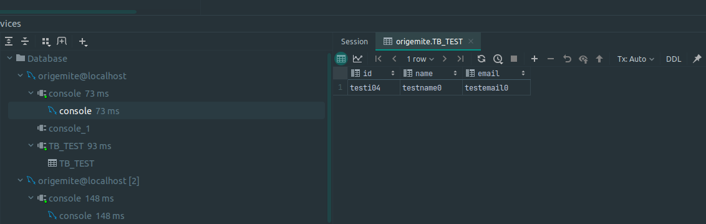

```yaml
show master status;
```

```sql
STOP SLAVE;
RESET SLAVE ALL;
```

```sql

STOP SLAVE;
RESET SLAVE ALL;
CHANGE MASTER TO
  MASTER_HOST='172.140.0.5',
  MASTER_USER='root',
  MASTER_PASSWORD='',
  MASTER_AUTO_POSITION = 1;
START SLAVE;
SHOW SLAVE STATUS\G;

```

```sql
STOP SLAVE;
RESET SLAVE ALL;
CHANGE MASTER TO
  MASTER_HOST='mysql-master',
  MASTER_USER='root',
  MASTER_PASSWORD='',
  MASTER_AUTO_POSITION = 1;
START SLAVE;
SHOW SLAVE STATUS\G;

```

이중화및 복제 성공

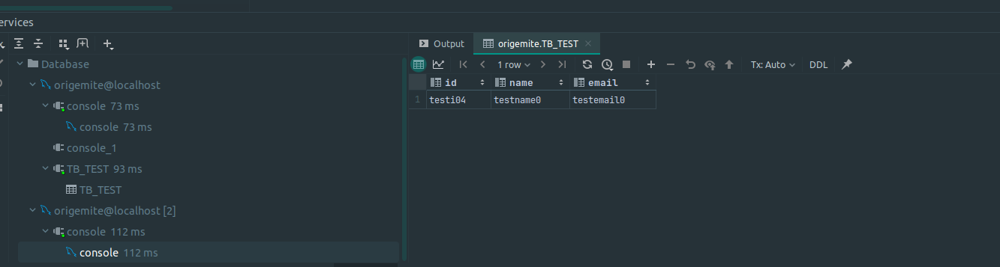


```sql
SELECT user FROM mysql.user WHERE user = 'origemite';
```

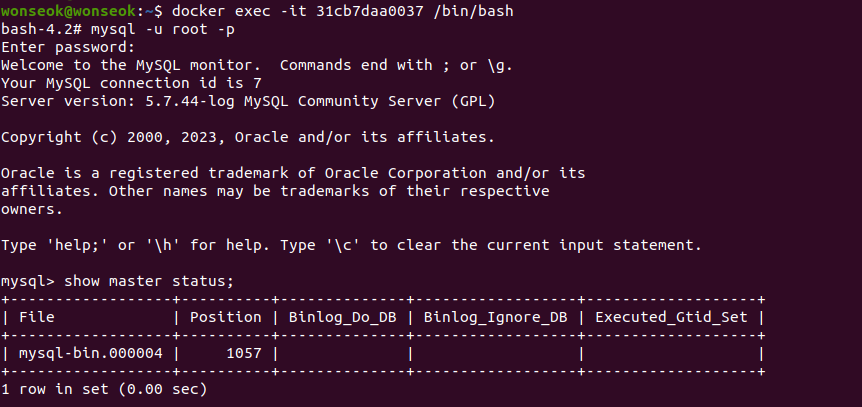

디비나 복제본을 사용하라해서 구축 하려했으나

master → source → kafka → sink → slave 구조로 

디비지움으로 보내서 이중화 시행합니다

## Debezium

[https://issues.redhat.com/browse/DBZ-5541](https://issues.redhat.com/browse/DBZ-5541)

debezium docker endpoint

[https://github.com/debezium/container-images/blob/main/connect-base/0.10/docker-entrypoint.sh](https://github.com/debezium/container-images/blob/main/connect-base/0.10/docker-entrypoint.sh)

sinkconnect endpoint
[https://debezium.io/documentation/reference/stable/connectors/jdbc.html](https://debezium.io/documentation/reference/stable/connectors/jdbc.html)
[https://docs.confluent.io/kafka-connectors/jdbc/current/sink-connector/sink_config_options.html](https://docs.confluent.io/kafka-connectors/jdbc/current/sink-connector/sink_config_options.html)

debezium2.x avro none….입니다. 

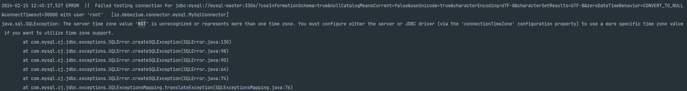

[https://debezium.io/documentation/reference/stable/configuration/avro.html](https://debezium.io/documentation/reference/stable/configuration/avro.html)

타임존 에러 해결

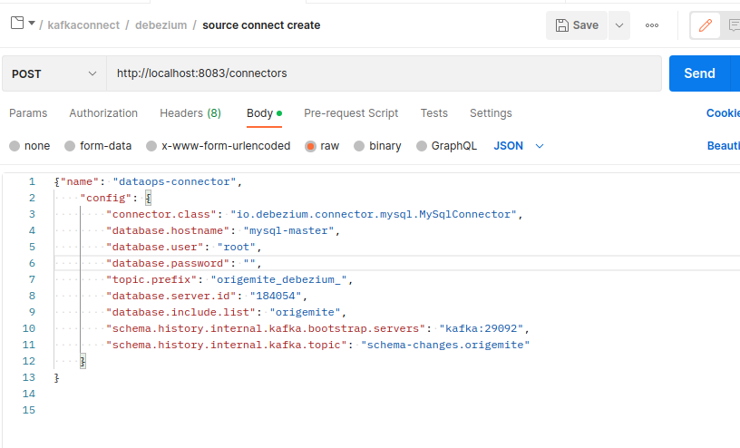

```sql
SELECT @@global.time_zone, @@session.time_zone;

SET GLOBAL time_zone = '+09:00';

SELECT @@global.time_zone;
```

로그는 덤으로…

```sql
SET global general_log = on;
SET global general_log_file='/var/log/mysql/mysql.log';
SET global log_output = 'file';
```

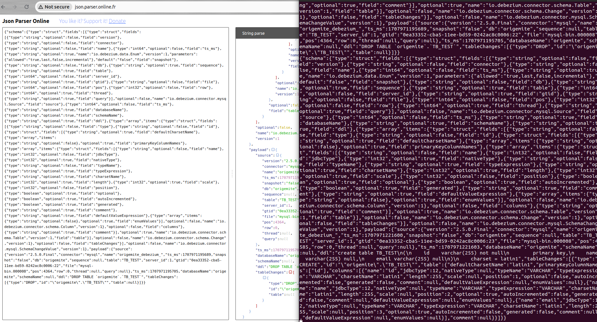

디비지움 연결 성공

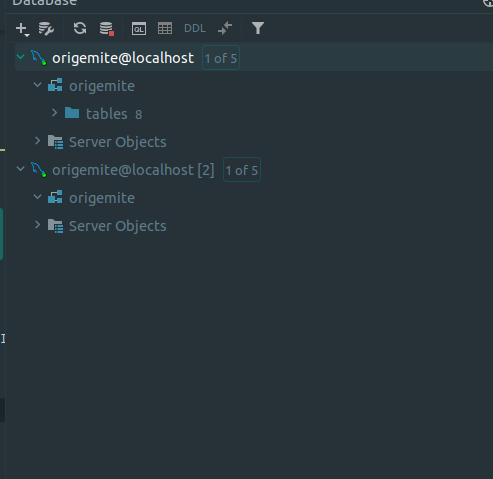

CDC 일반 개념과 Debezium→Kafka→Sink 흐름은 [CDC 패턴](../../patterns/architecture-patterns/cdc.md)을 봅니다.
아래 Sink·Compose 이슈는 전체 연동 완료로 바꾸지 않습니다.

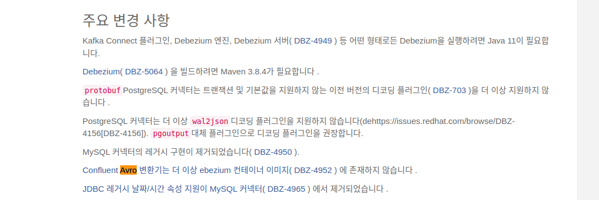

## 통합 Docker-compose

이슈사항

컨넥터싱크를 등록하고 브로커가 러닝상태임에도

JDBC를 찾지못해서 에러를 격고있습니다. 4일째…

1년전 부터안됬었나봅니다.

[https://github.com/confluentinc/demo-scene/issues/259](https://github.com/confluentinc/demo-scene/issues/259)

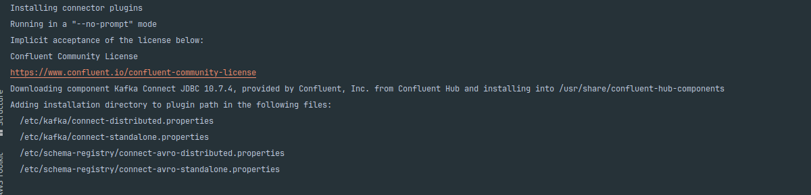

컨넥터에 curl로 설치까지 확인하고

플러그인패쓰도 정상적으로등록.

도커내부에 jdbc가 위치해있는것까지확인했는데도

찾을수없다나와 이부분은 우선 JPA 디비에 직접 저장으로 처리하고

시간을 너무 지체해서 포트폴리오 전체 구성을 먼저 개발해야할거같습니다.

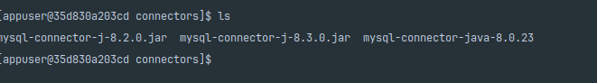

jdbc를 문서에나온곳.

구글링한곳 전부다위치시켯지만

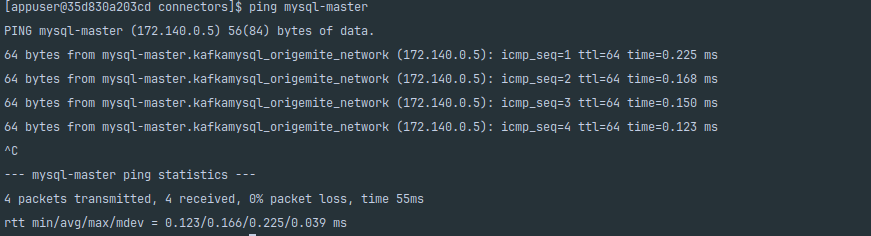

database연결실패.

도커네트워크 및 네트워크이름 핑호출까지 모두다 정상..

유저 접근호스트 권한 도 이상없음….

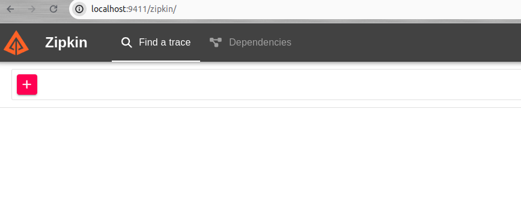

원인

도커환경의 커넥터가 문제였습니다.

컨넥터또한 도커에서 동작하여 도커 네트워크를 사용하는데

포트가 3310이엇던것. 습관처럼 외부접속하는 3310을 줄기차게 수정안하고있었습니다.

도커내부 아이피로 접근할땐 3306이 맞았던건데…

다른데서 이슈트랙킹을 하고있어.. 장작 일주일이라는 시간을 낭비했습니다.

```yaml
version: '3'

services:
  zookeeper:
    container_name: zookeeper
    image: confluentinc/cp-zookeeper:latest
    environment:
      ZOOKEEPER_CLIENT_PORT: 2181
    networks:
      - origemite_network

  kafka:
    container_name: kafka
    image: confluentinc/cp-kafka:latest
    ports:
      - "9092:9092"
    depends_on:
      - zookeeper
    environment:
      KAFKA_ZOOKEEPER_CONNECT: zookeeper:2181
      KAFKA_LISTENER_SECURITY_PROTOCOL_MAP: PLAINTEXT:PLAINTEXT,PLAINTEXT_INTERNAL:PLAINTEXT
      KAFKA_ADVERTISED_LISTENERS: PLAINTEXT://localhost:9092,PLAINTEXT_INTERNAL://kafka:29092
      KAFKA_OFFSETS_TOPIC_REPLICATION_FACTOR: 1
      KAFKA_TRANSACTION_STATE_LOG_MIN_ISR: 1
      KAFKA_TRANSACTION_STATE_LOG_REPLICATION_FACTOR: 1
      KAFKA_AUTO_CREATE_TOPICS_ENABLE: 'true'

    networks:
      - origemite_network

  debezium:
    container_name: debezium
    image: debezium/connect:latest
    ports:
      - 8083:8083
    depends_on:
      - kafka
      - zookeeper
      - mysql-master
    environment:
      BOOTSTRAP_SERVERS: kafka:29092
      GROUP_ID: connect-debezium
      CONFIG_STORAGE_TOPIC: docker-connect-debezium-configs
      OFFSET_STORAGE_TOPIC: docker-connect-debezium-offsets
      STATUS_STORAGE_TOPIC: docker-connect-debezium-status
      TZ: Asia/Seoul
    volumes:
      - ${PWD}/scripts:/scripts
    networks:
      - origemite_network

  mysql-master:
    container_name: mysql-master
    image: mysql:latest
    restart: always
    environment:
      MYSQL_ROOT_PASSWORD: ${MYSQL_ROOT_PASSWORD}
      MYSQL_DATABASE: ${MYSQL_DATABASE}
      MYSQL_USER: ${MYSQL_USER}
      MYSQL_PASSWORD: ${MYSQL_PASSWORD}
      TZ: Asia/Seoul
    env_file: .env
    command:
      - --server-id=1
      - --log-bin=mysql-bin
      - --gtid-mode=ON
      - --enforce-gtid-consistency
      - --sql-mode=STRICT_TRANS_TABLES,NO_ZERO_IN_DATE,NO_ZERO_DATE,ERROR_FOR_DIVISION_BY_ZERO,NO_ENGINE_SUBSTITUTION
      - --bind-address=0.0.0.0
      - --mysqlx-bind-address=0.0.0.0
    depends_on:
      - kafka
    ports:
      - "3310:3306"
    volumes:
      - ./mysql-master-data:/var/lib/mysql
      - ./mysql-master-data:/etc/mysql/conf.d
    networks:
      - origemite_network

  mysql-slave:
    container_name: mysql-slave
    image: mysql:latest
    restart: always
    environment:
      MYSQL_ROOT_PASSWORD: ${MYSQL_ROOT_PASSWORD}
      MYSQL_DATABASE: ${MYSQL_DATABASE}
      MYSQL_USER: ${MYSQL_USER}
      MYSQL_PASSWORD: ${MYSQL_PASSWORD}
      TZ: Asia/Seoul
    env_file: .env
    command: [ "--server-id=2", "--log-bin=mysql-bin", "--gtid-mode=ON", "--enforce-gtid-consistency", "--sql-mode=STRICT_TRANS_TABLES,NO_ZERO_IN_DATE,NO_ZERO_DATE,ERROR_FOR_DIVISION_BY_ZERO,NO_ENGINE_SUBSTITUTION" ]
    depends_on:
      - mysql-master
    ports:
      - "3311:3306"
    volumes:
      - ./mysql-slave-data:/var/lib/mysql
      - ./mysql-slave-data:/etc/mysql/conf.d
#      - ./replication-setup.sh:/docker-entrypoint-initdb.d/replication-setup.sh
    networks:
      - origemite_network

  redis:
    container_name: redis
    image: redis:latest
    restart: always
    command: redis-server --appendonly yes
    ports:
      - "6379:6379"
    volumes:
      - ./redis/data:/data
      - ./redis/conf/redis.conf:/usr/local/conf/redis.conf
    networks:
      - origemite_network

  zipkin:
    container_name: zipkin
    image: openzipkin/zipkin
    ports:
      - "9411:9411"
    networks:
      - origemite_network

  grafana:
    container_name: grafana
    image: grafana/grafana
    ports:
      - "3100:3000"
    depends_on:
      - prometheus
    networks:
      - origemite_network

  prometheus:
    container_name: prometheus
    image: prom/prometheus
    volumes:
      - ./prometheus/prometheus.yml:/etc/prometheus/prometheus.yml
    ports:
      - "9090:9090"
    networks:
      - origemite_network

  rabbitmq:
    container_name: rabbitmq
    image: "rabbitmq:3-management"
    hostname: "rabbitmq"
    ports:
      - "15672:15672" # Management interface
      - "5672:5672"   # RabbitMQ client
    networks:
      - origemite_network

volumes:
  mysql-master-data:
  mysql-slave-data:

networks:
  origemite_network:
    driver: bridge
    ipam:
      config:
        - subnet: 172.140.0.0/16
```

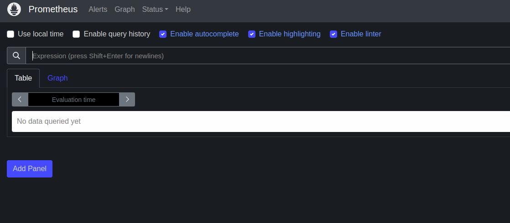

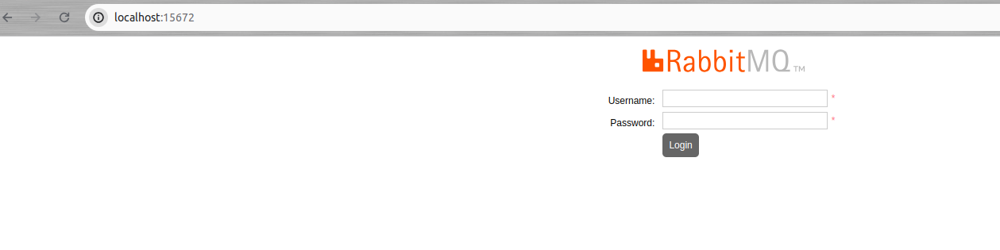

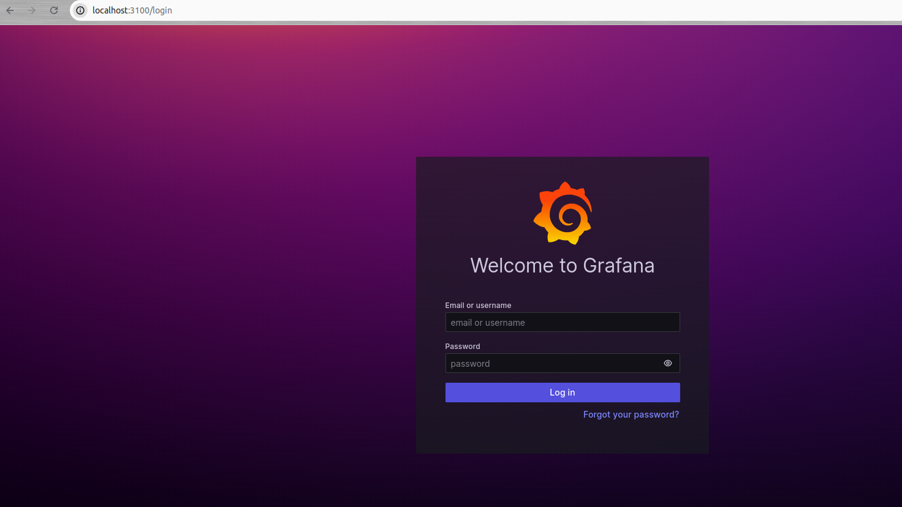

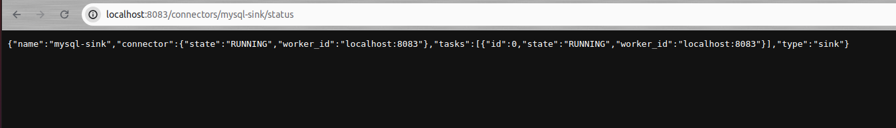

```bash
docker-compose down
docker-compose up -d
docker logs -f debezium

```

## 관련 글

- [설계 개요와 비용](./design-and-runtime.md)
- [애플리케이션 서비스](./application-services.md)
